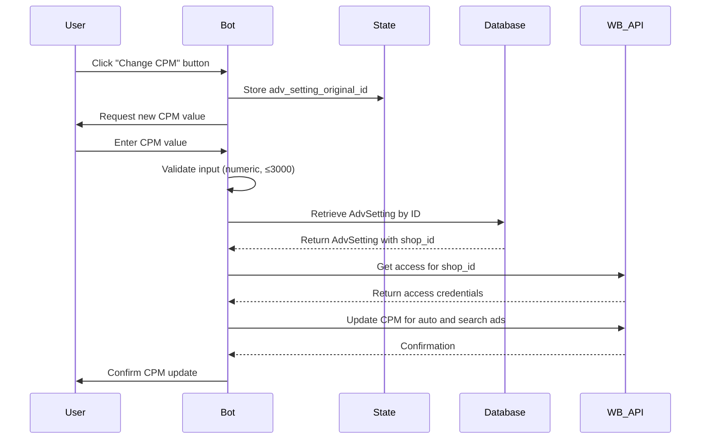
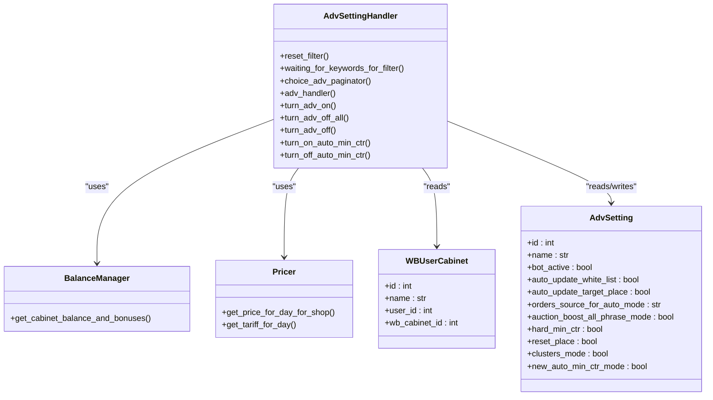
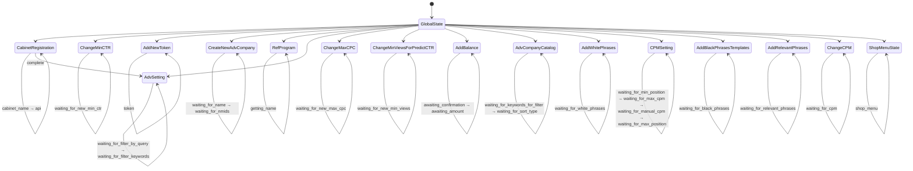
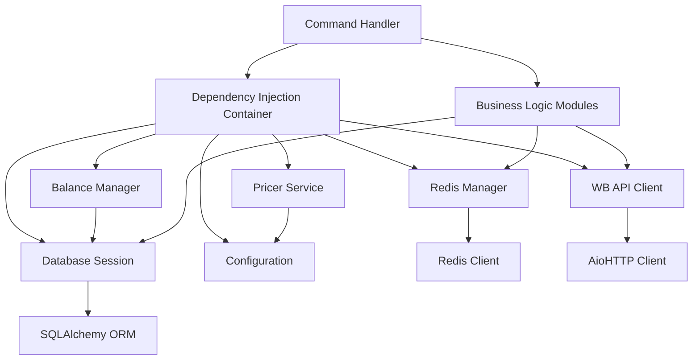
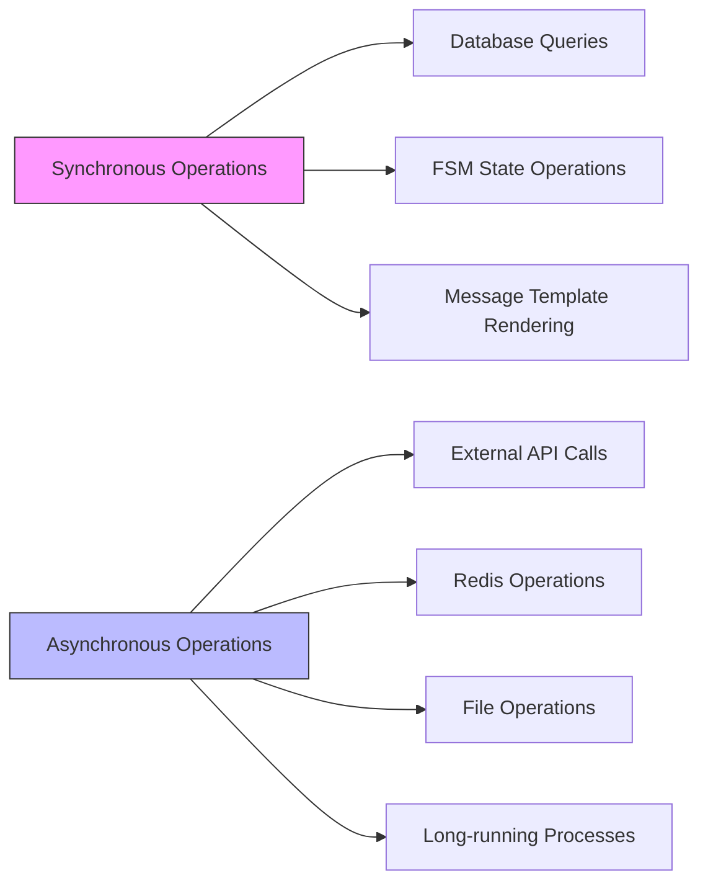

# Command Handling System

<cite>
**Referenced Files in This Document**   
- [global_router.py](file://app/client_bot/global_router.py)
- [common_routers.py](file://app/client_bot/common_routers.py)
- [start.py](file://app/client_bot/user_interface/handlers/start/start.py)
- [change_cpm.py](file://app/client_bot/user_interface/handlers/change_cpm.py)
- [adv_setting.py](file://app/client_bot/user_interface/handlers/adv_setting.py)
- [states.py](file://app/client_bot/user_interface/states.py)
- [callbacks.py](file://app/client_bot/user_interface/views/callbacks.py)
- [templates.py](file://app/client_bot/user_interface/message_templates/templates.py)
- [keyboards.py](file://app/client_bot/user_interface/views/keyboards.py)
- [bot.py](file://app/client_bot/bot.py)
</cite>

## Table of Contents
1. [Introduction](#introduction)
2. [Router Architecture](#router-architecture)
3. [Command Handler Structure](#command-handler-structure)
4. [Key Command Handlers](#key-command-handlers)
5. [State Management and FSM](#state-management-and-fsm)
6. [Dependency Injection and External Integrations](#dependency-injection-and-external-integrations)
7. [Error Handling Patterns](#error-handling-patterns)
8. [Best Practices for Command Development](#best-practices-for-command-development)
9. [Performance Considerations](#performance-considerations)
10. [Conclusion](#conclusion)

## Introduction
The Telegram bot's command handling system is built on the aiogram framework, utilizing a hierarchical router architecture to organize command handlers by functionality and user roles. The system implements a sophisticated state management approach using Finite State Machine (FSM) patterns to handle multi-step interactions. Command handlers are organized across multiple router modules, with dependency injection providing access to business logic and external APIs. The architecture supports complex workflows for onboarding, campaign configuration, and bid management while maintaining separation of concerns and testability.

**Section sources**
- [global_router.py](file://app/client_bot/global_router.py#L1-L30)
- [common_routers.py](file://app/client_bot/common_routers.py#L1-L104)

## Router Architecture

```mermaid
graph TD
GlobalRouter[Global Router] --> CommonRouter[Common Router]
GlobalRouter --> StartRouter[Start Router]
GlobalRouter --> BonusRouter[Bonus Scene Router]
GlobalRouter --> AddBalanceRouter[Add Balance Router]
GlobalRouter --> RefProgramRouter[Referral Program Router]
CommonRouter --> KeywordsPositionsRouter[Keywords Positions History]
CommonRouter --> ManualUpdateRouter[Manual Phrase Positions Update]
CommonRouter --> AutoUpdaterRouter[Auto Updater Target Place]
CommonRouter --> WhiteListUpdaterRouter[Auto White List Updater]
CommonRouter --> KeywordRelevantRouter[Keyword Relevant Setting]
CommonRouter --> OrdersSourceRouter[Orders Source Toggle]
CommonRouter --> BidderAutoModeRouter[Bidder Auto Mode]
CommonRouter --> SalesPlanRouter[Sales Plan Settings]
CommonRouter --> AuctionBoostRouter[Auction Boost Mode Settings]
CommonRouter --> ExponentSettingRouter[Exponent Setting in Adv Setting]
CommonRouter --> BidderStepSettingRouter[Bidder Step Setting]
CommonRouter --> AdvCreatorRouter[Adv Creator]
CommonRouter --> ResetPlaceRouter[Reset Place Setting]
CommonRouter --> BidderRouter[Bidder]
CommonRouter --> ChangeCPMRouter[Change CPM]
CommonRouter --> FavoriteAdvsRouter[Favorite Advs for Users]
CommonRouter --> ClustersRouter[Clusters]
CommonRouter --> DownloadKeywordsRouter[Download Keywords]
CommonRouter --> AdvSettingRouter[Adv Setting]
CommonRouter --> AddBlackPhrasesRouter[Add Black Phrases]
CommonRouter --> CPMBuilderRouter[CPM Builder]
CommonRouter --> GetShopForAdminRouter[Get Shop for Admin]
CommonRouter --> KeywordSettingsRouter[Keyword Settings]
CommonRouter --> AddWhitePhrasesRouter[Add White Phrases]
CommonRouter --> SettingMinCTRRouter[Setting Min CTR]
CommonRouter --> ChangeMaxCPCRouter[Change Max CPC]
CommonRouter --> MinViewsRouter[Min Views for ML Predict CTR]
CommonRouter --> UpdateAdvRouter[Update Adv]
CommonRouter --> StrategySettingRouter[Strategy Setting]
CommonRouter --> ShopSettingsRouter[Shop Settings]
```



**Diagram sources**
- [global_router.py](file://app/client_bot/global_router.py#L1-L30)
- [common_routers.py](file://app/client_bot/common_routers.py#L1-L104)

**Section sources**
- [global_router.py](file://app/client_bot/global_router.py#L1-L30)
- [common_routers.py](file://app/client_bot/common_routers.py#L1-L104)

## Command Handler Structure

The command handling system follows a modular architecture with handlers organized by functionality. The global_router.py serves as the entry point, importing and including routers from various modules. The common_routers.py file aggregates most command handlers, importing routers from both core functionality modules and specific handler files in the user_interface directory.

The system uses a hierarchical inclusion pattern where the global router includes the common router, which in turn includes individual feature routers. This structure allows for centralized middleware application and ensures proper execution order, particularly important for the /start command which must be processed before other handlers.

Command handlers are implemented as callback query and message handlers, with callback data classes defined in callbacks.py providing type-safe payload structures. Message templates in templates.py handle response formatting, while keyboards.py manages interactive button layouts.

**Section sources**
- [global_router.py](file://app/client_bot/global_router.py#L1-L30)
- [common_routers.py](file://app/client_bot/common_routers.py#L1-L104)
- [templates.py](file://app/client_bot/user_interface/message_templates/templates.py#L1-L186)
- [keyboards.py](file://app/client_bot/user_interface/views/keyboards.py#L1-L1161)

## Key Command Handlers

### Onboarding Handler (start.py)

```mermaid
flowchart TD
Start[/start command] --> StateClear["Clear FSM state"]
StateClear --> UserCheck["Check if user exists in DB"]
UserCheck --> CabinetCheck{"Has cabinets?"}
CabinetCheck --> |Yes| ShowCabinets["Display cabinet selection"]
CabinetCheck --> |No| CabinetName["Request cabinet name"]
CabinetName --> TokenInput["Request API token"]
TokenInput --> TokenValidation["Validate token with WB API"]
TokenValidation --> OwnershipCheck{"Token already used?"}
OwnershipCheck --> |Yes| Error["Show error message"]
OwnershipCheck --> |No| ShopIdCheck["Extract shop ID from token"]
ShopIdCheck --> CabinetExists{"Cabinet exists?"}
CabinetExists --> |Yes| LinkToExisting["Link to existing cabinet"]
CabinetExists --> |No| CreateNew["Create new cabinet"]
CreateNew --> UpdateData["Update shop data from WB"]
UpdateData --> ShowCabinets
```

**Diagram sources**
- [start.py](file://app/client_bot/user_interface/handlers/start/start.py#L1-L445)

**Section sources**
- [start.py](file://app/client_bot/user_interface/handlers/start/start.py#L1-L445)
- [states.py](file://app/client_bot/user_interface/states.py#L1-L79)

### Bid Adjustment Handler (change_cpm.py)



**Diagram sources**
- [change_cpm.py](file://app/client_bot/user_interface/handlers/change_cpm.py#L1-L84)

**Section sources**
- [change_cpm.py](file://app/client_bot/user_interface/handlers/change_cpm.py#L1-L84)
- [callbacks.py](file://app/client_bot/user_interface/views/callbacks.py#L1-L223)

### Campaign Configuration Handler (adv_setting.py)



**Diagram sources**
- [adv_setting.py](file://app/client_bot/user_interface/handlers/adv_setting.py#L1-L328)

**Section sources**
- [adv_setting.py](file://app/client_bot/user_interface/handlers/adv_setting.py#L1-L328)
- [callbacks.py](file://app/client_bot/user_interface/views/callbacks.py#L1-L223)
- [keyboards.py](file://app/client_bot/user_interface/views/keyboards.py#L1-L1161)

## State Management and FSM



**Diagram sources**
- [states.py](file://app/client_bot/user_interface/states.py#L1-L79)

**Section sources**
- [states.py](file://app/client_bot/user_interface/states.py#L1-L79)
- [start.py](file://app/client_bot/user_interface/handlers/start/start.py#L1-L445)
- [change_cpm.py](file://app/client_bot/user_interface/handlers/change_cpm.py#L1-L84)
- [adv_setting.py](file://app/client_bot/user_interface/handlers/adv_setting.py#L1-L328)

## Dependency Injection and External Integrations



**Diagram sources**
- [core/di](file://app/core/di/)
- [modules/balance_manager](file://app/modules/balance_manager/)
- [core/wb_api](file://app/core/wb_api/)
- [utils/db/session_maker.py](file://app/utils/db/session_maker.py)

**Section sources**
- [adv_setting.py](file://app/client_bot/user_interface/handlers/adv_setting.py#L1-L328)
- [change_cpm.py](file://app/client_bot/user_interface/handlers/change_cpm.py#L1-L84)
- [start.py](file://app/client_bot/user_interface/handlers/start/start.py#L1-L445)

## Error Handling Patterns

The command handling system implements comprehensive error handling at multiple levels. Handlers use try-except blocks to catch specific exceptions from external APIs and database operations. The system distinguishes between user-facing errors (such as invalid input) and system errors (such as API failures), providing appropriate responses for each.

Middleware components handle throttling and callback acknowledgment, ensuring users receive immediate feedback when interacting with buttons. The system also implements timeout handling for long-running operations, particularly when communicating with the Wildberries API for shop updates.

Error messages are standardized through message templates, with different templates for different error types. The system logs all errors with full context for debugging purposes while presenting user-friendly messages that guide users toward resolution.

**Section sources**
- [errors_message.py](file://app/client_bot/user_interface/views/errors_message.py#L1-L29)
- [start.py](file://app/client_bot/user_interface/handlers/start/start.py#L1-L445)
- [change_cpm.py](file://app/client_bot/user_interface/handlers/change_cpm.py#L1-L84)
- [adv_setting.py](file://app/client_bot/user_interface/handlers/adv_setting.py#L1-L328)

## Best Practices for Command Development

When adding new commands to the system, developers should follow these best practices:

1. **Router Organization**: Place new command handlers in appropriate modules based on functionality, and register them in common_routers.py unless they require special ordering in global_router.py.

2. **State Management**: Use dedicated state classes in states.py for multi-step commands, following the naming convention {CommandName}State with appropriate state attributes.

3. **Callback Data**: Define new callback data classes in callbacks.py using the CallbackData base class, ensuring type safety and proper serialization.

4. **Dependency Injection**: Access shared services through the dependency injection system rather than creating direct dependencies, maintaining testability.

5. **Error Handling**: Implement comprehensive error handling with user-friendly messages, logging system errors, and providing clear guidance for resolution.

6. **Circular Import Prevention**: Structure imports to avoid circular dependencies by using string annotations for type hints and importing modules at the function level when necessary.

7. **Testability**: Design handlers to be easily testable by separating business logic from Telegram-specific code and using dependency injection for external services.

**Section sources**
- [common_routers.py](file://app/client_bot/common_routers.py#L1-L104)
- [states.py](file://app/client_bot/user_interface/states.py#L1-L79)
- [callbacks.py](file://app/client_bot/user_interface/views/callbacks.py#L1-L223)

## Performance Considerations



**Diagram sources**
- [start.py](file://app/client_bot/user_interface/handlers/start/start.py#L1-L445)
- [change_cpm.py](file://app/client_bot/user_interface/handlers/change_cpm.py#L1-L84)
- [adv_setting.py](file://app/client_bot/user_interface/handlers/adv_setting.py#L1-L328)

**Section sources**
- [start.py](file://app/client_bot/user_interface/handlers/start/start.py#L1-L445)
- [change_cpm.py](file://app/client_bot/user_interface/handlers/change_cpm.py#L1-L84)
- [adv_setting.py](file://app/client_bot/user_interface/handlers/adv_setting.py#L1-L328)

The command handling system leverages asynchronous execution for optimal performance. All handlers are implemented as async functions to prevent blocking the event loop. The system distinguishes between synchronous operations (such as database queries and state management) and asynchronous operations (such as external API calls and Redis operations).

Long-running operations, particularly those involving communication with the Wildberries API, implement timeout mechanisms to prevent indefinite blocking. The system uses asyncio.wait_for() to enforce timeouts, ensuring that users receive timely feedback even when external services are slow.

Database operations are optimized through the use of SQLAlchemy's async capabilities, with careful management of session lifetimes to prevent connection leaks. Redis operations are similarly handled asynchronously, with pipelining used where appropriate to reduce round-trip times.

The system implements caching strategies through Redis to minimize redundant operations, particularly for frequently accessed data such as user cabinets and campaign settings.

## Conclusion
The Telegram bot's command handling system demonstrates a well-structured architecture that effectively organizes command handlers by functionality and user roles. The hierarchical router system, combined with comprehensive state management and dependency injection, enables the implementation of complex multi-step workflows while maintaining code organization and testability. The integration with business logic modules and external APIs is handled through well-defined interfaces, ensuring separation of concerns. The system's error handling patterns provide robust user experiences, while its asynchronous design ensures responsive performance even during long-running operations.