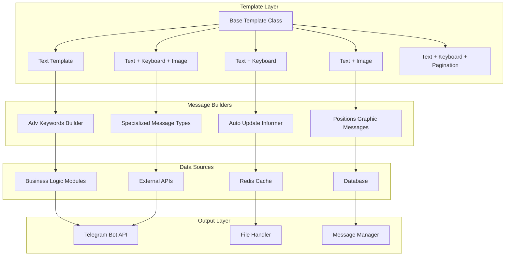
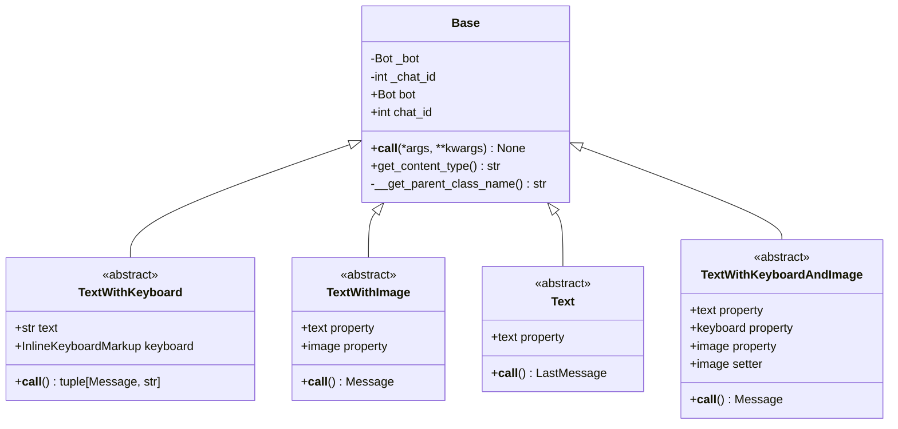
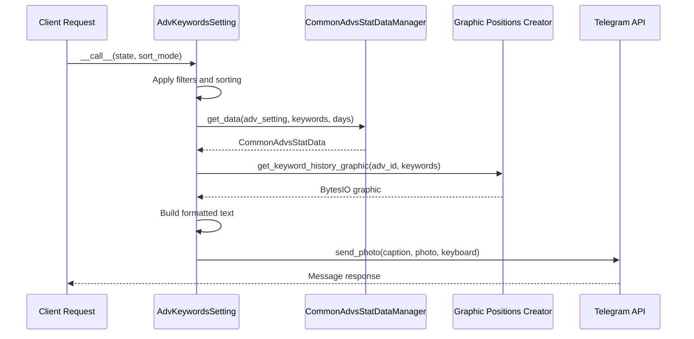
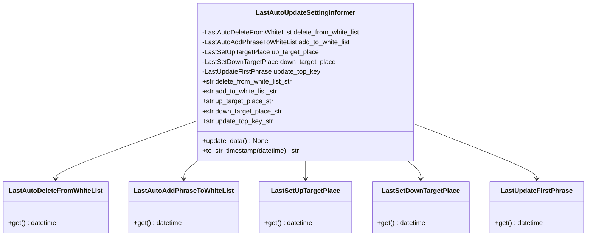
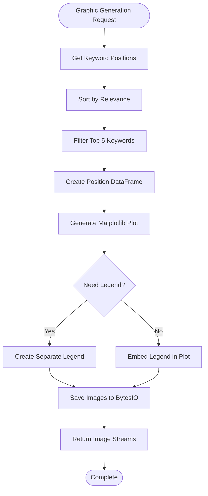
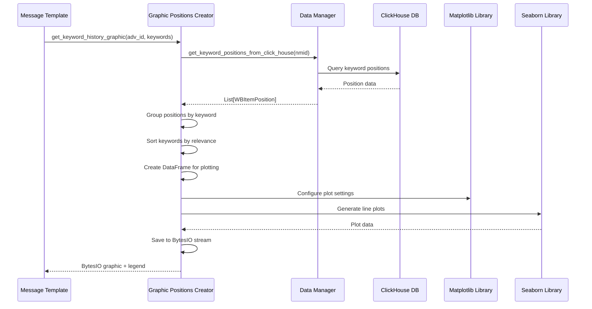
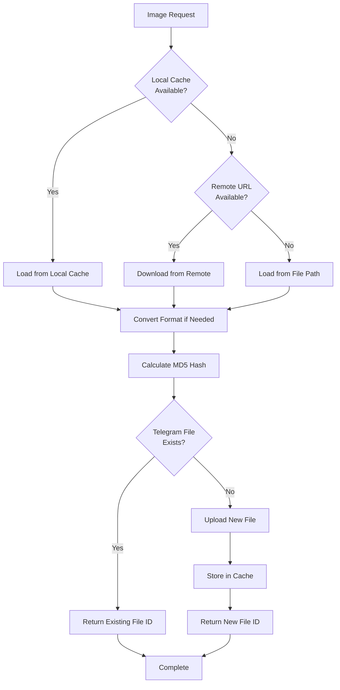
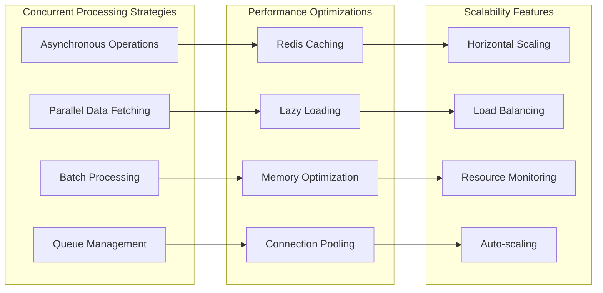
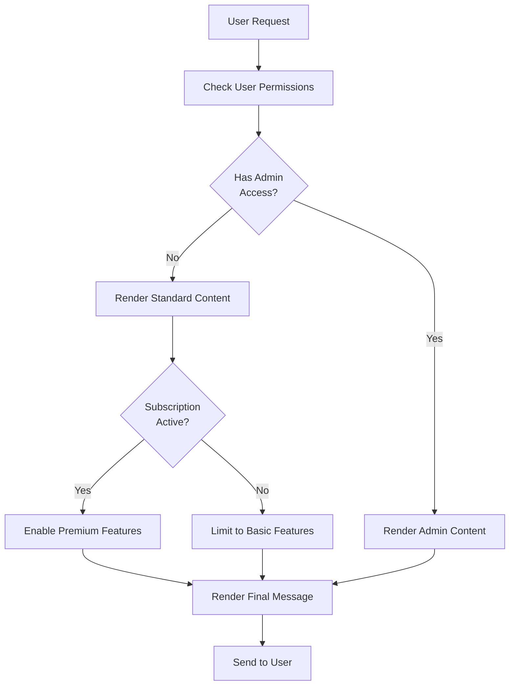
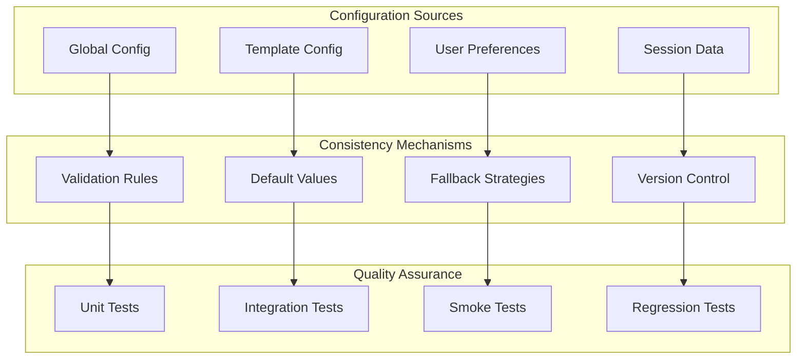

# Dynamic Message Templates

<cite>
**Referenced Files in This Document**
- [templates.py](file://app/client_bot/user_interface/message_templates/templates.py)
- [base.py](file://app/client_bot/user_interface/message_templates/base.py)
- [messages.py](file://app/client_bot/user_interface/views/messages/messages.py)
- [adv_keyword_messages.py](file://app/client_bot/user_interface/views/messages/adv_keyword_messages/adv_keyword_messages.py)
- [last_auto_update_informer.py](file://app/client_bot/user_interface/views/messages/last_auto_update_informer/last_auto_update_informer.py)
- [positions_graphic_messanges.py](file://app/client_bot/user_interface/views/messages/positions_graphic_messanges/positions_graphic_messanges.py)
- [graphic_positions_creator.py](file://app/utils/graphic_positions_creator/graphic_positions_creator.py)
- [classes.py](file://app/utils/graphic_positions_creator/classes.py)
- [file_handler.py](file://app/file_handler.py)
- [message_manager.py](file://app/client_bot/message_manager.py)
- [const.py](file://app/client_bot/const.py)
</cite>

## Table of Contents
1. [Introduction](#introduction)
2. [Template Architecture Overview](#template-architecture-overview)
3. [Core Template Classes](#core-template-classes)
4. [Specialized Message Builders](#specialized-message-builders)
5. [Integration with Graphic Systems](#integration-with-graphic-systems)
6. [Performance Considerations](#performance-considerations)
7. [Conditional Content Rendering](#conditional-content-rendering)
8. [Template Consistency Management](#template-consistency-management)
9. [Troubleshooting Guide](#troubleshooting-guide)
10. [Best Practices](#best-practices)

## Introduction

The dynamic message templating system in the adv-bot framework provides a sophisticated mechanism for constructing context-aware responses using data from business logic modules. This system enables the creation of personalized, data-driven messages that adapt to user permissions, subscription status, campaign state, and other contextual factors.

The architecture is built around a hierarchical template system that supports multiple content types including text-only messages, messages with inline keyboards, images, and combinations thereof. The system integrates seamlessly with the Telegram Bot API through the Aiogram framework while maintaining high performance and scalability under heavy load conditions.

## Template Architecture Overview

The message templating system follows a modular architecture with clear separation of concerns between template definition, data binding, and message delivery.

**Diagram sources**
- [templates.py](file://app/client_bot/user_interface/message_templates/templates.py#L1-L186)
- [base.py](file://app/client_bot/user_interface/message_templates/base.py#L1-L32)

**Section sources**
- [templates.py](file://app/client_bot/user_interface/message_templates/templates.py#L1-L186)
- [base.py](file://app/client_bot/user_interface/message_templates/base.py#L1-L32)

## Core Template Classes

### Base Template Class

The foundation of the template system is the abstract `Base` class that provides common functionality for all template types.

**Diagram sources**
- [base.py](file://app/client_bot/user_interface/message_templates/base.py#L6-L32)
- [templates.py](file://app/client_bot/user_interface/message_templates/templates.py#L45-L186)

### Template Type Hierarchy

The system defines several specialized template types, each designed for specific messaging scenarios:

1. **Text Templates**: Simple text-only messages
2. **TextWithKeyboard**: Messages with inline keyboard navigation
3. **TextWithImage**: Messages with embedded images
4. **TextWithKeyboardAndImage**: Combined keyboard and image support
5. **TextWithKeyboardPagination**: Paginated content with navigation controls

Each template type inherits from the base class and implements specific properties for content generation while maintaining consistent behavior across the system.

**Section sources**
- [templates.py](file://app/client_bot/user_interface/message_templates/templates.py#L45-L186)
- [base.py](file://app/client_bot/user_interface/message_templates/base.py#L6-L32)

## Specialized Message Builders

### Adv Keyword Messages Builder

The `AdvKeywordsSetting` class handles the construction of comprehensive keyword performance reports with integrated graphics and statistical data.

**Diagram sources**
- [adv_keyword_messages.py](file://app/client_bot/user_interface/views/messages/adv_keyword_messages/adv_keyword_messages.py#L30-L259)

Key features of the Adv Keyword Messages Builder:

- **Dynamic Filtering**: Supports keyword filtering with partial match and exact match modes
- **Statistical Aggregation**: Calculates CTR, spend, orders, and prediction metrics
- **Visual Integration**: Generates real-time keyword position graphics
- **Sorting Options**: Multiple sorting modes for keyword presentation
- **Pagination Support**: Handles large keyword lists with pagination controls

### Last Auto Update Informer

The `LastAutoUpdateSettingInformer` provides automated status updates for various campaign settings and operations.

**Diagram sources**
- [last_auto_update_informer.py](file://app/client_bot/user_interface/views/messages/last_auto_update_informer/last_auto_update_informer.py#L10-L43)

### Positions Graphic Messages

The positions graphic system creates visual representations of keyword performance trends.

**Diagram sources**
- [positions_graphic_messanges.py](file://app/client_bot/user_interface/views/messages/positions_graphic_messanges/positions_graphic_messanges.py#L1-L44)
- [graphic_positions_creator.py](file://app/utils/graphic_positions_creator/graphic_positions_creator.py#L30-L168)

**Section sources**
- [adv_keyword_messages.py](file://app/client_bot/user_interface/views/messages/adv_keyword_messages/adv_keyword_messages.py#L30-L259)
- [last_auto_update_informer.py](file://app/client_bot/user_interface/views/messages/last_auto_update_informer/last_auto_update_informer.py#L10-L43)
- [positions_graphic_messanges.py](file://app/client_bot/user_interface/views/messages/positions_graphic_messanges/positions_graphic_messanges.py#L1-L44)

## Integration with Graphic Systems

### Graphic Positions Creator

The graphic positions creator module handles the generation of keyword performance visualizations using advanced plotting libraries.

**Diagram sources**
- [graphic_positions_creator.py](file://app/utils/graphic_positions_creator/graphic_positions_creator.py#L30-L168)
- [classes.py](file://app/utils/graphic_positions_creator/classes.py#L1-L10)

### File Management and Caching

The file handler system manages image caching and optimization for efficient message delivery.

**Diagram sources**
- [file_handler.py](file://app/file_handler.py#L40-L113)

**Section sources**
- [graphic_positions_creator.py](file://app/utils/graphic_positions_creator/graphic_positions_creator.py#L30-L168)
- [classes.py](file://app/utils/graphic_positions_creator/classes.py#L1-L10)
- [file_handler.py](file://app/file_handler.py#L40-L113)

## Performance Considerations

### Asynchronous Operations and Concurrency

The message templating system is designed to handle high-load scenarios through careful use of asynchronous operations and concurrent processing.

### Memory Management and Optimization

The system implements several strategies to minimize memory usage and optimize performance:

1. **Lazy Evaluation**: Template properties are computed only when needed
2. **Streaming Processing**: Large datasets are processed in chunks
3. **Efficient Data Structures**: Use of appropriate data structures for different operations
4. **Garbage Collection**: Proper cleanup of temporary objects and resources

### Scalability Patterns

The architecture supports horizontal scaling through:

- **Stateless Design**: Templates don't maintain internal state between requests
- **Shared Resources**: Efficient sharing of expensive resources like database connections
- **Circuit Breakers**: Protection against cascading failures
- **Rate Limiting**: Built-in throttling mechanisms for external API calls

**Section sources**
- [graphic_positions_creator.py](file://app/utils/graphic_positions_creator/graphic_positions_creator.py#L100-L168)
- [file_handler.py](file://app/file_handler.py#L40-L113)

## Conditional Content Rendering

### User Permission-Based Rendering

The system adapts content based on user permissions and roles:

### Subscription Status Adaptation

Different subscription tiers trigger different content rendering strategies:

- **Free Tier**: Limited statistics, basic visualizations
- **Premium Tier**: Full analytics, advanced graphics, real-time updates
- **Enterprise Tier**: Custom dashboards, priority processing, dedicated support

### Campaign State Awareness

The system renders content differently based on campaign lifecycle stages:

- **Setup Phase**: Guidance and tutorial content
- **Active Phase**: Performance metrics and optimization tips
- **Paused Phase**: Resume options and performance summary
- **Completed Phase**: Final report and recommendations

**Section sources**
- [messages.py](file://app/client_bot/user_interface/views/messages/messages.py#L582-L710)

## Template Consistency Management

### Centralized Configuration

The system maintains consistency through centralized configuration management:

### Template Versioning and Migration

The system supports template versioning to ensure backward compatibility:

- **Schema Evolution**: Gradual migration of template structures
- **Backward Compatibility**: Support for older template formats
- **Automatic Migration**: Seamless conversion between versions
- **Rollback Capability**: Ability to revert to previous versions

### Quality Assurance Processes

Comprehensive testing ensures template reliability:

- **Automated Testing**: Continuous integration with template validation
- **Manual Review**: Human oversight for complex templates
- **Performance Testing**: Load testing with realistic scenarios
- **User Acceptance Testing**: Real-world validation by end users

**Section sources**
- [templates.py](file://app/client_bot/user_interface/message_templates/templates.py#L1-L186)
- [base.py](file://app/client_bot/user_interface/message_templates/base.py#L1-L32)

## Troubleshooting Guide

### Common Issues and Solutions

#### Template Rendering Failures

**Problem**: Templates fail to render with missing data
**Solution**: 
1. Verify data source connectivity
2. Check template property implementations
3. Implement proper error handling and fallbacks
4. Log detailed error information for debugging

#### Performance Degradation

**Problem**: Slow message delivery under load
**Solutions**:
1. Optimize database queries and caching
2. Implement connection pooling
3. Use asynchronous processing where appropriate
4. Monitor resource usage and scale accordingly

#### Image Generation Issues

**Problem**: Graphics fail to generate or display incorrectly
**Solutions**:
1. Verify matplotlib and seaborn installations
2. Check image format compatibility
3. Implement graceful degradation for unsupported formats
4. Test with various data sets and edge cases

### Debugging Tools and Techniques

The system provides several debugging capabilities:

- **Logging Integration**: Comprehensive logging at all levels
- **Template Inspection**: Runtime inspection of template properties
- **Performance Profiling**: Built-in performance monitoring
- **Error Tracking**: Centralized error reporting and analysis

**Section sources**
- [message_manager.py](file://app/client_bot/message_manager.py#L1-L34)
- [file_handler.py](file://app/file_handler.py#L40-L113)

## Best Practices

### Template Design Principles

1. **Single Responsibility**: Each template should handle one specific messaging scenario
2. **Composition Over Inheritance**: Favor composition for complex templates
3. **Immutable Data**: Templates should not modify input data
4. **Clear Separation**: Distinct separation between data and presentation logic

### Performance Optimization Guidelines

1. **Lazy Loading**: Defer expensive computations until absolutely necessary
2. **Caching Strategy**: Implement multi-level caching for frequently accessed data
3. **Resource Management**: Properly manage database connections and file handles
4. **Async Operations**: Use asynchronous patterns for I/O-bound operations

### Security Considerations

1. **Input Validation**: Thorough validation of all input data
2. **SQL Injection Prevention**: Use parameterized queries for database access
3. **XSS Prevention**: Proper escaping of user-generated content
4. **Rate Limiting**: Implement appropriate rate limiting for external API calls

### Maintenance and Evolution

1. **Documentation**: Maintain comprehensive documentation for all templates
2. **Testing**: Implement comprehensive test suites for template functionality
3. **Monitoring**: Set up monitoring for template performance and reliability
4. **Version Control**: Use version control for template changes and rollbacks

The dynamic message templating system provides a robust, scalable foundation for delivering personalized, context-aware messages in the adv-bot ecosystem. Through careful design and implementation of performance optimizations, the system maintains high reliability and responsiveness even under heavy load conditions.