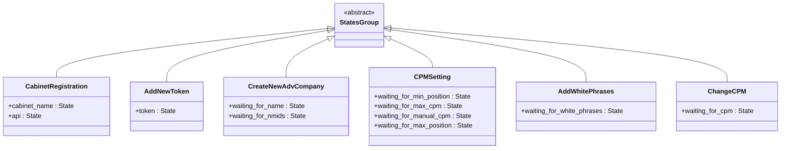
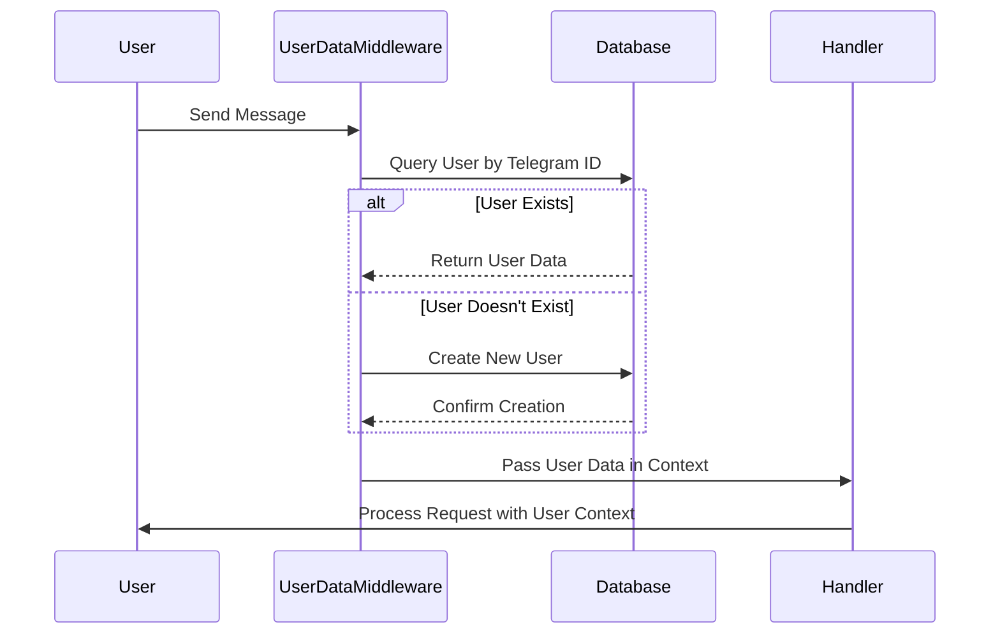
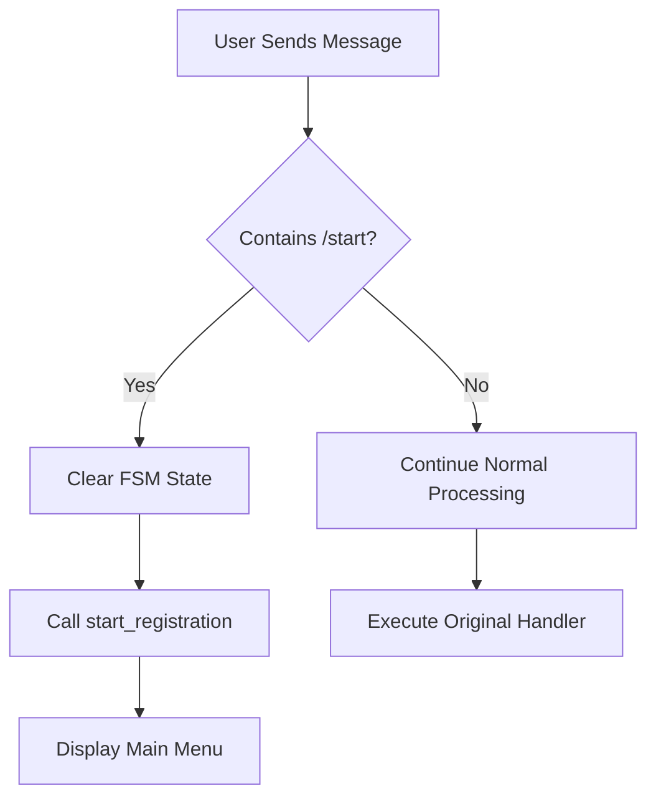
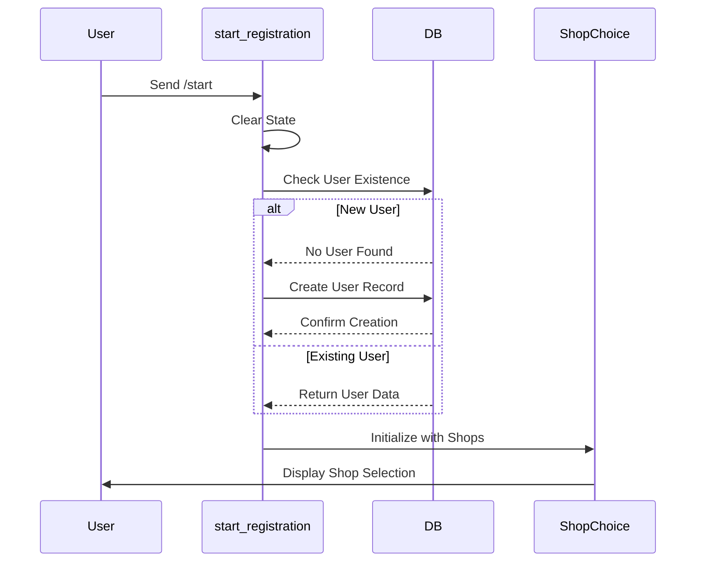
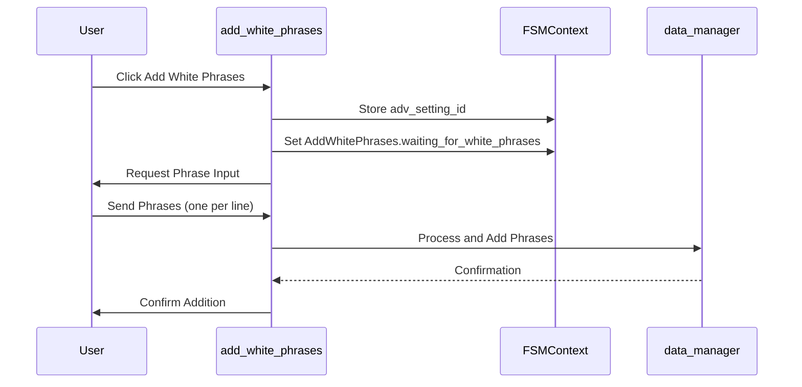
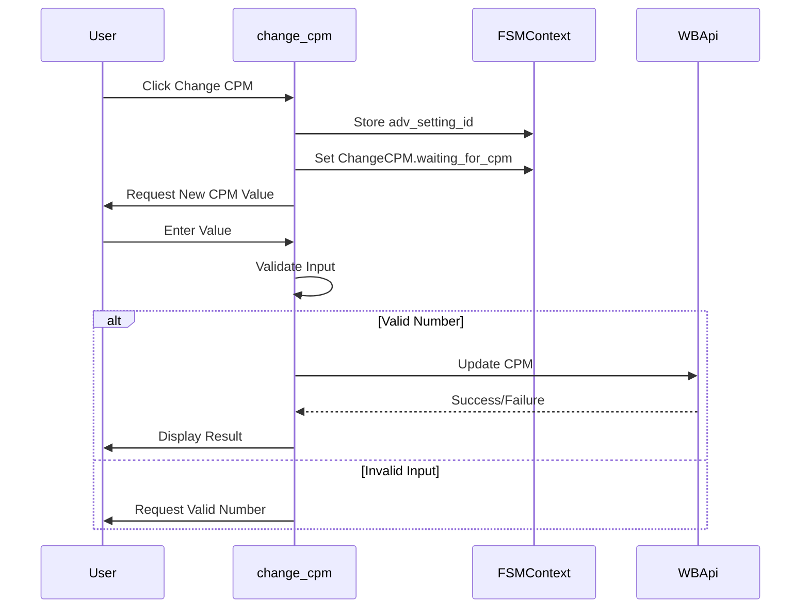

# Finite State Machine (FSM) Implementation

<cite>
**Referenced Files in This Document**   
- [states.py](file://app/client_bot/user_interface/states.py)
- [user_data.py](file://app/client_bot/middlewars/user_data.py)
- [return_to_start_from_state.py](file://app/client_bot/middlewars/return_to_start_from_state.py)
- [start_registration_func.py](file://app/client_bot/user_interface/handlers/start_registration_func.py)
- [shop_choice_message.py](file://app/client_bot/user_interface/handlers/shop_choice_message.py)
- [adv_setting.py](file://app/client_bot/user_interface/handlers/adv_setting.py)
- [add_white_phrases.py](file://app/client_bot/user_interface/handlers/add_white_phrases.py)
- [change_cpm.py](file://app/client_bot/user_interface/handlers/change_cpm.py)
- [callbacks.py](file://app/client_bot/user_interface/views/callbacks.py)
</cite>

## Table of Contents
1. [Introduction](#introduction)
2. [State Definitions and Workflow Management](#state-definitions-and-workflow-management)
3. [User Context Persistence with Middleware](#user-context-persistence-with-middleware)
4. [Navigation and State Reset Mechanisms](#navigation-and-state-reset-mechanisms)
5. [State Transition Examples](#state-transition-examples)
6. [Best Practices for State Management](#best-practices-for-state-management)
7. [Common Issues and Recovery Strategies](#common-issues-and-recovery-strategies)
8. [Extending the State Machine](#extending-the-state-machine)

## Introduction
The Finite State Machine (FSM) implementation in this Telegram bot leverages aiogram's state management system to handle multi-step user interactions. The system enables structured workflows for registration, shop selection, campaign configuration, and various settings modifications. This document details the architecture, state definitions, transition patterns, and best practices used in the implementation.

## State Definitions and Workflow Management

The FSM is implemented using aiogram's `StatesGroup` and `State` classes, with each workflow encapsulated in its own state group. The `states.py` file defines multiple state groups that correspond to different user interaction flows.

Each state group represents a specific workflow:
- `CabinetRegistration`: Manages the cabinet registration process with states for cabinet name and API key input
- `AddNewToken`: Handles token addition with a single state for token input
- `CreateNewAdvCompany`: Guides users through creating new advertising companies with name and NMID inputs
- `CPMSetting`: Manages CPM configuration with multiple states for different parameters
- `AddWhitePhrases` and `AddBlackPhrasesTemplates`: Handle phrase list management
- `ChangeCPM`: Specifically for CPM value modification

The state groups follow a consistent naming convention where the class name describes the workflow, and state attributes use descriptive names indicating the expected user input (e.g., `waiting_for_new_min_ctr`, `waiting_for_white_phrases`).

**Diagram sources**
- [states.py](file://app/client_bot/user_interface/states.py)

**Section sources**
- [states.py](file://app/client_bot/user_interface/states.py)

## User Context Persistence with Middleware

The `user_data.py` middleware implements a critical component of the FSM by persisting user context across interactions. This middleware automatically loads or creates user records from the database when a message is received, ensuring that user data is available throughout the state machine execution.

The `UserDataMiddleware` class implements the `__call__` method that executes on every message. It performs the following functions:
1. Retrieves the user from the database using their Telegram ID
2. Creates a new user record if one doesn't exist
3. Stores the user object in the handler data dictionary
4. Makes the user data available to all subsequent handlers in the chain

This approach ensures that user-specific data (such as associated WB cabinets and tokens) is consistently available during state transitions, eliminating the need for repeated database queries within individual handlers.

**Diagram sources**
- [user_data.py](file://app/client_bot/middlewars/user_data.py)

**Section sources**
- [user_data.py](file://app/client_bot/middlewars/user_data.py)

## Navigation and State Reset Mechanisms

The system implements a sophisticated navigation mechanism through the `return_to_start_from_state.py` middleware. This component allows users to return to the initial state of the application by sending the `/start` command at any point in any workflow.

The `ReturnToStart` middleware intercepts all messages containing `/start` and performs the following actions:
1. Clears the current FSM state using `state.clear()`
2. Calls the `start_registration` function to restart the registration flow
3. Prevents the original message handler from executing

This pattern provides a consistent way for users to reset their session and return to the main menu, regardless of their current state in the application. It enhances user experience by providing an escape hatch from any workflow.

**Diagram sources**
- [return_to_start_from_state.py](file://app/client_bot/middlewars/return_to_start_from_state.py)

**Section sources**
- [return_to_start_from_state.py](file://app/client_bot/middlewars/return_to_start_from_state.py)

## State Transition Examples

### Registration Flow
The registration process begins with the `start_registration` function, which clears any existing state and initiates the shop selection process. This function handles both new and existing users, creating user records as needed and displaying available shops.

**Diagram sources**
- [start_registration_func.py](file://app/client_bot/user_interface/handlers/start_registration_func.py)
- [shop_choice_message.py](file://app/client_bot/user_interface/handlers/shop_choice_message.py)

**Section sources**
- [start_registration_func.py](file://app/client_bot/user_interface/handlers/start_registration_func.py)
- [shop_choice_message.py](file://app/client_bot/user_interface/handlers/shop_choice_message.py)

### Phrase Management Workflow
The white phrases addition workflow demonstrates a typical state transition pattern. When a user selects the option to add white phrases, the system transitions to the appropriate state and waits for text input.

**Diagram sources**
- [add_white_phrases.py](file://app/client_bot/user_interface/handlers/add_white_phrases.py)

**Section sources**
- [add_white_phrases.py](file://app/client_bot/user_interface/handlers/add_white_phrases.py)

### CPM Modification Flow
The CPM change workflow illustrates how the system handles numeric input validation and API integration.

**Diagram sources**
- [change_cpm.py](file://app/client_bot/user_interface/handlers/change_cpm.py)

**Section sources**
- [change_cpm.py](file://app/client_bot/user_interface/handlers/change_cpm.py)

## Best Practices for State Management

### State Naming Conventions
The system follows consistent naming patterns:
- State group classes use PascalCase descriptive names (e.g., `CabinetRegistration`)
- State attributes use snake_case with clear action descriptions (e.g., `waiting_for_new_min_ctr`)
- Prefixes like "waiting_for" clearly indicate the expected user action

### State Scoping
Each state group is scoped to a specific workflow, preventing state name collisions and making the codebase more maintainable. The system avoids global states except for top-level navigation states like `GlobalState.shop_choice`.

### State Cleanup
The implementation includes proper state cleanup mechanisms:
- `state.clear()` is used to reset all state data when starting fresh workflows
- Specific states are cleared with `state.set_state(None)` after completing operations
- The `/start` command triggers a complete state reset, providing a reliable way to exit any workflow

### Data Persistence
The system uses `state.update_data()` to store intermediate values between steps:
- `last_wb_user_cabinet_original_id` stores the selected shop
- `last_adv_setting_id` maintains context about the current advertising setting
- Filter parameters are stored for pagination and filtering operations

## Common Issues and Recovery Strategies

### Stale States
The system addresses stale states through:
- Timeout mechanisms (not explicitly shown but typically configured in aiogram)
- The `/start` command as a universal reset mechanism
- Automatic cleanup after successful operations

### Race Conditions
Potential race conditions are mitigated by:
- Using database transactions for critical operations
- Implementing proper locking mechanisms in the billing module
- Sequential processing of state transitions

### Interrupted Flows
The system handles interrupted flows through:
- Persistent storage of user data in the database
- Context preservation via the user data middleware
- The ability to resume workflows from known states

Recovery strategies include:
- Using `state.get_data()` to retrieve previously stored context
- Validating state data before proceeding with operations
- Providing clear error messages when required data is missing

## Extending the State Machine

When adding new workflows to the system, follow these guidelines:

### Creating New State Groups
1. Define a new `StatesGroup` class in `states.py`
2. Use descriptive state names with consistent prefixes
3. Group related states within a single class
4. Avoid overly complex state hierarchies

### Implementing Handlers
1. Create handler functions that respond to specific callbacks or messages
2. Use `StateFilter` to restrict handlers to specific states
3. Store necessary context data using `state.update_data()`
4. Transition to new states with `state.set_state()`

### Maintaining Code Clarity
To avoid state explosion:
- Combine related operations into cohesive workflows
- Use data classes to manage complex state data
- Implement reusable components for common patterns
- Document state transitions and dependencies

### Integration Patterns
When integrating new workflows:
- Use consistent callback data structures
- Follow existing error handling patterns
- Integrate with the user data middleware
- Ensure proper state cleanup after completion

The current implementation provides a robust foundation for extending the state machine while maintaining code clarity and user experience.