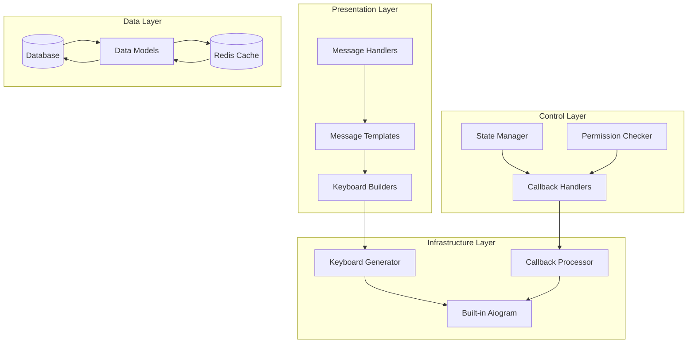
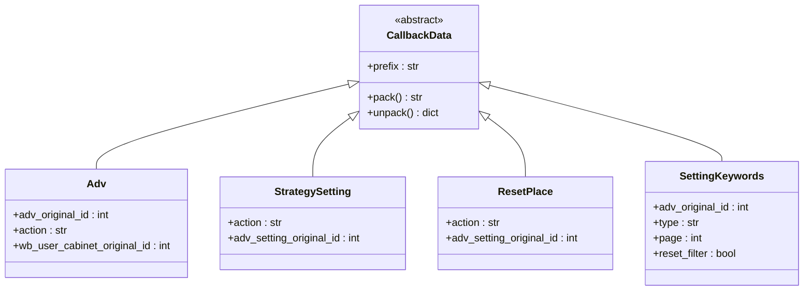
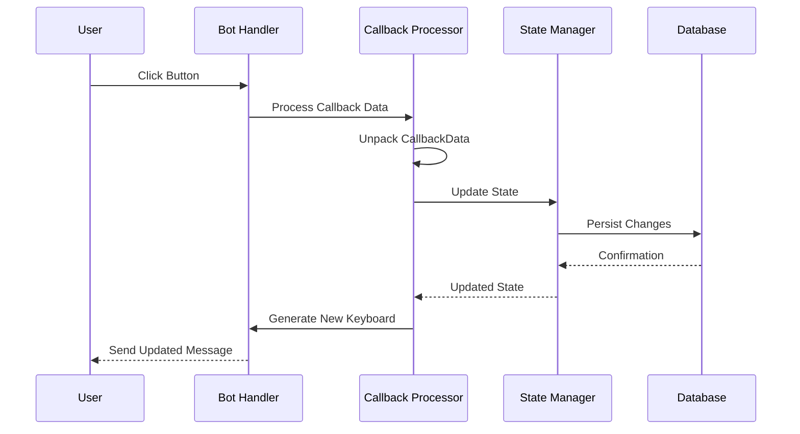
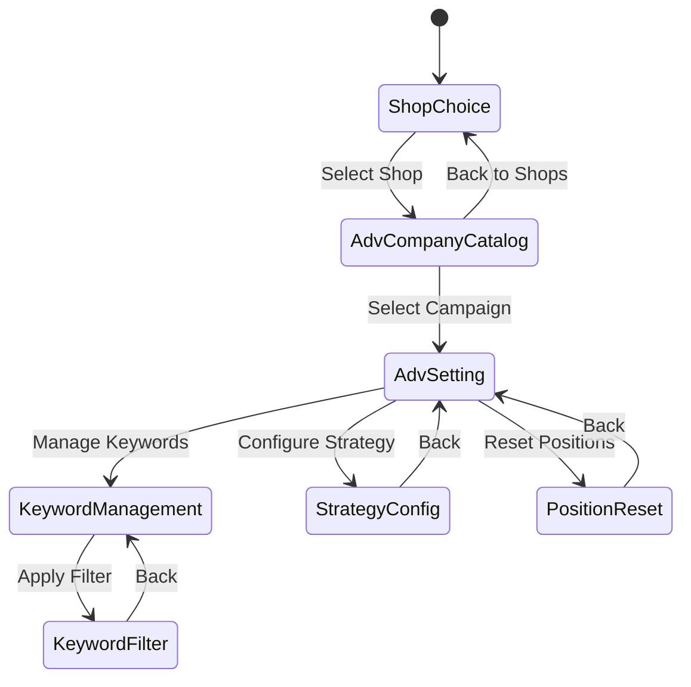

# Interactive Keyboard System

<cite>
**Referenced Files in This Document**
- [keyboards.py](file://app/client_bot/user_interface/views/keyboards.py)
- [callbacks.py](file://app/client_bot/user_interface/views/callbacks.py)
- [strategy_setting.py](file://app/client_bot/user_interface/handlers/strategy_setting.py)
- [reset_place_setting.py](file://app/client_bot/user_interface/handlers/reset_place_setting.py)
- [messages.py](file://app/client_bot/user_interface/views/messages/messages.py)
- [templates.py](file://app/client_bot/user_interface/message_templates/templates.py)
- [states.py](file://app/client_bot/user_interface/states.py)
- [admin_handler.py](file://app/client_bot/user_interface/handlers/admin_handler.py)
</cite>

## Table of Contents
1. [Introduction](#introduction)
2. [System Architecture](#system-architecture)
3. [Core Components](#core-components)
4. [Keyboard Generation Patterns](#keyboard-generation-patterns)
5. [Callback Data Management](#callback-data-management)
6. [State-Driven Keyboard Variations](#state-driven-keyboard-variations)
7. [Real Implementation Examples](#real-implementation-examples)
8. [Best Practices](#best-practices)
9. [Challenges and Solutions](#challenges-and-solutions)
10. [Integration Guidelines](#integration-guidelines)

## Introduction

The Interactive Keyboard System is a sophisticated dynamic keyboard generation framework built on top of Aiogram that creates contextual, permission-aware, and state-driven reply and inline keyboards. This system serves as the primary interface layer for user interaction within the Wildberries advertising automation platform, enabling seamless navigation through complex advertising workflows while maintaining consistency and accessibility across different user roles and contexts.

The system dynamically generates keyboards based on user permissions, active workflows, campaign states, and real-time data availability. It employs a hierarchical callback data structure that enables precise state transitions and maintains context throughout multi-step processes.

## System Architecture

The keyboard system follows a layered architecture that separates concerns between keyboard generation, callback management, state handling, and message composition:



**Diagram sources**
- [keyboards.py](file://app/client_bot/user_interface/views/keyboards.py#L1-L50)
- [callbacks.py](file://app/client_bot/user_interface/views/callbacks.py#L1-L30)

## Core Components

### Keyboard Generation Engine

The core keyboard generation engine resides in `keyboards.py` and provides a comprehensive collection of specialized keyboard builders:

```python
def get_adv_setting_keyboard(chat_id, wb_user_cabinet: WBUserCabinet, adv_setting: AdvSetting, in_favorites: bool):
    builder = InlineKeyboardBuilder()
    # Dynamic button creation based on campaign state
    if adv_setting.auto_update_white_list:
        text = "Выключить автообновление белого списка"
        new_status = False
    else:
        text = "Включить автообновление белого списка"
        new_status = True
    
    callback = AutoUpdateWhiteListSetting(new_status=new_status, adv_setting_original_id=adv_setting.id).pack()
    button = InlineKeyboardButton(text=text, callback_data=callback)
    builder.row(button)
    return builder.as_markup()
```

### Callback Data Structure

The system uses a hierarchical callback data structure that enables precise state management and context preservation:



**Diagram sources**
- [callbacks.py](file://app/client_bot/user_interface/views/callbacks.py#L20-L223)

**Section sources**
- [keyboards.py](file://app/client_bot/user_interface/views/keyboards.py#L81-L200)
- [callbacks.py](file://app/client_bot/user_interface/views/callbacks.py#L1-L223)

## Keyboard Generation Patterns

### Dynamic State-Based Generation

The system employs sophisticated state-based keyboard generation that adapts to the current context and user permissions:

```python
def get_advs_keyboard_with_paginator(wb_user_cabinet_original_id: int, adv_settings: list[AdvSetting], page: int, on_page: int, keyword_filter):
    active_part_advs = list(filter(lambda adv_local: adv_local.bot_active is True, adv_settings))
    not_active_part_advs = list(filter(lambda adv_locale: adv_locale.bot_active is not True, adv_settings))
    adv_settings = active_part_advs + not_active_part_advs
    
    keyboard_buttons = []
    start_index = (page - 1) * on_page
    end_index = start_index + on_page
    
    for adv in adv_settings[start_index:end_index]:
        check_last_24_hours = adv.check_last_24_hours
        check_text = "✅" if check_last_24_hours else "❓"
        button_text = f"{check_text} {adv.name} (Бот {'включен' if adv.bot_active else 'отключен'})"
        
        callback_data = callbacks.Adv(
            action="select",
            adv_original_id=adv.id,
            wb_user_cabinet_original_id=wb_user_cabinet_original_id,
        ).pack()
        
        keyboard_buttons.append([InlineKeyboardButton(text=button_text, callback_data=callback_data)])
    
    return InlineKeyboardMarkup(inline_keyboard=keyboard_buttons)
```

### Permission-Aware Button Creation

The system automatically adjusts available actions based on user permissions and current system state:

```python
def get_adv_setting_keyboard(chat_id, wb_user_cabinet: WBUserCabinet, adv_setting: AdvSetting, in_favorites: bool):
    builder = InlineKeyboardBuilder()
    
    # Conditional button creation based on campaign state
    if adv_setting.bot_active:
        builder.row(InlineKeyboardButton(
            text="Выключить автоматическое управление",
            callback_data=TurnBot(action="off", adv_original_id=adv_setting.id, wb_user_cabinet_original_id=wb_user_cabinet.id).pack(),
        ))
    else:
        builder.row(InlineKeyboardButton(
            text="Включить автоматическое управление",
            callback_data=TurnBot(action="on", adv_original_id=adv_setting.id, wb_user_cabinet_original_id=wb_user_cabinet.id).pack(),
        ))
    
    return builder.as_markup()
```

**Section sources**
- [keyboards.py](file://app/client_bot/user_interface/views/keyboards.py#L341-L420)
- [keyboards.py](file://app/client_bot/user_interface/views/keyboards.py#L81-L200)

## Callback Data Management

### Hierarchical Callback Structure

The callback system uses a hierarchical structure that enables complex state transitions while maintaining data integrity:



**Diagram sources**
- [strategy_setting.py](file://app/client_bot/user_interface/handlers/strategy_setting.py#L15-L30)
- [reset_place_setting.py](file://app/client_bot/user_interface/handlers/reset_place_setting.py#L10-L25)

### Callback Handler Implementation

The system provides robust callback handlers that manage state transitions and data persistence:

```python
@router.callback_query(callbacks.StrategySetting.filter(F.action == "turn_on_min_ctr"))
async def turn_on_min_ctr(callback: types.CallbackQuery, bot: aiogram.Bot, callback_data: callbacks.StrategySetting, state: FSMContext):
    adv_original_id = callback_data.adv_setting_original_id
    async with sm(read_only=False) as session:
        adv = await session.execute(select(AdvSetting).where(AdvSetting.id == adv_original_id))
        adv: AdvSetting = adv.scalar()
        adv.target_ctr_mode = False
        await session.commit()
    
    await messages.StrategySetting(bot, callback.message.chat.id)(adv_original_id)
    return
```

**Section sources**
- [strategy_setting.py](file://app/client_bot/user_interface/handlers/strategy_setting.py#L15-L30)
- [reset_place_setting.py](file://app/client_bot/user_interface/handlers/reset_place_setting.py#L10-L25)

## State-Driven Keyboard Variations

### Multi-State Navigation

The system supports complex multi-state navigation through dedicated state groups:



**Diagram sources**
- [states.py](file://app/client_bot/user_interface/states.py#L1-L79)

### Context-Aware Keyboard Adaptation

Keyboards adapt dynamically based on the current state and available data:

```python
class AdvCompanyChoicing(TextWithKeyboardPagination):
    def __init__(self, bot: Bot, chat_id: int, wb_user_cabinet_original_id: int, adv_settings: list[AdvSetting], state, page: int = 1):
        self._state = state
        super().__init__(bot, chat_id)
        self._wb_user_cabinet_original_id = wb_user_cabinet_original_id
        self._adv_settings = adv_settings
        self._page = page
        
    @property
    def keyboard(self):
        return keyboards.get_advs_keyboard_with_paginator(
            self._wb_user_cabinet_original_id,
            self._adv_settings,
            self._page,
            self.on_page,
            self._keywords_filter,
        )
```

**Section sources**
- [states.py](file://app/client_bot/user_interface/states.py#L1-L79)
- [messages.py](file://app/client_bot/user_interface/views/messages/messages.py#L70-L150)

## Real Implementation Examples

### Admin Controls Implementation

The admin handler demonstrates advanced keyboard management with role-based access:

```python
# Example from admin_handler.py (conceptual)
@router.callback_query(callbacks.AdminBonus.filter())
async def handle_admin_actions(callback: types.CallbackQuery, callback_data: callbacks.AdminBonus, bot: Bot):
    # Role verification would occur here
    if not await verify_admin_permissions(callback.from_user.id):
        await bot.answer_callback_query(callback.id, "Доступ запрещен")
        return
    
    # Generate admin-specific keyboard
    admin_keyboard = keyboards.get_admin_keyboard()
    await bot.edit_message_reply_markup(
        chat_id=callback.message.chat.id,
        message_id=callback.message.message_id,
        reply_markup=admin_keyboard
    )
```

### Strategy Settings Management

The strategy setting system showcases complex state transitions and data persistence:

```python
@router.callback_query(callbacks.StrategySetting.filter(F.action == "on_target_ctr"))
async def on_target_ctr(callback: types.CallbackQuery, bot: aiogram.Bot, callback_data: callbacks.StrategySetting, state: FSMContext):
    adv_original_id = callback_data.adv_setting_original_id
    async with sm(read_only=False) as session:
        adv = await session.execute(select(AdvSetting).where(AdvSetting.id == adv_original_id))
        adv: AdvSetting = adv.scalar()
        adv.target_ctr_mode = True
        await session.commit()
    
    await messages.StrategySetting(bot, callback.message.chat.id)(adv_original_id)
    return
```

### Position Management System

The position reset system demonstrates atomic state updates with immediate feedback:

```python
@router.callback_query(callbacks.ResetPlace.filter(F.action == "on"))
async def on_reset_place(callback: types.CallbackQuery, callback_data: callbacks.ResetPlace, bot: Bot):
    adv_original_id: int = callback_data.adv_setting_original_id
    
    stmt = update(AdvSetting).filter(AdvSetting.id == adv_original_id).values(reset_place=True)
    
    async with sm(read_only=False) as session:
        await session.execute(stmt)
        await session.commit()
    
    await bot.send_message(callback.message.chat.id, "Сброс места включен")
```

**Section sources**
- [strategy_setting.py](file://app/client_bot/user_interface/handlers/strategy_setting.py#L30-L50)
- [reset_place_setting.py](file://app/client_bot/user_interface/handlers/reset_place_setting.py#L10-L25)

## Best Practices

### Keyboard Consistency Guidelines

1. **Hierarchical Navigation**: Always provide "Back" buttons to maintain navigation flow
2. **State Indicators**: Use visual indicators (✅, ❓) to show current state
3. **Consistent Terminology**: Maintain consistent button text across similar actions
4. **Mobile Optimization**: Design for touch interfaces with appropriate button sizes

### Accessibility Considerations

```python
def get_accessible_keyboard():
    builder = InlineKeyboardBuilder()
    
    # Use descriptive text for screen readers
    builder.row(InlineKeyboardButton(
        text="Включить автоматическое управление кампанией",
        callback_data=TurnBot(action="on", adv_original_id=adv_id).pack(),
    ))
    
    # Provide alternative navigation options
    builder.row(InlineKeyboardButton(
        text="Вернуться к списку кампаний",
        callback_data=ChoiceAdvPaginator(page=1).pack(),
    ))
    
    return builder.as_markup()
```

### Mobile Optimization Strategies

1. **Button Size**: Ensure buttons are at least 44px on touch devices
2. **Layout**: Use single-column layouts for complex workflows
3. **Feedback**: Provide immediate visual feedback for button presses
4. **Navigation**: Include breadcrumbs for multi-step processes

## Challenges and Solutions

### Callback Conflicts Management

The system addresses callback conflicts through namespace isolation and validation:

```python
class CallbackData:
    def __init_subclass__(cls, prefix: str = None, **kwargs):
        super().__init_subclass__(**kwargs)
        cls.__prefix__ = prefix
    
    def pack(self) -> str:
        # Validate data before packing
        self.validate_data()
        return f"{self.__prefix__}:{self.serialize()}"
    
    def validate_data(self):
        # Implement validation logic
        pass
```

### Expired Keyboard Handling

The system implements robust expiration handling:

```python
def get_safe_keyboard(data_context):
    # Check if keyboard is still valid
    if not is_keyboard_valid(data_context):
        return get_fallback_keyboard()
    
    # Generate keyboard with expiration protection
    keyboard = generate_keyboard(data_context)
    keyboard.set_expiration_timeout(300)  # 5 minutes
    return keyboard
```

### Graceful Degradation

The system ensures graceful degradation when options change:

```python
def get_fallback_keyboard(original_data):
    builder = InlineKeyboardBuilder()
    
    # Try to preserve essential functionality
    essential_buttons = extract_essential_buttons(original_data)
    for button in essential_buttons:
        builder.row(InlineKeyboardButton(**button))
    
    # Add fallback option
    builder.row(InlineKeyboardButton(
        text="Обновить данные",
        callback_data=RefreshData().pack(),
    ))
    
    return builder.as_markup()
```

## Integration Guidelines

### Creating New Keyboard Layouts

When creating new keyboard layouts, follow this pattern:

```python
def get_custom_keyboard(item_id: int, user_role: str) -> InlineKeyboardMarkup:
    builder = InlineKeyboardBuilder()
    
    # Add role-specific buttons
    if user_role == "admin":
        builder.row(InlineKeyboardButton(
            text="Администрирование",
            callback_data=AdminAction(item_id=item_id).pack(),
        ))
    
    # Add common functionality
    builder.row(InlineKeyboardButton(
        text="Назад",
        callback_data=ReturnToPrevious(item_id=item_id).pack(),
    ))
    
    return builder.as_markup()
```

### State Transition Integration

Integrate keyboards with state transitions using the message template system:

```python
class CustomMessage(TextWithKeyboard):
    @property
    def text(self) -> str:
        return "Выберите действие:"
    
    @property
    def keyboard(self) -> InlineKeyboardMarkup:
        return keyboards.get_custom_keyboard(self.item_id, self.user_role)
    
    async def __call__(self) -> tuple[Message, str]:
        await super().__call__()
        return await self.bot.send_message(
            chat_id=self.chat_id,
            text=self.text,
            reply_markup=self.keyboard,
        )
```

### Command Handler Integration

Integrate keyboards with command handlers:

```python
@router.message(Command("custom_command"))
async def handle_custom_command(message: types.Message, state: FSMContext):
    await state.set_state(CustomState.waiting_for_action)
    
    # Generate initial keyboard
    keyboard = keyboards.get_initial_custom_keyboard(message.from_user.id)
    
    await message.answer(
        "Выберите действие:",
        reply_markup=keyboard
    )
```

**Section sources**
- [keyboards.py](file://app/client_bot/user_interface/views/keyboards.py#L1-L100)
- [templates.py](file://app/client_bot/user_interface/message_templates/templates.py#L50-L100)