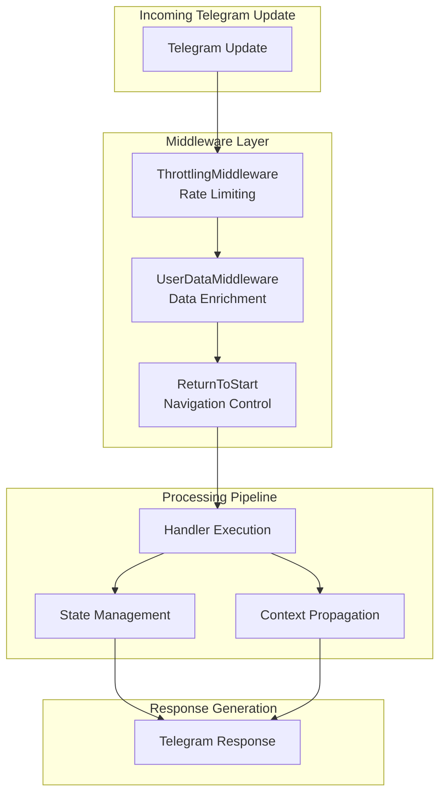
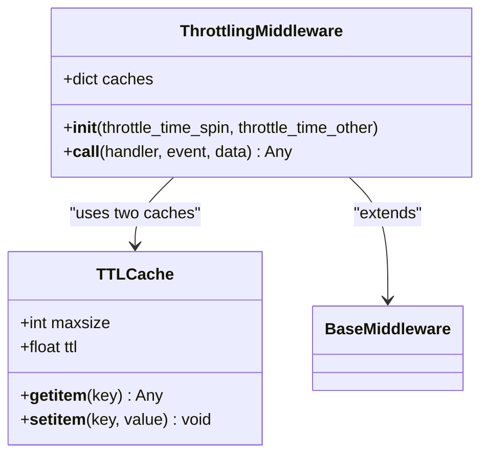
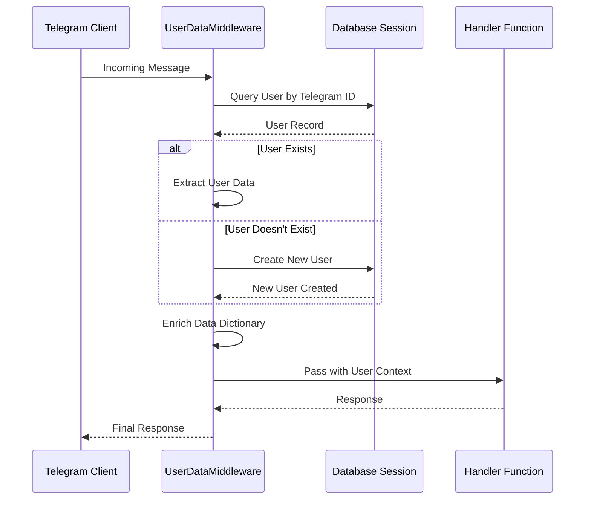
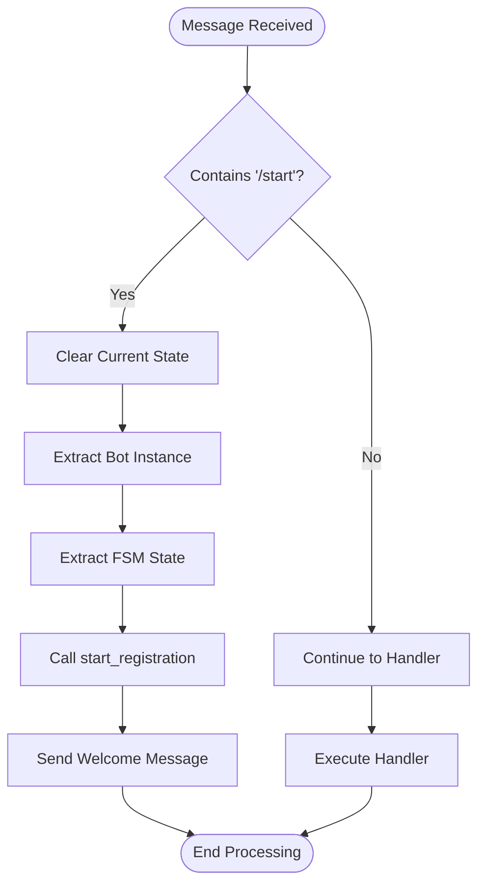
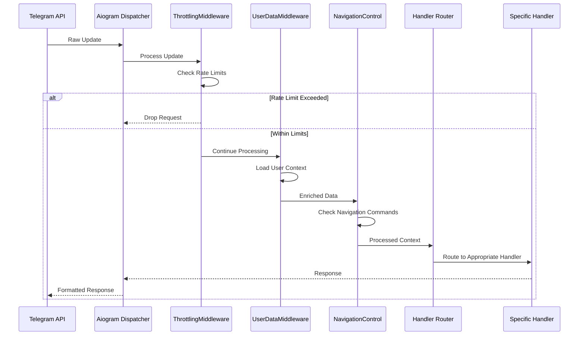
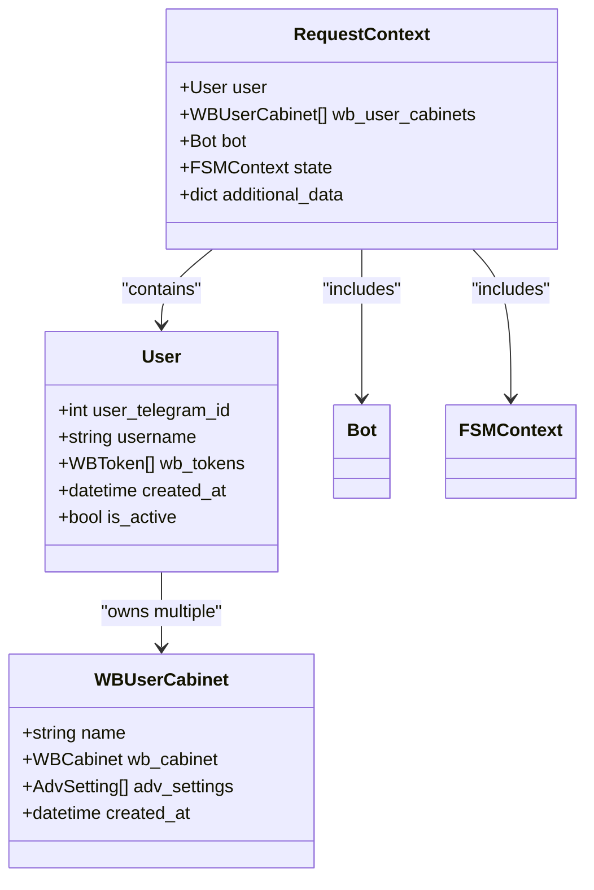
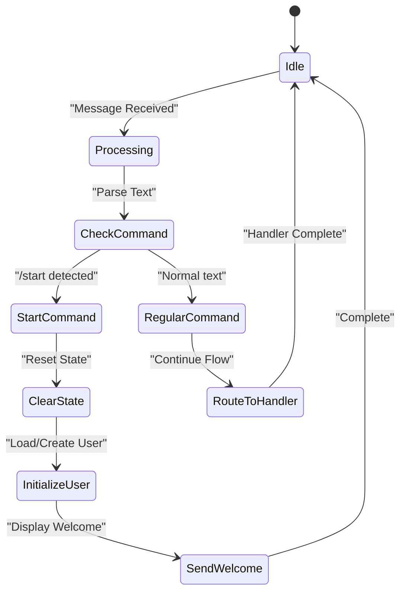
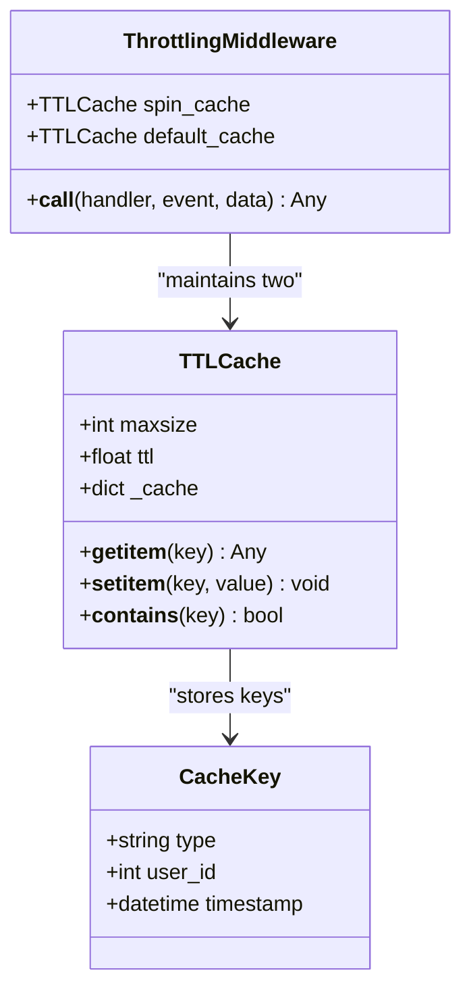
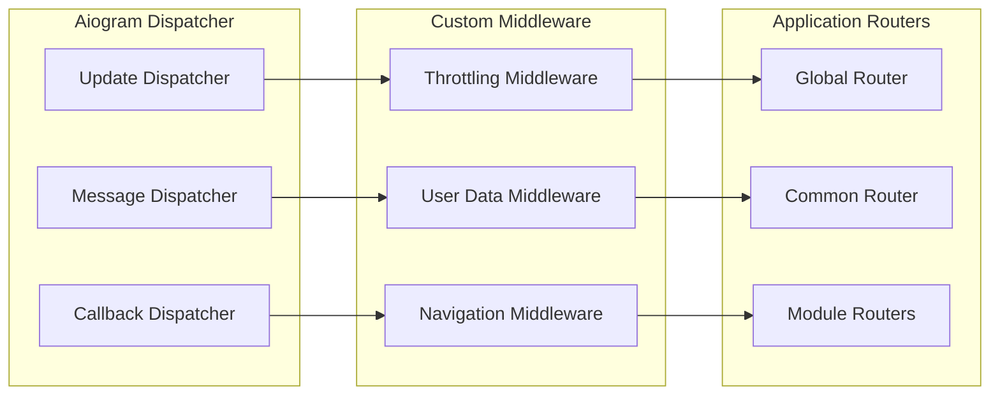

# Middleware and Request Processing

<cite>
**Referenced Files in This Document**
- [throtting.py](file://app/client_bot/middlewars/throtting.py)
- [user_data.py](file://app/client_bot/middlewars/user_data.py)
- [return_to_start_from_state.py](file://app/client_bot/middlewars/return_to_start_from_state.py)
- [global_router.py](file://app/client_bot/global_router.py)
- [common_routers.py](file://app/client_bot/common_routers.py)
- [client_bot_run.py](file://client_bot_run.py)
- [bot.py](file://app/client_bot/bot.py)
- [start_registration_func.py](file://app/client_bot/user_interface/handlers/start_registration_func.py)
- [states.py](file://app/client_bot/user_interface/states.py)
- [start.py](file://app/client_bot/user_interface/handlers/start/start.py)
- [echo_handler.py](file://app/client_bot/echo_handler.py)
</cite>

## Table of Contents
1. [Introduction](#introduction)
2. [Middleware Architecture Overview](#middleware-architecture-overview)
3. [Core Middleware Components](#core-middleware-components)
4. [Request Lifecycle Processing](#request-lifecycle-processing)
5. [Data Enrichment and Context Propagation](#data-enrichment-and-context-propagation)
6. [State Management and Navigation Control](#state-management-and-navigation-control)
7. [Rate Limiting Implementation](#rate-limiting-implementation)
8. [Integration with Aiogram Dispatching Pipeline](#integration-with-aiogram-dispatching-pipeline)
9. [Performance Considerations](#performance-considerations)
10. [Extending Middleware Stack](#extending-middleware-stack)
11. [Troubleshooting and Best Practices](#troubleshooting-and-best-practices)

## Introduction

The middleware system in this Telegram bot application serves as the backbone for processing incoming updates, managing user context, enforcing rate limits, and controlling navigation flow. Built on top of the aiogram framework, the middleware stack provides a robust foundation for handling complex conversational flows while maintaining performance and reliability.

The middleware architecture consists of three primary components: rate limiting through throttling mechanisms, user data enrichment via database integration, and navigation control for state management. These components work together to create a seamless user experience while ensuring system stability and scalability.

## Middleware Architecture Overview

The middleware system follows a layered architecture pattern where each middleware component handles specific aspects of request processing. The architecture is designed to be modular, allowing for easy extension and maintenance.



**Diagram sources**
- [throtting.py](file://app/client_bot/middlewars/throtting.py#L1-L30)
- [user_data.py](file://app/client_bot/middlewars/user_data.py#L1-L48)
- [return_to_start_from_state.py](file://app/client_bot/middlewars/return_to_start_from_state.py#L1-L30)

The middleware chain processes requests in a specific order, with each middleware having the opportunity to modify the request, enrich the context, or intercept the flow before reaching the final handler.

**Section sources**
- [global_router.py](file://app/client_bot/global_router.py#L1-L30)
- [common_routers.py](file://app/client_bot/common_routers.py#L1-L104)

## Core Middleware Components

### Throttling Middleware

The `ThrottlingMiddleware` provides sophisticated rate limiting capabilities using TTL (Time-To-Live) caches to prevent abuse and ensure fair resource distribution among users.



**Diagram sources**
- [throtting.py](file://app/client_bot/middlewars/throtting.py#L8-L30)

The middleware maintains separate caches for different throttling scenarios:
- **Spin Cache**: Used for rapid response scenarios requiring immediate feedback
- **Default Cache**: Standard throttling for general operations

Each cache operates independently with configurable TTL values, allowing fine-tuned control over rate limiting policies.

**Section sources**
- [throtting.py](file://app/client_bot/middlewars/throtting.py#L1-L30)

### User Data Middleware

The `UserDataMiddleware` integrates with the application's database layer to enrich incoming requests with user context and ensure proper user initialization.



**Diagram sources**
- [user_data.py](file://app/client_bot/middlewars/user_data.py#L15-L47)

The middleware performs several critical functions:
- **User Lookup**: Searches for existing users by Telegram ID
- **User Creation**: Creates new user records when necessary
- **Data Enrichment**: Adds user objects to the handler context
- **Relationship Loading**: Loads associated user cabinets and tokens

**Section sources**
- [user_data.py](file://app/client_bot/middlewars/user_data.py#L1-L48)

### Navigation Control Middleware

The `ReturnToStart` middleware manages conversational flow by intercepting `/start` commands and resetting user state appropriately.



**Diagram sources**
- [return_to_start_from_state.py](file://app/client_bot/middlewars/return_to_start_from_state.py#L13-L29)

This middleware ensures clean state management by:
- Detecting explicit `/start` commands
- Clearing existing state to prevent conflicts
- Reinitializing the user registration flow
- Maintaining conversational consistency

**Section sources**
- [return_to_start_from_state.py](file://app/client_bot/middlewars/return_to_start_from_state.py#L1-L30)

## Request Lifecycle Processing

The middleware system orchestrates a comprehensive request lifecycle that transforms raw Telegram updates into structured, enriched requests ready for handler execution.



**Diagram sources**
- [client_bot_run.py](file://client_bot_run.py#L40-L87)
- [common_routers.py](file://app/client_bot/common_routers.py#L30-L40)

The lifecycle includes several key phases:
1. **Update Reception**: Raw Telegram update received
2. **Rate Limiting**: Initial filtering based on user activity
3. **User Context Loading**: Database queries for user information
4. **State Management**: Navigation flow control
5. **Handler Routing**: Selection of appropriate handler
6. **Response Generation**: Formatted response creation

**Section sources**
- [client_bot_run.py](file://client_bot_run.py#L1-L151)

## Data Enrichment and Context Propagation

The middleware system implements sophisticated data enrichment strategies to provide handlers with comprehensive context information. This includes user profiles, preferences, and contextual metadata.



**Diagram sources**
- [user_data.py](file://app/client_bot/middlewars/user_data.py#L25-L47)
- [start_registration_func.py](file://app/client_bot/user_interface/handlers/start_registration_func.py#L15-L57)

The context propagation mechanism ensures that:
- **User Identity**: Telegram user ID is consistently tracked
- **Cabinet Associations**: Multiple user cabinets are loaded efficiently
- **State Persistence**: Conversation state is maintained across requests
- **Bot Context**: Access to bot instance for API calls
- **Additional Metadata**: Custom data can be attached to requests

**Section sources**
- [user_data.py](file://app/client_bot/middlewars/user_data.py#L15-L47)

## State Management and Navigation Control

The navigation control system provides sophisticated state management capabilities, particularly for handling user registration and command routing.



**Diagram sources**
- [return_to_start_from_state.py](file://app/client_bot/middlewars/return_to_start_from_state.py#L13-L29)
- [states.py](file://app/client_bot/user_interface/states.py#L1-L79)

The state management system supports various conversational states:
- **Global States**: Application-wide state management
- **Cabinet Registration**: Multi-step user onboarding
- **Advanced Settings**: Complex configuration workflows
- **Command Routing**: Dynamic handler selection

**Section sources**
- [states.py](file://app/client_bot/user_interface/states.py#L1-L79)
- [start.py](file://app/client_bot/user_interface/handlers/start/start.py#L1-L445)

## Rate Limiting Implementation

The rate limiting system employs TTL caches to provide efficient, scalable throttling without persistent storage dependencies.



**Diagram sources**
- [throtting.py](file://app/client_bot/middlewars/throtting.py#L8-L30)

The implementation provides:
- **Configurable Timeouts**: Separate timeouts for different operation types
- **Memory Efficiency**: TTL-based automatic cleanup prevents memory leaks
- **Scalability**: No external dependencies required
- **Flexibility**: Different throttling strategies for different contexts

**Section sources**
- [throtting.py](file://app/client_bot/middlewars/throtting.py#L1-L30)

## Integration with Aiogram Dispatching Pipeline

The middleware system integrates seamlessly with aiogram's dispatching pipeline, leveraging the framework's built-in middleware support.



**Diagram sources**
- [global_router.py](file://app/client_bot/global_router.py#L1-L30)
- [common_routers.py](file://app/client_bot/common_routers.py#L30-L40)

The integration strategy includes:
- **Router-Level Registration**: Middleware registered at router level
- **Selective Application**: Different middleware for different update types
- **Order Sensitivity**: Careful ordering to ensure proper flow
- **Error Handling**: Graceful degradation on middleware failures

**Section sources**
- [global_router.py](file://app/client_bot/global_router.py#L1-L30)
- [common_routers.py](file://app/client_bot/common_routers.py#L1-L104)

## Performance Considerations

The middleware system is designed with performance optimization as a primary concern, implementing several strategies to minimize overhead and maximize throughput.

### Memory Management

The throttling middleware uses TTL caches that automatically expire entries, preventing memory accumulation:
- **Automatic Cleanup**: Entries expire based on TTL values
- **Size Limits**: Maximum cache sizes prevent unbounded growth
- **Memory Efficiency**: Lightweight cache implementation

### Database Optimization

User data middleware implements several optimization strategies:
- **Lazy Loading**: Related objects loaded only when needed
- **Connection Pooling**: Efficient database connection management
- **Query Optimization**: Optimized SQL queries with proper indexing

### Concurrency Handling

The middleware system handles concurrent requests effectively:
- **Async Operations**: All database operations are asynchronous
- **Connection Isolation**: Each request gets isolated database connections
- **Resource Cleanup**: Proper cleanup of resources after processing

## Extending Middleware Stack

The middleware architecture supports easy extension for custom functionality, allowing developers to add monitoring, analytics, or security features.

### Custom Middleware Example

```python
class LoggingMiddleware(BaseMiddleware):
    async def __call__(self, handler, event, data):
        logger.info(f"Processing {event.__class__.__name__}: {event}")
        try:
            result = await handler(event, data)
            logger.info(f"Successfully processed {event}")
            return result
        except Exception as e:
            logger.error(f"Error processing {event}: {e}")
            raise
```

### Analytics Middleware

```python
class AnalyticsMiddleware(BaseMiddleware):
    async def __call__(self, handler, event, data):
        start_time = time.time()
        try:
            result = await handler(event, data)
            duration = time.time() - start_time
            self.record_metrics(event, duration, success=True)
            return result
        except Exception as e:
            duration = time.time() - start_time
            self.record_metrics(event, duration, success=False, error=str(e))
            raise
```

### Security Middleware

```python
class SecurityMiddleware(BaseMiddleware):
    async def __call__(self, handler, event, data):
        user = data.get("user")
        if not user or not user.is_active:
            await self.block_request(event)
            return
        
        if not self.check_permissions(user, event):
            await self.log_security_event(event, user)
            return
            
        return await handler(event, data)
```

## Troubleshooting and Best Practices

### Common Issues and Solutions

**Middleware Order Problems**
- Ensure proper middleware ordering in router registration
- Throttling middleware should typically come first
- Navigation middleware should handle special commands early

**Database Connection Issues**
- Monitor connection pool exhaustion
- Implement proper connection cleanup
- Use read-only sessions where appropriate

**Rate Limiting Conflicts**
- Configure appropriate TTL values for different use cases
- Monitor cache hit rates and adjust sizes accordingly
- Implement fallback strategies for cache misses

### Best Practices

**Middleware Design Principles**
- Keep middleware focused on single responsibilities
- Implement proper error handling and logging
- Design for composability and reusability
- Consider performance implications of each operation

**Testing Strategies**
- Unit test individual middleware components
- Integration test middleware chains
- Load test rate limiting functionality
- Test error conditions and edge cases

**Monitoring and Observability**
- Implement comprehensive logging for middleware operations
- Track middleware execution metrics
- Monitor cache performance and hit rates
- Set up alerts for middleware failures

The middleware system provides a robust foundation for building scalable, maintainable Telegram bot applications. By understanding the architecture and implementation details, developers can effectively leverage these components to create sophisticated conversational experiences while maintaining system reliability and performance.