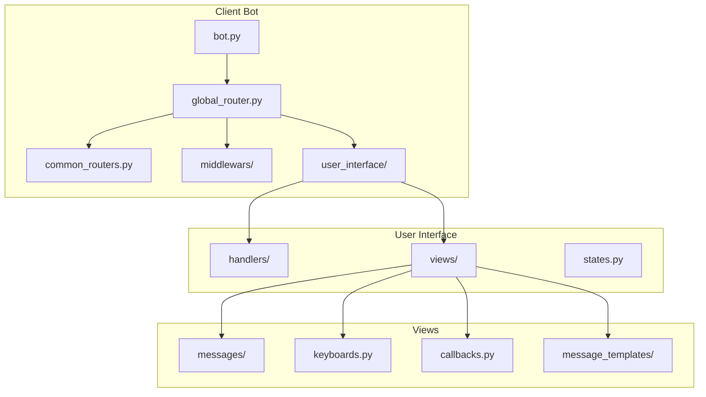
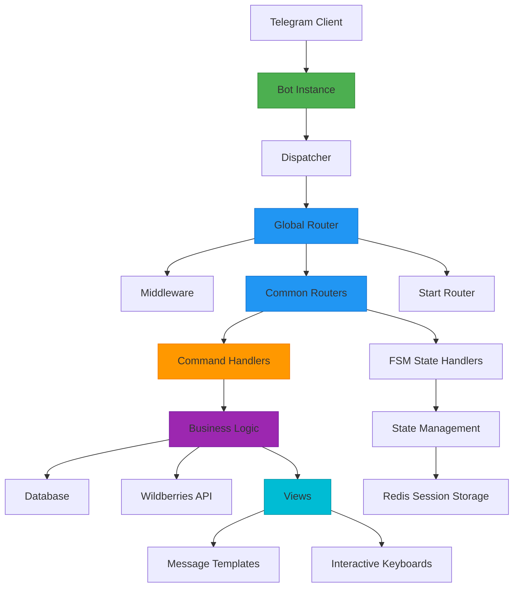
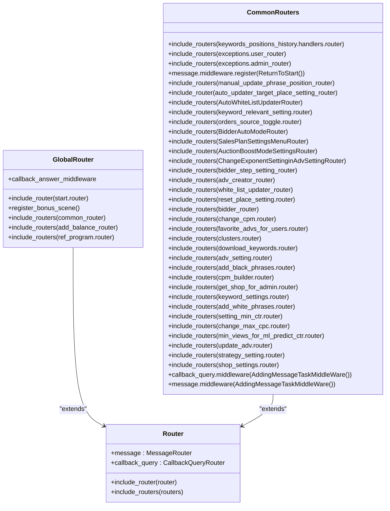
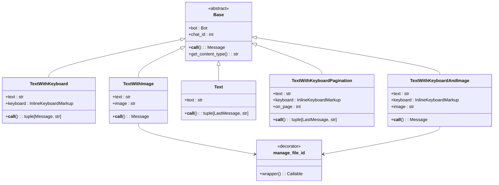
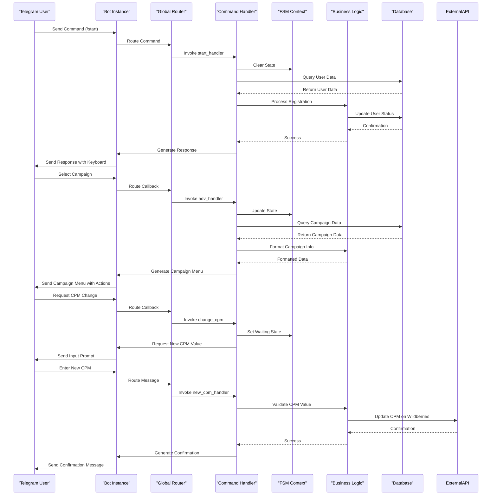
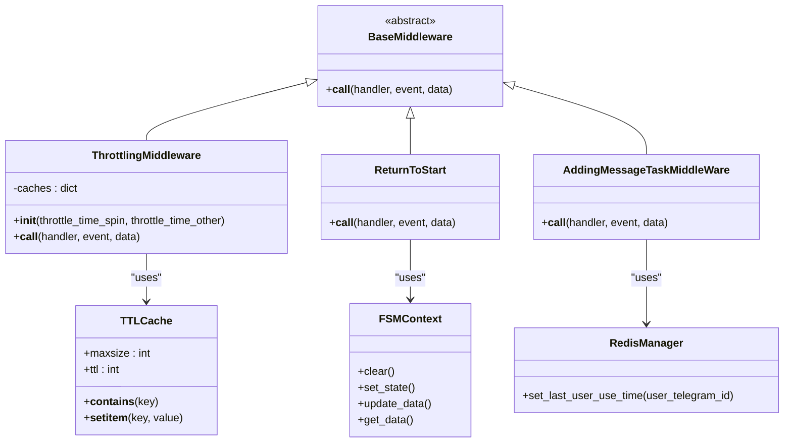
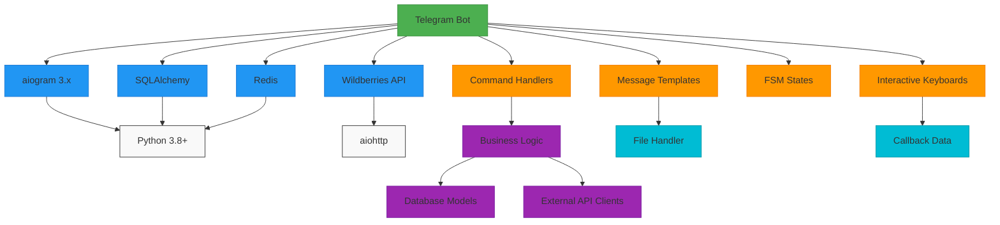

# Telegram Bot Interface

<cite>
**Referenced Files in This Document**   
- [global_router.py](file://app/client_bot/global_router.py)
- [states.py](file://app/client_bot/user_interface/states.py)
- [keyboards.py](file://app/client_bot/user_interface/views/keyboards.py)
- [templates.py](file://app/client_bot/user_interface/message_templates/templates.py)
- [start.py](file://app/client_bot/user_interface/handlers/start/start.py)
- [throtting.py](file://app/client_bot/middlewars/throtting.py)
- [bot.py](file://app/client_bot/bot.py)
- [common_routers.py](file://app/client_bot/common_routers.py)
- [callbacks.py](file://app/client_bot/user_interface/views/callbacks.py)
- [messages.py](file://app/client_bot/user_interface/views/messages/messages.py)
- [adv_setting.py](file://app/client_bot/user_interface/handlers/adv_setting.py)
- [add_white_phrases.py](file://app/client_bot/user_interface/handlers/add_white_phrases.py)
- [change_cpm.py](file://app/client_bot/user_interface/handlers/change_cpm.py)
</cite>

## Table of Contents
1. [Introduction](#introduction)
2. [Project Structure](#project-structure)
3. [Core Components](#core-components)
4. [Architecture Overview](#architecture-overview)
5. [Detailed Component Analysis](#detailed-component-analysis)
6. [Dependency Analysis](#dependency-analysis)
7. [Performance Considerations](#performance-considerations)
8. [Troubleshooting Guide](#troubleshooting-guide)
9. [Conclusion](#conclusion)

## Introduction
The Telegram bot interface implementation is a comprehensive system built on the aiogram 3.x framework for managing Wildberries advertising campaigns. This documentation provides a detailed analysis of the bot's architecture, focusing on its routing system, state management, middleware, and user interaction patterns. The bot enables users to manage advertising settings, configure keyword positions, handle campaign settings, and perform various administrative tasks through a conversational interface. The system is designed to handle complex multi-step interactions while maintaining responsiveness and reliability.

## Project Structure
The Telegram bot interface is organized within the `app/client_bot` directory, following a modular structure that separates concerns and promotes maintainability. The core components are organized into distinct subdirectories: `middlewars` for middleware implementations, `user_interface` for handlers, views, and states, and root-level files for the main bot configuration and routing. This structure enables clear separation between the bot's infrastructure (routing, middleware) and its business logic (handlers, state management).

**Diagram sources**
- [global_router.py](file://app/client_bot/global_router.py)
- [common_routers.py](file://app/client_bot/common_routers.py)
- [states.py](file://app/client_bot/user_interface/states.py)

**Section sources**
- [global_router.py](file://app/client_bot/global_router.py)
- [states.py](file://app/client_bot/user_interface/states.py)

## Core Components
The Telegram bot interface consists of several core components that work together to provide a seamless user experience. The global router serves as the central hub for all incoming requests, directing them to appropriate handlers based on the user's current state and actions. The finite state machine (FSM) implementation manages complex user interactions through defined states, allowing for multi-step processes like campaign setup and settings modification. Message templates provide a consistent interface for user communication, while keyboard generation enables interactive navigation through the bot's features.

**Section sources**
- [global_router.py](file://app/client_bot/global_router.py)
- [states.py](file://app/client_bot/user_interface/states.py)
- [templates.py](file://app/client_bot/user_interface/message_templates/templates.py)
- [keyboards.py](file://app/client_bot/user_interface/views/keyboards.py)

## Architecture Overview
The Telegram bot interface follows a layered architecture built on the aiogram 3.x framework, with a clear separation between routing, business logic, and presentation layers. The architecture is designed to handle high message volumes while maintaining responsiveness through efficient state management and middleware processing. At the core of the system is the global router, which orchestrates the flow of user interactions by including various sub-routers and applying middleware to incoming requests.

**Diagram sources**
- [global_router.py](file://app/client_bot/global_router.py)
- [bot.py](file://app/client_bot/bot.py)
- [common_routers.py](file://app/client_bot/common_routers.py)

## Detailed Component Analysis

### Router and Handler Architecture
The router and handler architecture forms the backbone of the Telegram bot interface, providing a structured way to handle user interactions. The global router serves as the entry point for all incoming requests, incorporating various sub-routers to manage different aspects of the bot's functionality. This hierarchical routing system allows for organized and maintainable code, with clear separation between different types of handlers and their responsibilities.

**Diagram sources**
- [global_router.py](file://app/client_bot/global_router.py)
- [common_routers.py](file://app/client_bot/common_routers.py)

**Section sources**
- [global_router.py](file://app/client_bot/global_router.py)
- [common_routers.py](file://app/client_bot/common_routers.py)

### Finite State Machine Implementation
The finite state machine (FSM) implementation is a critical component of the Telegram bot interface, enabling complex multi-step interactions with users. The FSM is implemented using aiogram's state management system, with each interaction flow defined as a state group containing specific states for different stages of the process. This approach allows the bot to maintain context across multiple messages, guiding users through processes like campaign setup, settings modification, and token registration.

```mermaid
classDiagram
class StatesGroup {
<<abstract>>
}
class GlobalState {
+shop_choice : State
}
class CabinetRegistration {
+cabinet_name : State
+api : State
}
class ChangeMinCTR {
+waiting_for_new_min_ctr : State
}
class AddNewToken {
+token : State
}
class CreateNewAdvCompany {
+waiting_for_name : State
+waiting_for_nmids : State
}
class RefProgram {
+getting_name : State
}
class AdvSetting {
+waiting_for_filter_by_query : State
+waiting_for_filter_keywords : State
}
class ChangeMaxCPC {
+waiting_for_new_max_cpc : State
}
class ChangeMinViewsForPredictCTR {
+waiting_for_new_min_views : State
}
class AddBalance {
+awaiting_confirmation : State
+awaiting_amount : State
}
class AdvCompanyCatalog {
+waiting_for_keywords_for_filter : State
+waiting_for_sort_type : State
}
class AddWhitePhrases {
+waiting_for_white_phrases : State
}
class CPMSetting {
+waiting_for_min_position : State
+waiting_for_max_cpm : State
+waiting_for_manual_cpm : State
+waiting_for_max_position : State
}
class AddBlackPhrasesTemplates {
+waiting_for_black_phrases : State
}
class AddRelevantPhrases {
+waiting_for_relevant_phrases : State
}
class ChangeCPM {
+waiting_for_cpm : State
}
class ShopMenuState {
+shop_menu : State
}
StatesGroup <|-- GlobalState
StatesGroup <|-- CabinetRegistration
StatesGroup <|-- ChangeMinCTR
StatesGroup <|-- AddNewToken
StatesGroup <|-- CreateNewAdvCompany
StatesGroup <|-- RefProgram
StatesGroup <|-- AdvSetting
StatesGroup <|-- ChangeMaxCPC
StatesGroup <|-- ChangeMinViewsForPredictCTR
StatesGroup <|-- AddBalance
StatesGroup <|-- AdvCompanyCatalog
StatesGroup <|-- AddWhitePhrases
StatesGroup <|-- CPMSetting
StatesGroup <|-- AddBlackPhrasesTemplates
StatesGroup <|-- AddRelevantPhrases
StatesGroup <|-- ChangeCPM
StatesGroup <|-- ShopMenuState
```

**Diagram sources**
- [states.py](file://app/client_bot/user_interface/states.py)

**Section sources**
- [states.py](file://app/client_bot/user_interface/states.py)

### Message Handling and Template System
The message handling and template system provides a structured approach to user communication, ensuring consistency and maintainability across the bot's interface. The system is built around message templates that define the content and presentation of messages, with different template types for various use cases such as text-only messages, messages with keyboards, and messages with images. This abstraction layer separates the content from the presentation, making it easier to modify the bot's interface without changing the underlying business logic.

**Diagram sources**
- [templates.py](file://app/client_bot/user_interface/message_templates/templates.py)

**Section sources**
- [templates.py](file://app/client_bot/user_interface/message_templates/templates.py)

### Keyboard Generation System
The keyboard generation system provides interactive navigation through the bot's features, allowing users to make selections and perform actions through inline buttons. The system is implemented in the keyboards.py file, which contains functions for generating various types of keyboards based on the current context and available options. This approach enables dynamic interface generation that adapts to the user's current state and available actions.

```mermaid
flowchart TD
Start([Generate Keyboard]) --> CheckContext["Determine Context<br/>(Campaign Settings, Keywords, etc.)"]
CheckContext --> |Campaign Settings| GenerateAdvSetting["Generate Campaign Settings Keyboard"]
CheckContext --> |Keyword Management| GenerateKeywordSetting["Generate Keyword Management Keyboard"]
CheckContext --> |Campaign List| GenerateAdvsList["Generate Campaign List with Paginator"]
CheckContext --> |Token Management| GenerateTokenManagement["Generate Token Management Options"]
GenerateAdvSetting --> AddButtons["Add Action Buttons"]
AddButtons --> |Auto Update| AddAutoUpdateWhiteList["Add Auto Update White List Button"]
AddButtons --> |Target Position| AddAutoUpdateTargetPlace["Add Auto Update Target Place Button"]
AddButtons --> |Orders Source| AddOrdersSourceToggle["Add Orders Source Toggle Button"]
AddButtons --> |Bot Status| AddBotStatusToggle["Add Bot Status Toggle Button"]
AddButtons --> |CPM Setting| AddCPMSetting["Add CPM Setting Button"]
AddButtons --> |Black Phrases| AddBlackPhrases["Add Black Phrases Templates Button"]
AddButtons --> |White Phrases| AddWhitePhrases["Add White Phrases Button"]
AddButtons --> |Relevant Phrases| AddRelevantPhrases["Add Relevant Phrases Button"]
AddButtons --> |Download CSV| AddDownloadCSV["Add Download CSV Button"]
AddButtons --> |Auction Boost| AddAuctionBoost["Add Auction Boost Mode Button"]
AddButtons --> |Keyword History| AddKeywordHistory["Add Keyword Position History Button"]
AddButtons --> |Min CTR| AddMinCTR["Add Change Min CTR Button"]
AddButtons --> |Max CPC| AddMaxCPC["Add Change Max CPC Button"]
AddButtons --> |Min Views| AddMinViews["Add Change Min Views for Predict CTR Button"]
AddButtons --> |Reset Place| AddResetPlace["Add Reset Place Button"]
AddButtons --> |Clusters| AddClusters["Add Clusters Toggle Button"]
AddButtons --> |Update Stats| AddUpdateStats["Add Update Keyword Stat Button"]
AddButtons --> |Update Minus| AddUpdateMinus["Add Update Minus Keywords Button"]
AddButtons --> |Reset White List| AddResetWhiteList["Add Reset White List Button"]
AddButtons --> |Favorites| AddFavorites["Add Add/Remove from Favorites Button"]
AddButtons --> |Return| AddReturn["Add Return to Campaigns Button"]
GenerateKeywordSetting --> AddKeywordButtons["Add Keyword Action Buttons"]
AddKeywordButtons --> |Status| AddStatusToggle["Add Status Toggle Button"]
AddKeywordButtons --> |Hard Status| AddHardStatus["Add Hard Status Change Button"]
AddKeywordButtons --> |Position| AddPositionCheck["Add Position Check Button"]
AddKeywordButtons --> |Return| AddReturnKeyword["Add Return to Settings Button"]
GenerateAdvsList --> AddListButtons["Add List Navigation Buttons"]
AddListButtons --> |Previous| AddPreviousPage["Add Previous Page Button"]
AddListButtons --> |Next| AddNextPage["Add Next Page Button"]
AddListButtons --> |Filter| AddFilterReset["Add Filter Reset Button"]
AddListButtons --> |Return| AddReturnList["Add Return to Shop Menu Button"]
AddListButtons --> |Update| AddUpdateMetadata["Add Update Metadata Button"]
GenerateTokenManagement --> AddTokenButtons["Add Token Management Buttons"]
AddTokenButtons --> |Add Token| AddAddToken["Add Add New Token Button"]
AddTokenButtons --> |Delete Cabinet| AddDeleteCabinet["Add Delete Cabinet Button"]
AddButtons --> AssembleKeyboard["Assemble Keyboard"]
AddKeywordButtons --> AssembleKeyboard
AddListButtons --> AssembleKeyboard
AddTokenButtons --> AssembleKeyboard
AssembleKeyboard --> ReturnKeyboard["Return Keyboard Markup"]
style Start fill:#4CAF50,stroke:#388E3C
style ReturnKeyboard fill:#4CAF50,stroke:#388E3C
style CheckContext fill:#2196F3,stroke:#1976D2
style GenerateAdvSetting fill:#FF9800,stroke:#F57C00
style GenerateKeywordSetting fill:#FF9800,stroke:#F57C00
style GenerateAdvsList fill:#FF9800,stroke:#F57C00
style GenerateTokenManagement fill:#FF9800,stroke:#F57C00
style AddButtons fill:#00BCD4,stroke:#0097A7
style AddKeywordButtons fill:#00BCD4,stroke:#0097A7
style AddListButtons fill:#00BCD4,stroke:#0097A7
style AddTokenButtons fill:#00BCD4,stroke:#0097A7
style AssembleKeyboard fill:#9C27B0,stroke:#7B1FA2
```

**Diagram sources**
- [keyboards.py](file://app/client_bot/user_interface/views/keyboards.py)

**Section sources**
- [keyboards.py](file://app/client_bot/user_interface/views/keyboards.py)

### Command Handler Integration
The command handler integration demonstrates how specific commands are connected to business logic through a structured routing system. Each command handler is responsible for a specific functionality, such as starting the bot, managing campaign settings, or handling user registration. The handlers are organized in separate files within the handlers directory, with each file focusing on a particular aspect of the bot's functionality.

**Diagram sources**
- [start.py](file://app/client_bot/user_interface/handlers/start/start.py)
- [adv_setting.py](file://app/client_bot/user_interface/handlers/adv_setting.py)
- [change_cpm.py](file://app/client_bot/user_interface/handlers/change_cpm.py)

**Section sources**
- [start.py](file://app/client_bot/user_interface/handlers/start/start.py)
- [adv_setting.py](file://app/client_bot/user_interface/handlers/adv_setting.py)
- [change_cpm.py](file://app/client_bot/user_interface/handlers/change_cpm.py)

### Middleware Implementation
The middleware implementation provides essential functionality for request processing, rate limiting, and user session management. The bot uses several middleware components to enhance its functionality and reliability. The throttling middleware prevents users from sending too many requests in a short period, while the return-to-start middleware handles the /start command from any state, ensuring users can always reset their interaction with the bot.

**Diagram sources**
- [throtting.py](file://app/client_bot/middlewars/throtting.py)
- [return_to_start_from_state.py](file://app/client_bot/middlewars/return_to_start_from_state.py)
- [middleware_for_adding_task.py](file://app/modules/user_message_sender/middleware_for_adding_task.py)

**Section sources**
- [throtting.py](file://app/client_bot/middlewars/throtting.py)
- [return_to_start_from_state.py](file://app/client_bot/middlewars/return_to_start_from_state.py)

## Dependency Analysis
The Telegram bot interface has a well-defined dependency structure that ensures modularity and maintainability. The core dependencies include the aiogram framework for Telegram integration, SQLAlchemy for database operations, and Redis for session storage and caching. The bot also depends on external APIs, particularly the Wildberries API, for retrieving and updating advertising data. These dependencies are managed through a combination of direct imports and dependency injection, with clear separation between the bot's core functionality and external services.

**Diagram sources**
- [bot.py](file://app/client_bot/bot.py)
- [requirements.txt](file://requirements.txt)

**Section sources**
- [bot.py](file://app/client_bot/bot.py)
- [requirements.txt](file://requirements.txt)

## Performance Considerations
The Telegram bot interface is designed with performance considerations in mind, particularly for handling high message volumes and maintaining responsiveness. The system uses Redis for session storage and caching, which provides fast access to user data and reduces database load. The throttling middleware helps prevent abuse and ensures fair resource usage among users. For operations that may take longer to complete, such as updating campaign data from Wildberries, the bot provides immediate feedback to the user and performs the operation asynchronously to maintain responsiveness.

**Section sources**
- [throtting.py](file://app/client_bot/middlewars/throtting.py)
- [redis_manager.py](file://app/client_bot/redis_manager.py)
- [message_manager.py](file://app/client_bot/message_manager.py)

## Troubleshooting Guide
The troubleshooting guide addresses common issues that may arise when using the Telegram bot interface. Error handling is implemented at multiple levels, from input validation to exception handling in business logic. The bot provides clear error messages to users when issues occur, such as invalid input or API errors. For more complex issues, the system logs detailed information to help diagnose and resolve problems. The guide also covers common user errors, such as providing invalid API tokens or attempting to perform actions without sufficient permissions.

**Section sources**
- [exceptions.py](file://app/client_bot/user_interface/handlers/exceptions.py)
- [error_handler.py](file://app/user_backend_errors_handler/error_handler.py)
- [messages.py](file://app/client_bot/user_interface/views/messages/messages.py)

## Conclusion
The Telegram bot interface implementation provides a comprehensive solution for managing Wildberries advertising campaigns through a conversational interface. The system is built on the aiogram 3.x framework, leveraging its routing, state management, and middleware capabilities to create a robust and user-friendly experience. The architecture is well-structured, with clear separation between concerns and modular components that can be extended or modified as needed. The bot supports complex interactions through its finite state machine implementation, while maintaining performance and reliability through efficient session management and error handling. This documentation provides a detailed overview of the system's components and their interactions, serving as a valuable resource for understanding and extending the bot's functionality.