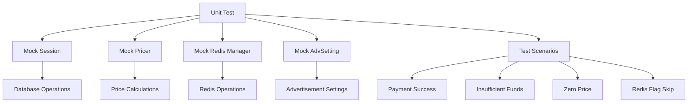
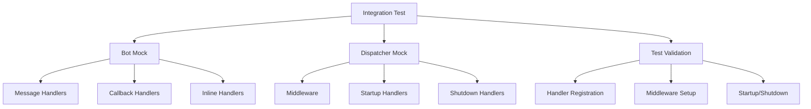
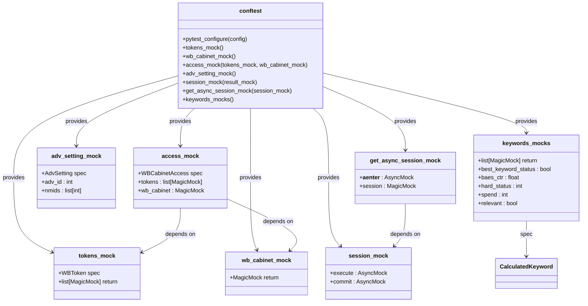
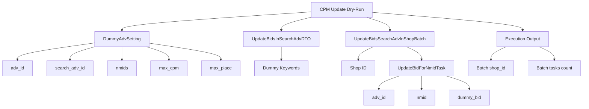
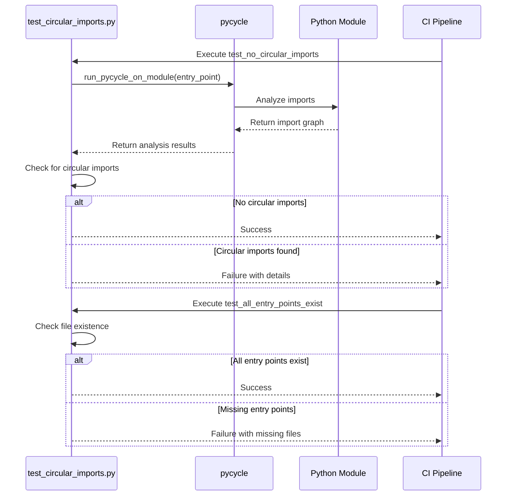
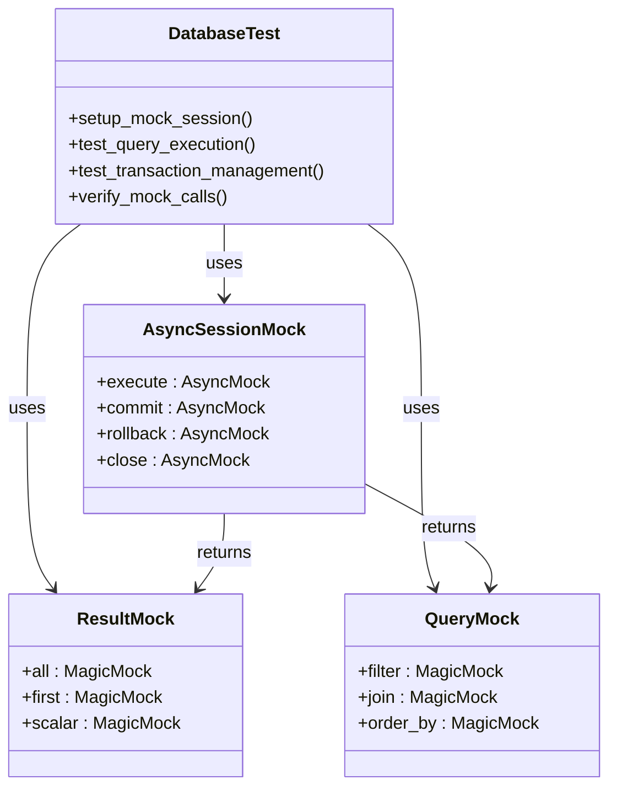
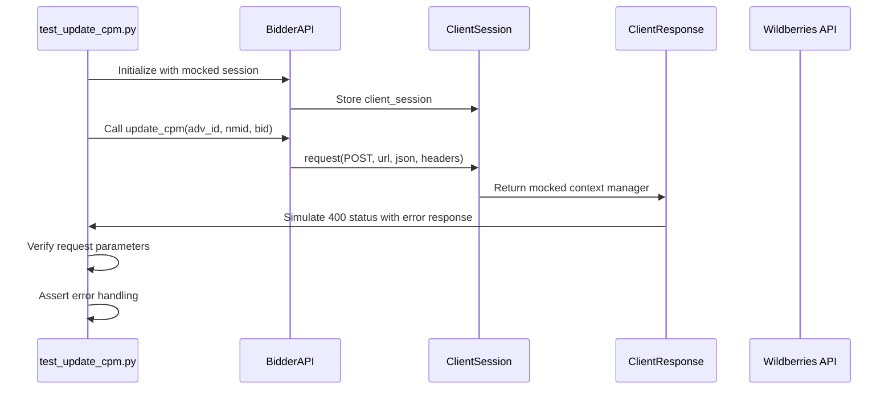
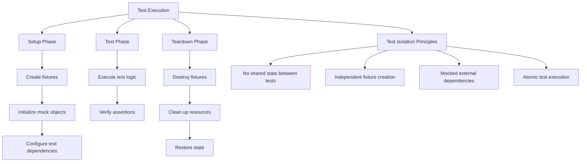
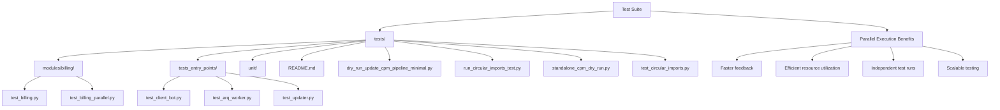
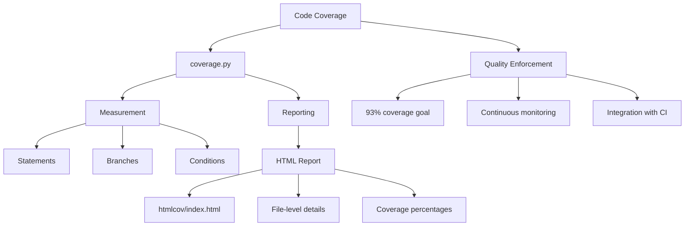

# Testing Strategy

<cite>
**Referenced Files in This Document**   
- [conftest.py](file://conftest.py)
- [test_billing.py](file://tests/modules/billing/test_billing.py)
- [test_client_bot.py](file://tests/tests_entry_points/test_client_bot.py)
- [test_circular_imports.py](file://tests/test_circular_imports.py)
- [dry_run_update_cpm_pipeline_minimal.py](file://tests/dry_run_update_cpm_pipeline_minimal.py)
- [standalone_cpm_dry_run.py](file://tests/standalone_cpm_dry_run.py)
- [pytest.ini](file://pytest.ini)
- [htmlcov/index.html](file://htmlcov/index.html)
- [app/modules/shop_runner/bidder/test_update_cpm.py](file://app/modules/shop_runner/bidder/test_update_cpm.py)
- [app/modules/shop_runner/service_manager/old_modules/auto_updater_target_place/test_auto_updater_target_place.py](file://app/modules/shop_runner/service_manager/old_modules/auto_updater_target_place/test_auto_updater_target_place.py)
</cite>

## Table of Contents
1. [Introduction](#introduction)
2. [Test Pyramid Implementation](#test-pyramid-implementation)
3. [Pytest Fixtures and Test Dependencies](#pytest-fixtures-and-test-dependencies)
4. [Specialized Testing Approaches](#specialized-testing-approaches)
5. [Testing Async Code and External Integrations](#testing-async-code-and-external-integrations)
6. [Test Data Management and Isolation](#test-data-management-and-isolation)
7. [Parallel Execution and Performance](#parallel-execution-and-performance)
8. [Code Coverage and Quality Enforcement](#code-coverage-and-quality-enforcement)
9. [Best Practices for Test Development](#best-practices-for-test-development)
10. [Conclusion](#conclusion)

## Introduction
The testing strategy for the adv-bot project follows a comprehensive approach to ensure code quality, reliability, and maintainability. The test suite is structured according to the test pyramid principle, with a strong emphasis on unit tests, integration tests, and end-to-end scenarios. The project leverages pytest as the primary testing framework, with extensive use of fixtures for dependency management and mocking. Specialized testing approaches include dry-run simulations for CPM updates and automated detection of circular imports. The test infrastructure supports asynchronous code testing, database interactions, and external API integrations through comprehensive mocking strategies.

**Section sources**
- [pytest.ini](file://pytest.ini#L1-L13)
- [conftest.py](file://conftest.py#L1-L121)

## Test Pyramid Implementation

The project implements a well-defined test pyramid with three distinct layers: unit tests, integration tests, and end-to-end tests. This approach ensures comprehensive coverage while maintaining test efficiency and reliability.

### Unit Tests in test_billing.py
The unit tests in `test_billing.py` focus on isolated components of the billing system, specifically the daily charge logic for cabinets. These tests use mocking to isolate the billing functionality from external dependencies such as database sessions, pricing services, and Redis managers. The tests validate various scenarios including successful payments, insufficient funds, zero pricing, and Redis flag handling.



**Diagram sources**
- [tests/modules/billing/test_billing.py](file://tests/modules/billing/test_billing.py#L1-L176)

### Integration Tests in test_client_bot.py
The integration tests in `test_client_bot.py` verify the proper setup and configuration of the client bot system. These tests focus on ensuring that all handlers, middleware, and startup/shutdown procedures are correctly registered and functional. The tests use mocking to verify the interactions between the bot framework components without requiring actual Telegram API connectivity.



**Diagram sources**
- [tests/tests_entry_points/test_client_bot.py](file://tests/tests_entry_points/test_client_bot.py#L1-L118)

### End-to-End Testing Strategy
The project's end-to-end testing strategy focuses on validating complete workflows and system integrations. While specific end-to-end test files are not explicitly mentioned in the provided context, the test infrastructure supports comprehensive scenario testing through the combination of unit and integration tests that collectively validate end-to-end functionality.

**Section sources**
- [tests/modules/billing/test_billing.py](file://tests/modules/billing/test_billing.py#L1-L176)
- [tests/tests_entry_points/test_client_bot.py](file://tests/tests_entry_points/test_client_bot.py#L1-L118)

## Pytest Fixtures and Test Dependencies

The project extensively uses pytest fixtures in `conftest.py` to manage test dependencies and provide consistent test environments across the test suite. These fixtures enable code reuse, simplify test setup, and ensure test isolation.

### Core Fixtures in conftest.py
The `conftest.py` file defines several key fixtures that are used throughout the test suite:



**Diagram sources**
- [conftest.py](file://conftest.py#L1-L121)

### Fixture Usage Patterns
The fixtures follow established patterns for test dependency management:

1. **Mock Objects**: Fixtures create MagicMock instances with specific specifications to ensure type safety and proper behavior.
2. **Dependency Injection**: Complex fixtures like `access_mock` depend on simpler fixtures, enabling hierarchical dependency management.
3. **Async Support**: The test suite properly handles asynchronous operations with AsyncMock instances for coroutine methods.
4. **Configuration**: The `pytest_configure` function sets up test markers and configuration options.

**Section sources**
- [conftest.py](file://conftest.py#L1-L121)
- [pytest.ini](file://pytest.ini#L1-L13)

## Specialized Testing Approaches

The project employs several specialized testing approaches to address specific quality assurance requirements and complex system behaviors.

### Dry-Run Simulations for CPM Updates
The project includes dry-run simulation capabilities for CPM (Cost Per Mille) updates, allowing developers to test bidding logic without affecting production systems. The `dry_run_update_cpm_pipeline_minimal.py` and `standalone_cpm_dry_run.py` scripts provide isolated environments for testing CPM update pipelines.



**Diagram sources**
- [tests/dry_run_update_cpm_pipeline_minimal.py](file://tests/dry_run_update_cpm_pipeline_minimal.py#L1-L41)

### Circular Import Detection
The project implements automated detection of circular imports to maintain code quality and prevent potential runtime issues. The `test_circular_imports.py` file contains tests that use the `pycycle` tool to analyze import dependencies and identify circular references.



**Diagram sources**
- [tests/test_circular_imports.py](file://tests/test_circular_imports.py#L1-L121)

**Section sources**
- [tests/dry_run_update_cpm_pipeline_minimal.py](file://tests/dry_run_update_cpm_pipeline_minimal.py#L1-L41)
- [tests/test_circular_imports.py](file://tests/test_circular_imports.py#L1-L121)

## Testing Async Code and External Integrations

The project's testing strategy includes comprehensive approaches for testing asynchronous code and external API integrations, which are critical components of the system.

### Testing Async Code
The test suite is configured to handle asynchronous code through the pytest-asyncio plugin, as indicated by the `asyncio_mode = auto` setting in `pytest.ini`. Tests use the `@pytest.mark.asyncio` decorator to mark asynchronous test functions, and employ AsyncMock for mocking coroutine methods.

```mermaid
flowchart TD
A[Async Test] --> B[@pytest.mark.asyncio]
A --> C[AsyncMock]
A --> D[await]
B --> E[pytest-asyncio]
C --> F[Coroutine Methods]
C --> G[Async Context Managers]
D --> H[Async Operations]
I[Async Test Patterns] --> J[Mock async database operations]
I --> K[Mock async HTTP requests]
I --> L[Test async startup/shutdown handlers]
A --> I
```

**Diagram sources**
- [pytest.ini](file://pytest.ini#L1-L13)
- [tests/modules/billing/test_billing.py](file://tests/modules/billing/test_billing.py#L1-L176)

### Testing Database Interactions
Database interactions are tested using mocked session objects that simulate the behavior of SQLAlchemy's AsyncSession. The `session_mock` and `get_async_session_mock` fixtures provide controlled environments for testing database operations without requiring actual database connectivity.



**Diagram sources**
- [conftest.py](file://conftest.py#L1-L121)
- [tests/modules/billing/test_billing.py](file://tests/modules/billing/test_billing.py#L1-L176)

### Testing External API Integrations
External API integrations, particularly with the Wildberries advertising API, are tested using comprehensive mocking strategies. The `test_update_cpm.py` file demonstrates how HTTP requests to external services are mocked to validate request construction and error handling.



**Diagram sources**
- [app/modules/shop_runner/bidder/test_update_cpm.py](file://app/modules/shop_runner/bidder/test_update_cpm.py#L1-L89)

**Section sources**
- [pytest.ini](file://pytest.ini#L1-L13)
- [tests/modules/billing/test_billing.py](file://tests/modules/billing/test_billing.py#L1-L176)
- [app/modules/shop_runner/bidder/test_update_cpm.py](file://app/modules/shop_runner/bidder/test_update_cpm.py#L1-L89)

## Test Data Management and Isolation

The project implements robust test data management practices to ensure test isolation and reliability.

### Test Data Isolation
Each test operates in an isolated environment with mocked dependencies, preventing interference between tests. The fixture system ensures that test data is created and destroyed appropriately for each test case.



**Diagram sources**
- [conftest.py](file://conftest.py#L1-L121)
- [tests/modules/billing/test_billing.py](file://tests/modules/billing/test_billing.py#L1-L176)

### Test Data Generation
The project uses fixture functions to generate consistent test data for various entities such as tokens, cabinet access, advertisement settings, and keywords. This approach ensures that test data is reproducible and maintainable.

**Section sources**
- [conftest.py](file://conftest.py#L1-L121)
- [tests/modules/billing/test_billing.py](file://tests/modules/billing/test_billing.py#L1-L176)

## Parallel Execution and Performance

The testing infrastructure supports parallel execution considerations to optimize test suite performance.

### Test Organization for Parallel Execution
The test suite is organized in a way that facilitates parallel execution, with independent test files and minimal shared state. The directory structure separates different types of tests (unit, integration, entry points) to enable selective execution.



**Diagram sources**
- [tests/](file://tests/#L1-L100)

**Section sources**
- [tests/](file://tests/#L1-L100)
- [pytest.ini](file://pytest.ini#L1-L13)

## Code Coverage and Quality Enforcement

The project enforces code quality through comprehensive code coverage metrics and reporting.

### Coverage Goals and Reporting
The project uses coverage.py to measure code coverage, with reports generated in the `htmlcov/` directory. The coverage report indicates a 93% coverage rate, demonstrating a strong commitment to comprehensive testing.



**Diagram sources**
- [htmlcov/index.html](file://htmlcov/index.html#L1-L161)

### CI Integration
The test suite is designed to integrate with continuous integration systems, with specific markers and configuration options to support automated testing workflows.

**Section sources**
- [htmlcov/index.html](file://htmlcov/index.html#L1-L161)
- [pytest.ini](file://pytest.ini#L1-L13)

## Best Practices for Test Development

The project follows several best practices for test development to ensure high-quality, maintainable tests.

### Test Organization
Tests are organized by module and functionality, with clear separation between unit, integration, and specialized tests. This organization makes it easy to locate and understand tests for specific components.

### Mocking Strategy
The project uses a consistent mocking strategy with MagicMock and AsyncMock to isolate components under test. The fixture system provides reusable mock objects that ensure consistency across tests.

### Assertion Patterns
Tests use clear, descriptive assertions that verify the expected behavior of the system under test. The use of multiple assertion points in some tests ensures comprehensive validation of complex scenarios.

### Documentation and Maintenance
The test suite includes documentation in the form of README files and docstrings, making it easier for developers to understand and maintain the tests over time.

**Section sources**
- [conftest.py](file://conftest.py#L1-L121)
- [tests/README.md](file://tests/README.md#L1-L65)
- [tests/modules/billing/test_billing.py](file://tests/modules/billing/test_billing.py#L1-L176)

## Conclusion
The testing strategy for the adv-bot project demonstrates a comprehensive approach to quality assurance, with a well-structured test pyramid, extensive use of pytest fixtures, and specialized testing approaches for complex scenarios. The project effectively tests asynchronous code, database interactions, and external API integrations through comprehensive mocking strategies. Test data management and isolation practices ensure reliable test execution, while code coverage metrics and CI integration enforce quality standards. The documented best practices provide guidance for maintaining and extending the test suite over time, ensuring the continued reliability and maintainability of the system.