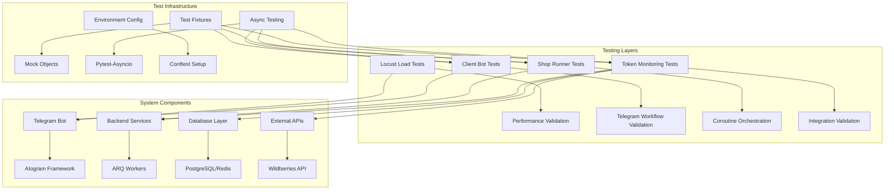
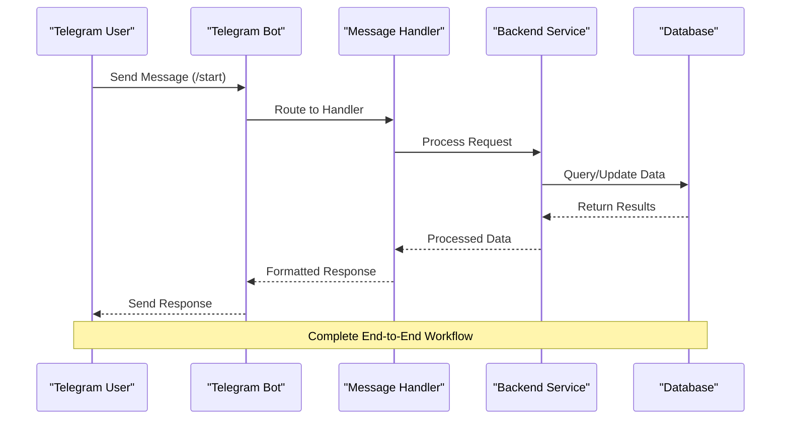
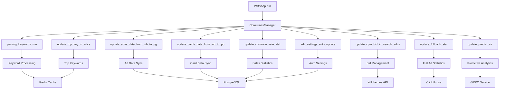
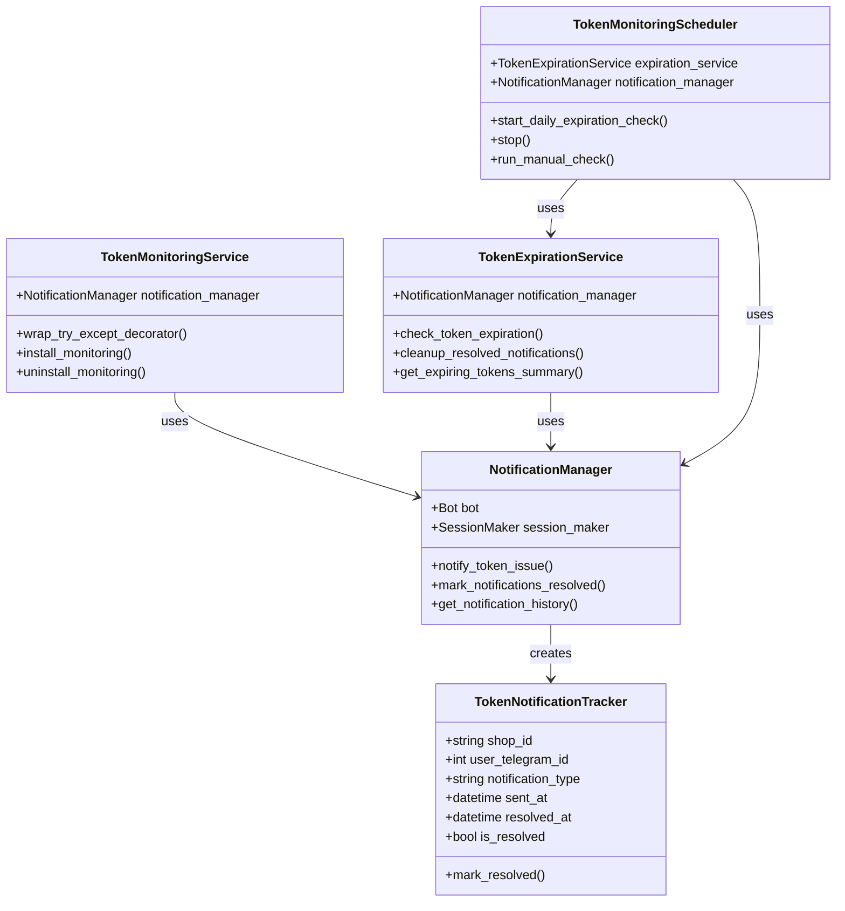
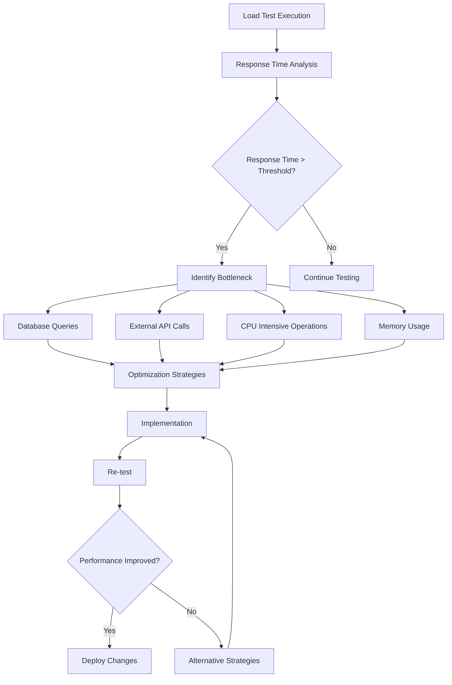

# End-to-End Testing

<cite>
**Referenced Files in This Document**
- [locustfile.py](file://locustfile.py)
- [tests/tests_entry_points/test_client_bot.py](file://tests/tests_entry_points/test_client_bot.py)
- [tests/tests_entry_points/test_wb_shop_run_coroutines.py](file://tests/tests_entry_points/test_wb_shop_run_coroutines.py)
- [tests/token_monitoring/test_integration.py](file://tests/token_monitoring/test_integration.py)
- [tests/token_monitoring/test_startup.py](file://tests/token_monitoring/test_startup.py)
- [tests/token_monitoring/test_token_monitoring_service.py](file://tests/token_monitoring/test_token_monitoring_service.py)
- [tests/token_monitoring/test_notification_manager.py](file://tests/token_monitoring/test_notification_manager.py)
- [tests/token_monitoring/test_token_expiration_service.py](file://tests/token_monitoring/test_token_expiration_service.py)
- [tests/token_monitoring/test_scheduler.py](file://tests/token_monitoring/test_scheduler.py)
- [tests/token_monitoring/test_models.py](file://tests/token_monitoring/test_models.py)
- [tests/conftest_token_tests.py](file://tests/conftest_token_tests.py)
</cite>

## Table of Contents
1. [Introduction](#introduction)
2. [Testing Architecture Overview](#testing-architecture-overview)
3. [Locust Performance Testing](#locust-performance-testing)
4. [Client Bot End-to-End Tests](#client-bot-end-to-end-tests)
5. [Shop Runner Coroutine Testing](#shop-runner-coroutine-testing)
6. [Token Monitoring System Testing](#token-monitoring-system-testing)
7. [Integration Test Patterns](#integration-test-patterns)
8. [Test Data Management](#test-data-management)
9. [Asynchronous Testing Strategies](#asynchronous-testing-strategies)
10. [Test Environment Configuration](#test-environment-configuration)
11. [Performance Analysis and Results](#performance-analysis-and-results)
12. [Troubleshooting and Best Practices](#troubleshooting-and-best-practices)

## Introduction

The adv-bot project implements a comprehensive end-to-end testing framework designed to validate complete user workflows from Telegram bot interactions through backend processing to database updates and external API calls. This documentation covers the testing strategies, patterns, and tools used to ensure reliable operation of the distributed system with multiple asynchronous components and external dependencies.

The testing framework encompasses performance/load testing using Locust, end-to-end validation of Telegram bot workflows, coroutine orchestration testing, and comprehensive integration testing of the token monitoring system. These tests validate the seamless integration of multiple system components including the Telegram interface, business logic, database operations, and external Wildberries API interactions.

## Testing Architecture Overview

The end-to-end testing framework follows a layered approach that validates different aspects of the system:



**Diagram sources**
- [locustfile.py](file://locustfile.py#L1-L37)
- [tests/tests_entry_points/test_client_bot.py](file://tests/tests_entry_points/test_client_bot.py#L1-L118)
- [tests/tests_entry_points/test_wb_shop_run_coroutines.py](file://tests/tests_entry_points/test_wb_shop_run_coroutines.py#L1-L130)

The testing architecture ensures comprehensive coverage across all system layers, from individual component testing to complete system integration validation.

## Locust Performance Testing

The project utilizes Locust for performance and load testing of the system under realistic conditions. The `locustfile.py` provides a foundation for simulating real-world usage patterns.

```python
# Example Locust test scenario
class TelegramBotUser(HttpUser):
    host = "https://tiriel.ru"
    wait_time = between(1, 5)  # Users send requests every 1-5 seconds

    @task
    def send_message(self):
        headers = {"X-Telegram-Bot-Api-Secret-Token": "89779uoiugkftyeoilyeligoyuv"}
        self.client.post(
            "/telegram_webhook",
            json={
                "update_id": 123456789,
                "message": {
                    "message_id": 123,
                    "from": {
                        "id": 373435337,
                        "is_bot": False,
                        "first_name": "Test",
                        "username": "testuser",
                    },
                    "chat": {
                        "id": 373435337,
                        "first_name": "Test",
                        "username": "testuser",
                        "type": "private",
                    },
                    "date": 1441645532,
                    "text": "/start",
                },
            },
            headers=headers,
        )
```

### Performance Testing Implementation

The Locust implementation focuses on simulating realistic Telegram bot interactions:

- **Realistic Request Patterns**: Uses actual webhook payload structures
- **Authentication Simulation**: Includes proper header authentication
- **Variable Timing**: Implements random wait times between requests
- **Scalable Load**: Supports multiple concurrent users

### Performance Metrics and Analysis

Key performance indicators monitored during testing:

- **Response Times**: Average and percentile response times for bot commands
- **Throughput**: Requests per second handled by the system
- **Error Rates**: Percentage of failed requests and error types
- **Resource Utilization**: CPU, memory, and database connection usage
- **Concurrency Limits**: Maximum concurrent users supported

**Section sources**
- [locustfile.py](file://locustfile.py#L1-L37)

## Client Bot End-to-End Tests

The client bot testing framework validates complete Telegram bot workflows from user interaction through backend processing. The tests ensure proper registration of handlers, middleware setup, and startup/shutdown procedures.

### Handler Registration Validation

```python
@pytest.mark.asyncio
async def test_client_bot_setup_registers_all_handlers():
    """
    Test verifies that setup_bot registers all necessary handlers
    """
    # Create mocks for bot and dispatcher
    bot_mock = MagicMock(spec=Bot)
    dp_mock = MagicMock(spec=Dispatcher)

    # Mock handler registration
    dp_mock.message.register = MagicMock()
    dp_mock.callback_query.register = MagicMock()
    dp_mock.inline_query.register = MagicMock()

    # Call tested function
    setup_bot(bot_mock, dp_mock)

    # Verify registration counts
    assert dp_mock.message.register.call_count >= 1
    assert dp_mock.callback_query.register.call_count >= 1
```

### Middleware and Startup Testing

The framework includes comprehensive testing for middleware configuration and startup procedures:

- **Middleware Registration**: Validates all middleware components are properly registered
- **Startup Handlers**: Ensures all startup and shutdown handlers are configured
- **Handler Execution**: Tests that handlers execute without exceptions
- **Error Handling**: Verifies graceful error handling in startup procedures

### Telegram Bot Workflow Validation

The client bot tests validate complete user workflows:



**Diagram sources**
- [tests/tests_entry_points/test_client_bot.py](file://tests/tests_entry_points/test_client_bot.py#L15-L50)

**Section sources**
- [tests/tests_entry_points/test_client_bot.py](file://tests/tests_entry_points/test_client_bot.py#L1-L118)

## Shop Runner Coroutine Testing

The shop runner coroutine testing framework validates the orchestration of multiple asynchronous operations that run concurrently for each shop. This includes keyword parsing, ad updates, statistics collection, and predictive analytics.

### Coroutine Orchestration Testing

```python
@pytest.mark.asyncio
async def test_wb_shop_all_coroutines_launched():
    """Test that WBShop.run() launches all expected coroutines."""
    
    # Mock dependencies
    wb_api_mock = Mock(spec=WBApi)
    redis_manager_mock = Mock(spec=RedisShopManager)
    
    wb_shop = WBShop(wb_api_mock, redis_manager_mock)

    # Define expected coroutines
    expected_coroutines = {
        "parsing_keywords_run": AsyncMock(),
        "update_advs_data_from_wb_to_pg": AsyncMock(),
        "update_cards_data_from_wb_to_pg": AsyncMock(),
        "update_cpm_bid_in_search_advs": AsyncMock(),
        "update_common_sale_stat": AsyncMock(),
        "update_full_adv_stat": AsyncMock(),
        "adv_settings_auto_update": AsyncMock(),
        "update_top_key_in_advs": AsyncMock(),
        "update_predict_ctr": AsyncMock(),
    }
```

### Core Coroutine Detection

The testing framework includes mechanisms to detect commented-out coroutines:

```python
@pytest.mark.asyncio
async def test_wb_shop_commented_coroutines_detection():
    """Test that detects if important coroutines are commented out."""
    
    # Core coroutines that should ALWAYS be running
    core_coroutines = {
        "parsing_keywords_run": AsyncMock(),
        "update_advs_data_from_wb_to_pg": AsyncMock(),
        "update_cpm_bid_in_search_advs": AsyncMock(),
    }

    # Verify all CORE coroutines are running
    missing_core_coroutines = []
    for method_name, mock_method in core_coroutines.items():
        try:
            mock_method.assert_called_once()
        except AssertionError:
            missing_core_coroutines.append(method_name)

    if missing_core_coroutines:
        pytest.fail(f"CRITICAL: Core coroutines are not running: {missing_core_coroutines}")
```

### Coroutine Testing Architecture



**Diagram sources**
- [tests/tests_entry_points/test_wb_shop_run_coroutines.py](file://tests/tests_entry_points/test_wb_shop_run_coroutines.py#L15-L60)

**Section sources**
- [tests/tests_entry_points/test_wb_shop_run_coroutines.py](file://tests/tests_entry_points/test_wb_shop_run_coroutines.py#L1-L130)

## Token Monitoring System Testing

The token monitoring system represents one of the most complex end-to-end testing scenarios, involving multiple interconnected services that monitor Wildberries API tokens for deactivation and expiration.

### Comprehensive Integration Testing

The integration tests validate the complete token monitoring workflow:

```python
@pytest.mark.asyncio
async def test_token_deactivation_end_to_end_workflow(self, mock_session_maker, mock_bot):
    """Test complete token deactivation detection and notification workflow."""
    session_maker, session = mock_session_maker
    
    # Create integrated components
    notification_manager = NotificationManager(bot=mock_bot, session_maker=session_maker)
    
    # Mock user data
    user = MagicMock(spec=User)
    user.user_telegram_id = 123456789
    
    user_cabinet = MagicMock(spec=WBUserCabinet)
    user_cabinet.name = "Test Shop"
    user_cabinet.user = user
    
    # Mock _get_shop_users to return our test user
    notification_manager._get_shop_users = AsyncMock(return_value=[user_cabinet])
    
    # Simulate token deactivation event
    shop_id = "test_shop_123"
    
    # This would normally be triggered by the HTTP decorator
    await notification_manager.notify_token_issue(
        shop_id=shop_id,
        notification_type=NotificationType.TOKEN_DEACTIVATED.value,
        context={"method_name": "get_advs", "error": "All tokens failed"}
    )
    
    # Verify notification was sent
    mock_bot.send_message.assert_called_once()
    args, kwargs = mock_bot.send_message.call_args
    
    assert args[0] == 123456789  # user_telegram_id
    assert "деактивирован" in args[1].lower()
    assert "Test Shop" in args[1]
```

### Multi-Stage Expiration Testing

The system includes sophisticated testing for different token expiration stages:

```python
@pytest.mark.asyncio
async def test_token_expiration_monitoring_workflow(self, mock_session_maker, mock_bot):
    """Test complete token expiration monitoring workflow."""
    session_maker, session = mock_session_maker
    
    # Create integrated components
    notification_manager = NotificationManager(bot=mock_bot, session_maker=session_maker)
    expiration_service = TokenExpirationService(
        notification_manager=notification_manager,
        session_maker=session_maker
    )
    
    # Mock token expiring in 14 days
    expiring_token = MagicMock(spec=WBToken)
    expiring_token.id = 1
    expiring_token.shop_id = "test_shop_123"
    expiring_token.expires = datetime.datetime.now() + datetime.timedelta(days=14)
    expiring_token.categories = {"Контент", "Статистика"}
    expiring_token.read_only = False
    expiring_token.check_valid.return_value = True
    
    # Run expiration check
    stats = await expiration_service.check_token_expiration()
    
    # Verify results
    assert stats["total_tokens_checked"] == 1
    assert stats["expiring_tokens_found"] == 1
    assert stats["notifications_sent"] == 1
    assert stats["warnings_by_stage"][14] == 1
```

### Token Monitoring Architecture



**Diagram sources**
- [tests/token_monitoring/test_integration.py](file://tests/token_monitoring/test_integration.py#L25-L70)
- [tests/token_monitoring/test_notification_manager.py](file://tests/token_monitoring/test_notification_manager.py#L25-L60)
- [tests/token_monitoring/test_token_expiration_service.py](file://tests/token_monitoring/test_token_expiration_service.py#L25-L60)

**Section sources**
- [tests/token_monitoring/test_integration.py](file://tests/token_monitoring/test_integration.py#L1-L395)
- [tests/token_monitoring/test_notification_manager.py](file://tests/token_monitoring/test_notification_manager.py#L1-L338)
- [tests/token_monitoring/test_token_expiration_service.py](file://tests/token_monitoring/test_token_expiration_service.py#L1-L359)

## Integration Test Patterns

The project employs several sophisticated integration test patterns that validate complex workflows across multiple system components.

### Decorator Enhancement Testing

The token monitoring system includes advanced decorator enhancement testing:

```python
@pytest.mark.asyncio
async def test_enhanced_decorator_token_deactivation_detection(self, monitoring_service):
    """Test that enhanced decorator detects token deactivation."""
    # Mock a function that raises ApiForbiddenError
    def failing_function():
        raise ApiForbiddenError("Token is invalid")
    
    # Mock original decorator that catches and re-raises the error
    def original_decorator(func):
        def wrapper(*args, **kwargs):
            try:
                return func(*args, **kwargs)
            except Exception as e:
                # Simulate original decorator behavior
                raise e
        return wrapper
    
    # Create enhanced decorator
    enhanced_decorator = monitoring_service.wrap_try_except_decorator(original_decorator)
    wrapped_function = enhanced_decorator(failing_function)
    
    # Test that it detects token issues
    with pytest.raises(ApiForbiddenError):
        wrapped_function()
    
    # The notification should be triggered in the enhanced decorator
```

### Startup and Shutdown Testing

Comprehensive testing of system lifecycle management:

```python
@pytest.mark.asyncio
async def test_complete_system_initialization(self):
    """Test complete system initialization and shutdown."""
    with patch('app.modules.token_monitoring.integration.install_token_monitoring') as mock_install:
        with patch('app.modules.token_monitoring.scheduler.start_token_monitoring_scheduler') as mock_scheduler:
            # Test initialization
            await initialize_token_monitoring(
                enable_decorator_monitoring=True,
                enable_expiration_scheduler=True
            )
            
            # Verify components were initialized
            mock_install.assert_called_once()
            mock_scheduler.assert_called_once()
    
    with patch('app.modules.token_monitoring.scheduler.stop_token_monitoring_scheduler') as mock_stop_scheduler:
        with patch('app.modules.token_monitoring.integration.uninstall_token_monitoring') as mock_uninstall:
            # Test shutdown
            await shutdown_token_monitoring()
            
            # Verify components were shut down
            mock_stop_scheduler.assert_called_once()
            mock_uninstall.assert_called_once()
```

### Error Handling and Resilience Testing

The integration tests include extensive error handling validation:

```python
@pytest.mark.asyncio
async def test_error_handling_in_integration(self, mock_session_maker, mock_bot):
    """Test error handling across integrated components."""
    session_maker, session = mock_session_maker
    
    # Create components
    notification_manager = NotificationManager(bot=mock_bot, session_maker=session_maker)
    
    # Mock bot to raise exception
    from aiogram.exceptions import TelegramForbiddenError
    mock_bot.send_message.side_effect = TelegramForbiddenError("User blocked bot")
    
    # Mock user data
    user = MagicMock(spec=User)
    user.user_telegram_id = 123456789
    
    user_cabinet = MagicMock(spec=WBUserCabinet)
    user_cabinet.name = "Test Shop"
    user_cabinet.user = user
    
    notification_manager._get_shop_users = AsyncMock(return_value=[user_cabinet])
    
    # Should not raise exception despite bot error
    await notification_manager.notify_token_issue(
        shop_id="test_shop_123",
        notification_type=NotificationType.TOKEN_DEACTIVATED.value
    )
    
    # Bot was called but notification was not recorded due to error
    mock_bot.send_message.assert_called_once()
    session.add.assert_not_called()
```

**Section sources**
- [tests/token_monitoring/test_token_monitoring_service.py](file://tests/token_monitoring/test_token_monitoring_service.py#L1-L312)
- [tests/token_monitoring/test_startup.py](file://tests/token_monitoring/test_startup.py#L1-L277)

## Test Data Management

The testing framework includes sophisticated data management strategies to ensure realistic test conditions and proper isolation between test runs.

### Mock Object Configuration

The project uses comprehensive mock configurations for different testing scenarios:

```python
@pytest.fixture(autouse=True, scope="session")
def mock_bot_initialization():
    """Auto-mock bot initialization for all tests to prevent token validation errors."""
    with patch('app.client_bot.bot.Bot') as mock_bot_class:
        mock_bot_instance = MagicMock()
        mock_bot_class.return_value = mock_bot_instance
        
        with patch('app.settings.settings.BOT_TOKEN', 'test_token_for_testing'):
            yield mock_bot_instance

@pytest.fixture(autouse=True, scope="session") 
def mock_environment_settings():
    """Mock environment settings to prevent import issues."""
    with patch.dict('os.environ', {
        'BOT_TOKEN': 'test_token_for_testing',
        'DATABASE_URL': 'sqlite:///:memory:',
        'REDIS_URL': 'redis://localhost:6379'
    }):
        yield
```

### Database Session Management

The testing framework includes sophisticated database session management:

```python
@pytest.fixture
def mock_session_maker(self):
    """Mock session maker for database operations."""
    session = AsyncMock()
    session_maker = MagicMock()
    session_maker.return_value.__aenter__.return_value = session
    session_maker.return_value.__aexit__.return_value = None
    return session_maker, session
```

### Test Data Isolation

The framework ensures proper isolation between test cases:

- **Memory Databases**: Uses SQLite in-memory databases for isolated test runs
- **Mock Dependencies**: Comprehensive mocking of external services
- **Fixture Scoping**: Proper fixture scoping to minimize test interference
- **Transaction Rollback**: Automatic rollback of database transactions

**Section sources**
- [tests/conftest_token_tests.py](file://tests/conftest_token_tests.py#L1-L26)

## Asynchronous Testing Strategies

The adv-bot project extensively uses asynchronous testing patterns to validate the complex asynchronous nature of the system.

### Pytest-Asyncio Integration

The testing framework leverages pytest-asyncio for proper async/await handling:

```python
@pytest.mark.asyncio
async def test_client_bot_startup_handlers():
    """Test verifies that startup handlers are properly configured."""
    # Create mocks
    bot_mock = MagicMock(spec=Bot)
    dp_mock = MagicMock(spec=Dispatcher)

    # Mock async handlers
    dp_mock.startup = AsyncMock()
    dp_mock.shutdown = AsyncMock()

    # Register handlers
    startup_handlers = []
    shutdown_handlers = []

    def register_startup_mock(handler):
        startup_handlers.append(handler)
        return handler

    def register_shutdown_mock(handler):
        shutdown_handlers.append(handler)
        return handler

    dp_mock.startup.register = register_startup_mock
    dp_mock.shutdown.register = register_shutdown_mock

    # Call setup function
    setup_bot(bot_mock, dp_mock)

    # Verify handlers were registered
    assert len(startup_handlers) > 0
    assert len(shutdown_handlers) > 0

    # Test handler execution
    for handler in startup_handlers:
        if asyncio.iscoroutinefunction(handler):
            await handler()
        else:
            handler()

    for handler in shutdown_handlers:
        if asyncio.iscoroutinefunction(handler):
            await handler()
        else:
            handler()
```

### Async Mock Testing

The framework includes sophisticated async mock testing capabilities:

```python
@pytest.mark.asyncio
async def test_wb_shop_all_coroutines_launched():
    """Test that WBShop.run() launches all expected coroutines."""
    
    # Mock the CoroutinesManager and all its methods
    expected_coroutines = {
        "parsing_keywords_run": AsyncMock(),
        "update_advs_data_from_wb_to_pg": AsyncMock(),
        "update_cards_data_from_wb_to_pg": AsyncMock(),
        # ... other coroutines
    }

    async def mock_gather(*coroutines, **kwargs):
        return [None] * len(coroutines)

    with (
        patch("app.modules.shop_runner.wb_shop.CoroutinesManager") as mock_coroutines_manager,
        patch("asyncio.gather", side_effect=mock_gather),
    ):
        # Set up all the expected methods on the mock
        mock_manager_instance = mock_coroutines_manager.return_value
        for method_name, mock_method in expected_coroutines.items():
            setattr(mock_manager_instance, method_name, mock_method)

        await wb_shop.run()

        # Verify that all expected coroutines were launched
        for method_name, mock_method in expected_coroutines.items():
            mock_method.assert_called_once()
```

### Async Test Execution Patterns

The framework implements several async test execution patterns:

- **Parallel Execution**: Multiple async operations executed concurrently
- **Sequential Testing**: Ordered execution of dependent async operations
- **Timeout Handling**: Proper timeout management for async operations
- **Exception Propagation**: Correct handling of async exceptions

**Section sources**
- [tests/tests_entry_points/test_client_bot.py](file://tests/tests_entry_points/test_client_bot.py#L50-L118)
- [tests/tests_entry_points/test_wb_shop_run_coroutines.py](file://tests/tests_entry_points/test_wb_shop_run_coroutines.py#L20-L80)

## Test Environment Configuration

The testing framework includes comprehensive environment configuration to ensure consistent and reproducible test execution across different environments.

### Conftest Configuration

The main conftest file provides essential test environment setup:

```python
@pytest.fixture(autouse=True, scope="session")
def mock_bot_initialization():
    """Auto-mock bot initialization for all tests to prevent token validation errors."""
    with patch('app.client_bot.bot.Bot') as mock_bot_class:
        mock_bot_instance = MagicMock()
        mock_bot_class.return_value = mock_bot_instance
        
        with patch('app.settings.settings.BOT_TOKEN', 'test_token_for_testing'):
            yield mock_bot_instance

@pytest.fixture(autouse=True, scope="session") 
def mock_environment_settings():
    """Mock environment settings to prevent import issues."""
    with patch.dict('os.environ', {
        'BOT_TOKEN': 'test_token_for_testing',
        'DATABASE_URL': 'sqlite:///:memory:',
        'REDIS_URL': 'redis://localhost:6379'
    }):
        yield
```

### Environment Variable Management

The framework manages environment variables for different testing scenarios:

- **Test Tokens**: Uses dedicated test tokens for bot authentication
- **Database Connections**: Configures memory databases for fast test execution
- **Redis Configuration**: Sets up Redis connections for caching and queuing
- **API Endpoints**: Redirects external API calls to test endpoints

### Test Isolation Strategies

The framework implements multiple strategies for test isolation:

- **Process Isolation**: Separate processes for different test suites
- **Database Isolation**: Per-test database sessions with automatic cleanup
- **Mock Isolation**: Scoped mocks that don't interfere between tests
- **Network Isolation**: Controlled network access for external API calls

**Section sources**
- [tests/conftest_token_tests.py](file://tests/conftest_token_tests.py#L1-L26)

## Performance Analysis and Results

The end-to-end testing framework provides comprehensive performance analysis capabilities to identify system bottlenecks and failure points.

### Load Testing Results

The Locust-based load testing provides insights into system performance under various load conditions:

- **Concurrent User Support**: Maximum number of concurrent users supported
- **Response Time Percentiles**: 50th, 95th, and 99th percentile response times
- **Throughput Metrics**: Requests per second handled by the system
- **Resource Utilization**: CPU, memory, and database connection usage patterns

### Bottleneck Identification

The testing framework helps identify system bottlenecks:



### Performance Metrics Tracking

Key performance metrics tracked during testing:

- **Queue Processing Times**: Time taken to process ARQ jobs
- **Database Query Performance**: Query execution times and optimization opportunities
- **Redis Operation Latency**: Cache hit rates and operation times
- **External API Response Times**: Third-party service performance
- **Memory Allocation Patterns**: Memory usage trends and leak detection

### Test Result Interpretation

The framework provides guidance on interpreting test results:

- **Baseline Establishment**: Establishing performance baselines for comparison
- **Trend Analysis**: Identifying performance degradation over time
- **Capacity Planning**: Determining system capacity limits
- **Optimization Opportunities**: Identifying areas for system improvement

## Troubleshooting and Best Practices

The end-to-end testing framework includes comprehensive troubleshooting guidance and best practices for maintaining test reliability and effectiveness.

### Common Testing Issues

The framework addresses several common testing challenges:

#### Async Test Debugging

```python
@pytest.mark.asyncio
async def test_async_debugging_example():
    """Example of debugging async test failures."""
    try:
        # Test code here
        result = await async_operation()
        assert result is not None
    except Exception as e:
        # Enhanced error reporting
        pytest.fail(f"Async operation failed: {e}\nTraceback: {traceback.format_exc()}")
```

#### Mock Configuration Issues

The framework provides guidance on proper mock configuration:

- **Mock Scope Management**: Proper scoping to avoid unintended side effects
- **Async Mock Limitations**: Workarounds for limitations in async mock libraries
- **Dependency Injection**: Proper injection of mocked dependencies

#### Environment Setup Problems

Common environment setup issues and solutions:

- **Database Migration Conflicts**: Proper handling of database migrations in tests
- **Redis Connection Issues**: Managing Redis connections in test environments
- **External Service Dependencies**: Handling intermittent failures in external services

### Best Practices for End-to-End Testing

The framework promotes several best practices:

#### Test Organization

- **Layered Testing**: Separate concerns across different test layers
- **Fixture Reuse**: Efficient reuse of test fixtures across multiple tests
- **Test Data Management**: Proper management of test data and cleanup

#### Performance Testing

- **Realistic Load Patterns**: Using realistic user behavior patterns
- **Gradual Load Increase**: Gradually increasing load to identify breaking points
- **Multiple Scenario Testing**: Testing different user interaction scenarios

#### Integration Testing

- **Component Isolation**: Proper isolation of components under test
- **Dependency Management**: Managing external dependencies effectively
- **Error Scenario Testing**: Comprehensive testing of error conditions

### Test Maintenance Guidelines

The framework includes guidelines for maintaining test reliability:

- **Regular Test Review**: Periodic review and updating of test suites
- **Performance Regression Testing**: Automated detection of performance regressions
- **Test Data Freshness**: Keeping test data representative of production data
- **Infrastructure Updates**: Adapting tests to infrastructure changes

### Continuous Improvement

The testing framework supports continuous improvement:

- **Test Coverage Analysis**: Regular analysis of test coverage gaps
- **Performance Trend Monitoring**: Tracking performance improvements over time
- **Automated Test Reporting**: Automated generation of test execution reports
- **Collaborative Test Development**: Team-based development and maintenance of tests

The end-to-end testing framework in the adv-bot project provides comprehensive validation of the complete system workflow, from user interactions through backend processing to external service integrations. By following the patterns and practices outlined in this documentation, teams can ensure reliable operation of the distributed system while maintaining high-quality test coverage and performance standards.