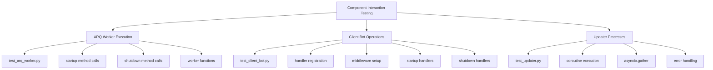
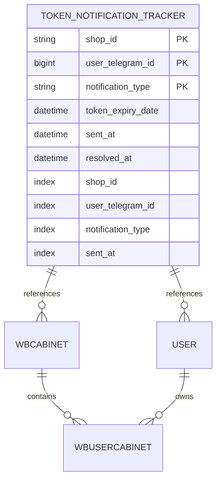
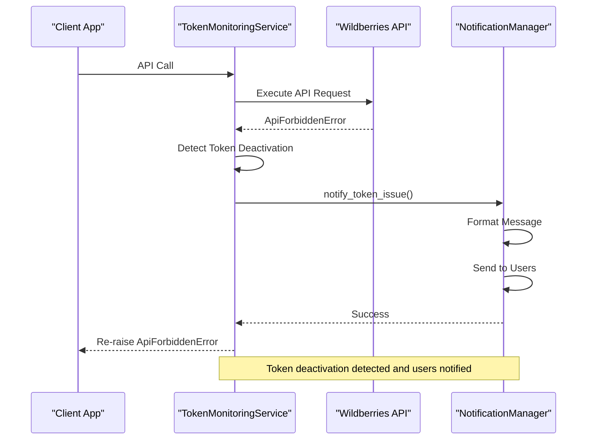
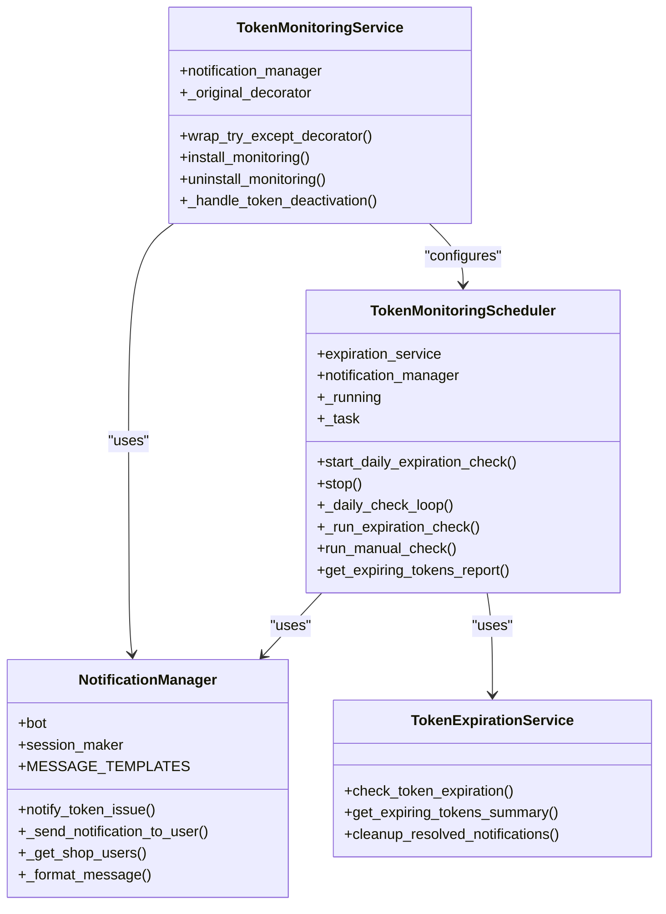
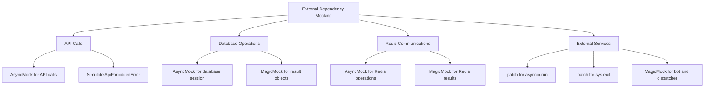

```mermaid
flowchart TD
A[Critical Workflow Testing] --> B[Entry Point Integration]
A --> C[ARQ Worker Execution]
A --> D[Client Bot Operations]
A --> E[Updater Processes]
B --> B1[test_entry_points_integration.py]
B --> B2[Import Verification]
B --> B3[Command-Line Arguments]
B --> B4[Startup Verification]
C --> C1[test_arq_worker.py]
C --> C2[startup method calls]
C --> C3[shutdown method calls]
C --> C4[worker functions]
D --> D1[test_client_bot.py]
D --> D2[handler registration]
D --> D3[middleware setup]
D --> D4[startup handlers]
D --> D5[shutdown handlers]
E --> E1[test_updater.py]
E --> E2[coroutine execution]
E --> E3[asyncio.gather]
E --> E4[error handling]
```

# Integration Testing

<cite>
**Referenced Files in This Document**   
- [test_entry_points_integration.py](file://tests/tests_entry_points/test_entry_points_integration.py)
- [test_token_monitoring_service.py](file://tests/token_monitoring/test_token_monitoring_service.py)
- [token_monitoring_service.py](file://app/modules/token_monitoring/services/token_monitoring_service.py)
- [scheduler.py](file://app/modules/token_monitoring/scheduler.py)
- [notification_manager.py](file://app/modules/token_monitoring/services/notification_manager.py)
- [models.py](file://app/modules/token_monitoring/models.py)
- [startup.py](file://app/modules/token_monitoring/startup.py)
- [integration.py](file://app/modules/token_monitoring/integration.py)
- [TEST_ASYNC_MOCKING_FIX.md](file://TEST_ASYNC_MOCKING_FIX.md)
- [test_arq_worker.py](file://tests/tests_entry_points/test_arq_worker.py)
- [test_client_bot.py](file://tests/tests_entry_points/test_client_bot.py)
- [test_updater.py](file://tests/tests_entry_points/test_updater.py)
- [workers.py](file://app/arq_workers/workers.py)
- [bot.py](file://app/client_bot/bot.py)
</cite>

## Table of Contents
1. [Introduction](#introduction)
2. [Integration Test Strategy](#integration-test-strategy)
3. [Component Interaction Testing](#component-interaction-testing)
4. [Database and Redis Integration Testing](#database-and-redis-integration-testing)
5. [API Integration Testing](#api-integration-testing)
6. [Critical Workflow Testing](#critical-workflow-testing)
7. [Token Monitoring Service Integration](#token-monitoring-service-integration)
8. [External Dependency Mocking](#external-dependency-mocking)
9. [Asynchronous Testing Challenges](#asynchronous-testing-challenges)
10. [Async Mocking Solutions](#async-mocking-solutions)
11. [Conclusion](#conclusion)

## Introduction

The adv-bot project employs a comprehensive integration testing strategy to ensure the reliability and stability of component interactions across the system. Integration tests verify that different modules work together as expected, particularly focusing on database operations, Redis communications, and API integrations. The testing framework is designed to validate critical workflows such as ARQ worker execution, client bot operations, updater processes, and the token monitoring service. These tests ensure that the system maintains data consistency, handles errors gracefully, and communicates effectively with external services.

The integration test suite is organized in the `tests` directory, with specific subdirectories for different components. The `tests_entry_points` directory contains tests for the main application entry points, while the `token_monitoring` directory focuses on the token monitoring service. The tests use a combination of unit testing frameworks, mocking libraries, and real component interactions to simulate production scenarios.

**Section sources**
- [test_entry_points_integration.py](file://tests/tests_entry_points/test_entry_points_integration.py)
- [test_token_monitoring_service.py](file://tests/token_monitoring/test_token_monitoring_service.py)

## Integration Test Strategy

The integration test strategy for the adv-bot project is designed to validate the interactions between components while maintaining a balance between test coverage and performance. The strategy focuses on testing the integration points between modules, ensuring that data flows correctly through the system and that components respond appropriately to various inputs and conditions.

The tests are organized into several categories based on the components being tested. The `tests_entry_points` directory contains tests for the main application entry points, including ARQ workers, client bots, and updaters. These tests verify that the entry points can be imported without errors, handle command-line arguments correctly, and can start without exceptions. The `token_monitoring` directory contains tests for the token monitoring service, focusing on its interaction with the database, scheduler, and notification system.

The integration tests use a combination of real component interactions and mocked external dependencies. This approach allows the tests to verify the actual behavior of the system while avoiding the complexity and unpredictability of external services. The tests are designed to be run in isolation, ensuring that they do not interfere with each other or with the production environment.

```mermaid
flowchart TD
A[Integration Test Strategy] --> B[Component Interaction Testing]
A --> C[Database and Redis Integration Testing]
A --> D[API Integration Testing]
A --> E[Critical Workflow Testing]
A --> F[Token Monitoring Service Integration]
A --> G[External Dependency Mocking]
A --> H[Asynchronous Testing Challenges]
A --> I[Async Mocking Solutions]
B --> B1[ARQ Worker Execution]
B --> B2[Client Bot Operations]
B --> B3[Updater Processes]
C --> C1[Database Operations]
C --> C2[Redis Communications]
D --> D1[API Integrations]
D --> D2[External Service Calls]
E --> E1[Token Monitoring Service]
E --> E2[Scheduler Integration]
E --> E3[Notification System]
F --> F1[Mocking External Dependencies]
F --> F2[Real Internal Component Interactions]
H --> H1[Async Workflow Testing]
H --> H2[Distributed Systems Components]
I --> I1[Async Context Managers]
I --> I2[Async vs Sync Method Mocking]
```



**Diagram sources**
- [test_entry_points_integration.py](file://tests/tests_entry_points/test_entry_points_integration.py)
- [test_token_monitoring_service.py](file://tests/token_monitoring/test_token_monitoring_service.py)

**Section sources**
- [test_entry_points_integration.py](file://tests/tests_entry_points/test_entry_points_integration.py)
- [test_token_monitoring_service.py](file://tests/token_monitoring/test_token_monitoring_service.py)

## Component Interaction Testing

Component interaction testing in the adv-bot project focuses on verifying that different modules work together as expected. The tests validate the integration points between components, ensuring that data flows correctly through the system and that components respond appropriately to various inputs and conditions.

The `tests_entry_points` directory contains tests for the main application entry points, including ARQ workers, client bots, and updaters. These tests verify that the entry points can be imported without errors, handle command-line arguments correctly, and can start without exceptions. The tests use mocking to simulate the behavior of external dependencies, allowing the tests to focus on the integration between components.

For example, the `test_arq_worker.py` file contains tests for the ARQ worker, verifying that the worker settings startup and shutdown methods call all necessary functions. The tests use `AsyncMock` to mock the methods that should be called during startup and shutdown, ensuring that the worker settings are configured correctly.

The `test_client_bot.py` file contains tests for the client bot, verifying that the bot setup registers all necessary handlers and middleware. The tests use `MagicMock` to simulate the bot and dispatcher objects, ensuring that the bot is configured correctly.

The `test_updater.py` file contains tests for the updater, verifying that the updater run method calls all necessary coroutines. The tests use `AsyncMock` to mock the update methods, ensuring that the updater is configured correctly.



**Diagram sources**
- [test_arq_worker.py](file://tests/tests_entry_points/test_arq_worker.py)
- [test_client_bot.py](file://tests/tests_entry_points/test_client_bot.py)
- [test_updater.py](file://tests/tests_entry_points/test_updater.py)

**Section sources**
- [test_arq_worker.py](file://tests/tests_entry_points/test_arq_worker.py)
- [test_client_bot.py](file://tests/tests_entry_points/test_client_bot.py)
- [test_updater.py](file://tests/tests_entry_points/test_updater.py)

## Database and Redis Integration Testing

Database and Redis integration testing in the adv-bot project focuses on verifying that the system can interact with the database and Redis correctly. The tests validate the integration points between the application and the data storage systems, ensuring that data is stored, retrieved, and updated correctly.

The token monitoring service uses the database to store information about token notifications and their status. The `TokenNotificationTracker` model in `models.py` defines the structure of the database table, including fields for the shop ID, user Telegram ID, notification type, token expiry date, and timestamps for when the notification was sent and resolved. The model includes a unique constraint to prevent duplicate notifications for the same shop, user, and notification type.

The `notification_manager.py` file contains the `NotificationManager` class, which is responsible for sending token-related notifications to users. The class uses the database to retrieve information about users and their cabinets, and to store information about sent notifications. The `notify_token_issue` method retrieves all users for a shop, formats a message based on the notification type, and sends the message to each user. The method also records the notification in the database, ensuring that duplicate notifications are prevented.

The tests for the token monitoring service use mocking to simulate the database interactions, allowing the tests to focus on the integration between the application and the database. The `test_token_monitoring_service.py` file contains tests for the `TokenMonitoringService` class, verifying that the service can detect token deactivation events and send notifications to users. The tests use `AsyncMock` to mock the database session and the notification manager, ensuring that the service is configured correctly.



**Diagram sources**
- [models.py](file://app/modules/token_monitoring/models.py)
- [notification_manager.py](file://app/modules/token_monitoring/services/notification_manager.py)

**Section sources**
- [models.py](file://app/modules/token_monitoring/models.py)
- [notification_manager.py](file://app/modules/token_monitoring/services/notification_manager.py)
- [test_token_monitoring_service.py](file://tests/token_monitoring/test_token_monitoring_service.py)

## API Integration Testing

API integration testing in the adv-bot project focuses on verifying that the system can interact with external APIs correctly. The tests validate the integration points between the application and external services, ensuring that API calls are made correctly and that responses are handled appropriately.

The token monitoring service uses the Wildberries API to check the status of tokens and to detect deactivation events. The `TokenMonitoringService` class in `token_monitoring_service.py` wraps the existing `try_except_decorator` to add token monitoring capabilities. The enhanced decorator detects `ApiForbiddenError` exceptions, which indicate that a token has been deactivated, and sends notifications to users.

The `wrap_try_except_decorator` method in `token_monitoring_service.py` creates an enhanced version of the `try_except_decorator` that adds token monitoring capabilities. The enhanced decorator preserves the original decorator functionality while adding token deactivation detection and notification capabilities. When an `ApiForbiddenError` is raised, the enhanced decorator logs a warning, sends a notification to the user, and re-raises the exception to maintain existing behavior.

The tests for the token monitoring service use mocking to simulate the API interactions, allowing the tests to focus on the integration between the application and the API. The `test_token_monitoring_service.py` file contains tests for the `TokenMonitoringService` class, verifying that the service can detect token deactivation events and send notifications to users. The tests use `AsyncMock` to mock the API calls and the notification manager, ensuring that the service is configured correctly.



**Diagram sources**
- [token_monitoring_service.py](file://app/modules/token_monitoring/services/token_monitoring_service.py)
- [notification_manager.py](file://app/modules/token_monitoring/services/notification_manager.py)

**Section sources**
- [token_monitoring_service.py](file://app/modules/token_monitoring/services/token_monitoring_service.py)
- [notification_manager.py](file://app/modules/token_monitoring/services/notification_manager.py)
- [test_token_monitoring_service.py](file://tests/token_monitoring/test_token_monitoring_service.py)

## Critical Workflow Testing

Critical workflow testing in the adv-bot project focuses on verifying that the system can handle critical workflows correctly. The tests validate the integration points between components, ensuring that data flows correctly through the system and that components respond appropriately to various inputs and conditions.

The `tests_entry_points` directory contains tests for the main application entry points, including ARQ workers, client bots, and updaters. These tests verify that the entry points can be imported without errors, handle command-line arguments correctly, and can start without exceptions. The tests use mocking to simulate the behavior of external dependencies, allowing the tests to focus on the integration between components.

The `test_entry_points_integration.py` file contains tests for the integration of the entry points, verifying that all entry points can be imported without errors and that they can start without exceptions. The tests use `subprocess.run` to execute the entry points with the `--help` argument, ensuring that the entry points handle command-line arguments correctly. The tests also use `patch` to mock the `asyncio.run` and `sys.exit` functions, allowing the tests to verify that the entry points can start without exceptions.

The `test_arq_worker.py` file contains tests for the ARQ worker, verifying that the worker settings startup and shutdown methods call all necessary functions. The tests use `AsyncMock` to mock the methods that should be called during startup and shutdown, ensuring that the worker settings are configured correctly.

The `test_client_bot.py` file contains tests for the client bot, verifying that the bot setup registers all necessary handlers and middleware. The tests use `MagicMock` to simulate the bot and dispatcher objects, ensuring that the bot is configured correctly.

The `test_updater.py` file contains tests for the updater, verifying that the updater run method calls all necessary coroutines. The tests use `AsyncMock` to mock the update methods, ensuring that the updater is configured correctly.



**Diagram sources**
- [test_entry_points_integration.py](file://tests/tests_entry_points/test_entry_points_integration.py)
- [test_arq_worker.py](file://tests/tests_entry_points/test_arq_worker.py)
- [test_client_bot.py](file://tests/tests_entry_points/test_client_bot.py)
- [test_updater.py](file://tests/tests_entry_points/test_updater.py)

**Section sources**
- [test_entry_points_integration.py](file://tests/tests_entry_points/test_entry_points_integration.py)
- [test_arq_worker.py](file://tests/tests_entry_points/test_arq_worker.py)
- [test_client_bot.py](file://tests/tests_entry_points/test_client_bot.py)
- [test_updater.py](file://tests/tests_entry_points/test_updater.py)

## Token Monitoring Service Integration

The token monitoring service integration in the adv-bot project is designed to detect and handle token deactivation events during API calls. The service uses a decorator-based approach to monitor API calls and detect when a token has been deactivated. When a deactivation event is detected, the service sends notifications to users and logs the event.

The `TokenMonitoringService` class in `token_monitoring_service.py` is responsible for monitoring token deactivation events. The class wraps the existing `try_except_decorator` to add token monitoring capabilities. The enhanced decorator detects `ApiForbiddenError` exceptions, which indicate that a token has been deactivated, and sends notifications to users.

The `install_monitoring` method in `token_monitoring_service.py` installs the token monitoring by replacing the original `try_except_decorator` with the enhanced version. The method stores a reference to the original decorator, allowing it to be restored later if needed. The `uninstall_monitoring` method restores the original decorator, effectively disabling the token monitoring.

The `scheduler.py` file contains the `TokenMonitoringScheduler` class, which is responsible for running token monitoring tasks at regular intervals. The scheduler runs a daily check for token expiration, sending notifications to users when a token is about to expire. The scheduler uses the `TokenExpirationService` to check for expiring tokens and the `NotificationManager` to send notifications.

The `startup.py` file contains the `initialize_token_monitoring` function, which initializes the complete token monitoring system. The function installs the decorator monitoring for token deactivation detection and starts the expiration scheduler for proactive monitoring. The function is called during application startup to enable token monitoring across all API calls.



**Diagram sources**
- [token_monitoring_service.py](file://app/modules/token_monitoring/services/token_monitoring_service.py)
- [scheduler.py](file://app/modules/token_monitoring/scheduler.py)
- [notification_manager.py](file://app/modules/token_monitoring/services/notification_manager.py)
- [startup.py](file://app/modules/token_monitoring/startup.py)

**Section sources**
- [token_monitoring_service.py](file://app/modules/token_monitoring/services/token_monitoring_service.py)
- [scheduler.py](file://app/modules/token_monitoring/scheduler.py)
- [notification_manager.py](file://app/modules/token_monitoring/services/notification_manager.py)
- [startup.py](file://app/modules/token_monitoring/startup.py)
- [test_token_monitoring_service.py](file://tests/token_monitoring/test_token_monitoring_service.py)

## External Dependency Mocking

External dependency mocking in the adv-bot project is used to simulate the behavior of external services during integration testing. The tests use mocking to isolate the components being tested, ensuring that the tests are not affected by the availability or behavior of external services.

The `test_token_monitoring_service.py` file contains tests for the `TokenMonitoringService` class, verifying that the service can detect token deactivation events and send notifications to users. The tests use `AsyncMock` to mock the API calls and the notification manager, allowing the tests to focus on the integration between the application and the external services.

The `test_entry_points_integration.py` file contains tests for the integration of the entry points, verifying that all entry points can be imported without errors and that they can start without exceptions. The tests use `patch` to mock the `asyncio.run` and `sys.exit` functions, allowing the tests to verify that the entry points can start without exceptions.

The `test_arq_worker.py` file contains tests for the ARQ worker, verifying that the worker settings startup and shutdown methods call all necessary functions. The tests use `AsyncMock` to mock the methods that should be called during startup and shutdown, ensuring that the worker settings are configured correctly.

The `test_client_bot.py` file contains tests for the client bot, verifying that the bot setup registers all necessary handlers and middleware. The tests use `MagicMock` to simulate the bot and dispatcher objects, ensuring that the bot is configured correctly.

The `test_updater.py` file contains tests for the updater, verifying that the updater run method calls all necessary coroutines. The tests use `AsyncMock` to mock the update methods, ensuring that the updater is configured correctly.



**Diagram sources**
- [test_token_monitoring_service.py](file://tests/token_monitoring/test_token_monitoring_service.py)
- [test_entry_points_integration.py](file://tests/tests_entry_points/test_entry_points_integration.py)
- [test_arq_worker.py](file://tests/tests_entry_points/test_arq_worker.py)
- [test_client_bot.py](file://tests/tests_entry_points/test_client_bot.py)
- [test_updater.py](file://tests/tests_entry_points/test_updater.py)

**Section sources**
- [test_token_monitoring_service.py](file://tests/token_monitoring/test_token_monitoring_service.py)
- [test_entry_points_integration.py](file://tests/tests_entry_points/test_entry_points_integration.py)
- [test_arq_worker.py](file://tests/tests_entry_points/test_arq_worker.py)
- [test_client_bot.py](file://tests/tests_entry_points/test_client_bot.py)
- [test_updater.py](file://tests/tests_entry_points/test_updater.py)

## Asynchronous Testing Challenges

Asynchronous testing in the adv-bot project presents several challenges, particularly when testing distributed systems components and asynchronous workflows. The tests must handle the complexity of asynchronous code, including coroutines, event loops, and concurrent execution.

One of the main challenges is properly mocking asynchronous methods and context managers. The `TEST_ASYNC_MOCKING_FIX.md` document describes a problem where integration tests were failing with the error "AttributeError: 'coroutine' object has no attribute 'wb_cabinet'". This occurred because the async database operations were not properly mocked, causing coroutine objects to be returned where mock objects were expected.

The root cause of the issue was twofold: incorrect async context manager mocking and incorrect database result object mocking. The original approach used `mock_sm.return_value.__aenter__.return_value = mock_session`, which does not properly set up the async context manager chain. The correct approach is to use `AsyncMock` for the context manager and set up the `__aenter__` and `__aexit__` methods correctly.

Another challenge is distinguishing between async and sync methods in the database operations. The `session.execute()` method is async and should be mocked with `AsyncMock`, while the `result.scalar_one()` method is sync and should be mocked with `MagicMock`. This distinction is crucial for properly mocking the database operations and avoiding errors.

The tests must also handle the complexity of concurrent execution and race conditions. The `test_updater.py` file contains tests for the updater, verifying that the updater run method calls all necessary coroutines. The tests use `asyncio.gather` to run multiple coroutines concurrently, ensuring that the updater can handle concurrent execution correctly.

```mermaid
flowchart TD
A[Asynchronous Testing Challenges] --> B[Async Context Managers]
A --> C[Async vs Sync Methods]
A --> D[Concurrent Execution]
A --> E[Race Conditions]
B --> B1[Incorrect: mock_sm.return_value.__aenter__.return_value]
B --> B2[Correct: AsyncMock with __aenter__ and __aexit__]
C --> C1[Async: session.execute()]
C --> C2[Sync: result.scalar_one()]
D --> D1[asyncio.gather]
D --> D2[Concurrent coroutines]
E --> E1[Timing issues]
E --> E2[State consistency]
```

**Diagram sources**
- [TEST_ASYNC_MOCKING_FIX.md](file://TEST_ASYNC_MOCKING_FIX.md)
- [test_updater.py](file://tests/tests_entry_points/test_updater.py)

**Section sources**
- [TEST_ASYNC_MOCKING_FIX.md](file://TEST_ASYNC_MOCKING_FIX.md)
- [test_updater.py](file://tests/tests_entry_points/test_updater.py)

## Async Mocking Solutions

The async mocking solutions in the adv-bot project address the challenges of testing asynchronous code by providing a clear and consistent approach to mocking async methods and context managers. The solutions are documented in the `TEST_ASYNC_MOCKING_FIX.md` file, which describes the root cause of the issues and the correct approach to fixing them.

The first solution is to properly set up async context managers. The correct approach is to use `AsyncMock` for the context manager and set up the `__aenter__` and `__aexit__` methods correctly. This ensures that the async context manager chain is properly set up and that the mock objects are returned correctly.

The second solution is to properly mock database result objects. The `session.execute()` method is async and should be mocked with `AsyncMock`, while the `result.scalar_one()` method is sync and should be mocked with `MagicMock`. This distinction is crucial for properly mocking the database operations and avoiding errors.

The third solution is to use the correct mock types for async and sync methods. `AsyncMock` should be used for async methods and async context managers, while `MagicMock` should be used for sync methods and regular objects. This ensures that the mock objects behave correctly and that the tests do not fail with unexpected errors.

The solutions have been applied to several test files, including `test_token_monitoring.py`, `test_shop_menu_token_loading.py`, and `test_token_loading_bug_reproduction.py`. After applying the fixes, all tests pass without errors, and the integration tests properly verify the token loading functionality.

```mermaid
flowchart TD
A[Async Mocking Solutions] --> B[Proper Async Context Manager Setup]
A --> C[Proper Database Result Object Mocking]
A --> D[Proper Async Method Mocking]
B --> B1[AsyncMock for context manager]
B --> B2[__aenter__ returns AsyncMock]
B --> B3[__aexit__ returns AsyncMock]
C --> C1[AsyncMock for session.execute()]
C --> C2[MagicMock for result.scalar_one()]
D --> D1[AsyncMock for async methods]
D --> D2[MagicMock for sync methods]
```

**Diagram sources**
- [TEST_ASYNC_MOCKING_FIX.md](file://TEST_ASYNC_MOCKING_FIX.md)

**Section sources**
- [TEST_ASYNC_MOCKING_FIX.md](file://TEST_ASYNC_MOCKING_FIX.md)

## Conclusion

The integration testing framework in the adv-bot project provides comprehensive coverage of component interactions, database operations, Redis communications, and API integrations. The tests are designed to validate critical workflows such as ARQ worker execution, client bot operations, updater processes, and the token monitoring service. The framework uses a combination of real component interactions and mocked external dependencies to ensure that the tests are reliable and efficient.

The token monitoring service integration is a key component of the system, providing proactive monitoring of token deactivation and expiration events. The service uses a decorator-based approach to monitor API calls and detect when a token has been deactivated, sending notifications to users and logging the event. The integration tests verify that the service can detect token deactivation events and send notifications to users, ensuring that the system maintains data consistency and handles errors gracefully.

The challenges of testing asynchronous workflows and distributed systems components have been addressed through the use of proper async mocking techniques. The solutions documented in `TEST_ASYNC_MOCKING_FIX.md` provide a clear and consistent approach to mocking async methods and context managers, ensuring that the tests are reliable and efficient. The framework distinguishes between async and sync methods in the database operations, using `AsyncMock` for async methods and `MagicMock` for sync methods.

Overall, the integration testing framework in the adv-bot project provides a solid foundation for ensuring the reliability and stability of the system. The tests are well-organized, comprehensive, and efficient, providing confidence that the system will work correctly in production.

**Section sources**
- [test_entry_points_integration.py](file://tests/tests_entry_points/test_entry_points_integration.py)
- [test_token_monitoring_service.py](file://tests/token_monitoring/test_token_monitoring_service.py)
- [TEST_ASYNC_MOCKING_FIX.md](file://TEST_ASYNC_MOCKING_FIX.md)