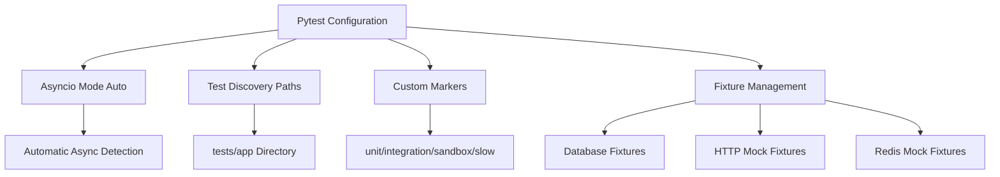
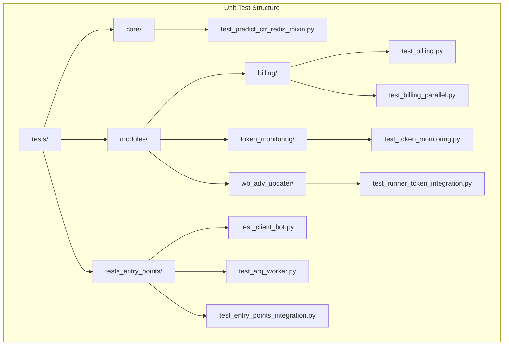
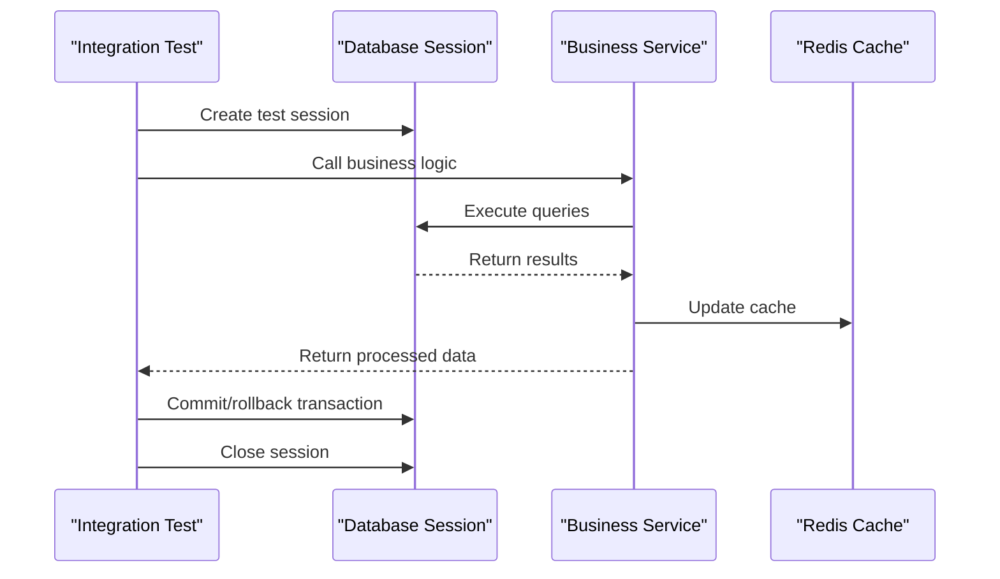
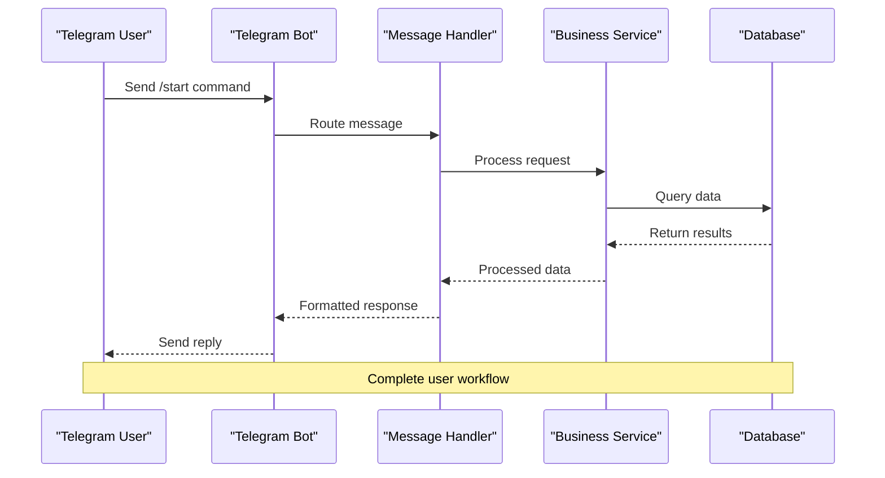
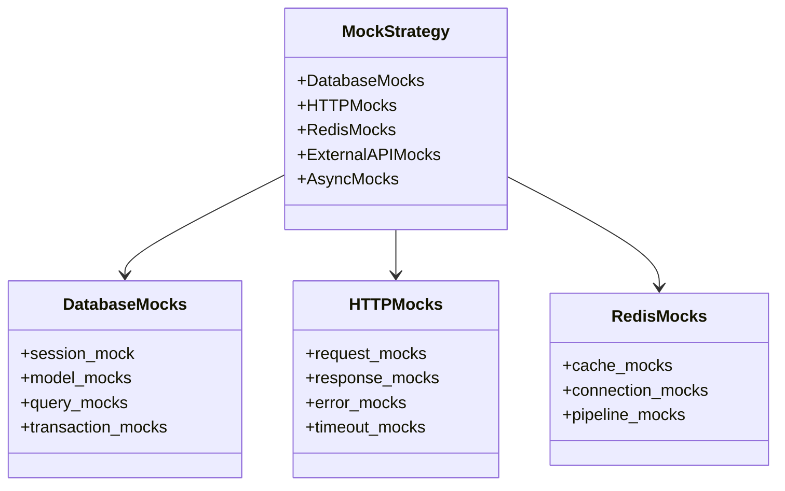
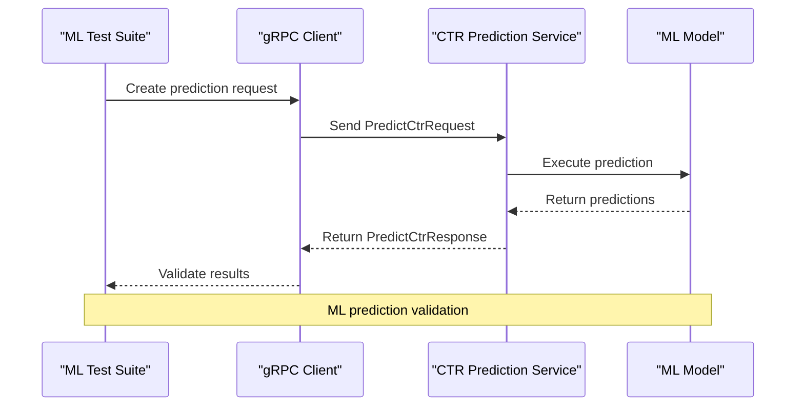

# Testing Strategy

<cite>
**Referenced Files in This Document**
- [pyproject.toml](file://pyproject.toml)
- [pytest.ini](file://pytest.ini)
- [conftest.py](file://conftest.py)
- [tests/README.md](file://tests/README.md)
- [tests/tests_entry_points/test_client_bot.py](file://tests/tests_entry_points/test_client_bot.py)
- [tests/tests_entry_points/test_arq_worker.py](file://tests/tests_entry_points/test_arq_worker.py)
- [tests/token_monitoring/test_integration.py](file://tests/token_monitoring/test_integration.py)
- [tests/modules/billing/test_billing.py](file://tests/modules/billing/test_billing.py)
- [locustfile.py](file://locustfile.py)
- [test_predict_service.py](file://test_predict_service.py)
- [ruff-report.json](file://ruff-report.json)
</cite>

## Table of Contents
1. [Introduction](#introduction)
2. [Testing Framework Setup](#testing-framework-setup)
3. [Unit Testing Strategy](#unit-testing-strategy)
4. [Integration Testing Practices](#integration-testing-practices)
5. [End-to-End Testing Scenarios](#end-to-end-testing-scenarios)
6. [Asynchronous Code Testing](#asynchronous-code-testing)
7. [Mocking External Dependencies](#mocking-external-dependencies)
8. [Test Coverage and Reporting](#test-coverage-and-reporting)
9. [Machine Learning Component Testing](#machine-learning-component-testing)
10. [Background Workers Testing](#background-workers-testing)
11. [Performance Testing](#performance-testing)
12. [Best Practices and Guidelines](#best-practices-and-guidelines)

## Introduction

The adv-bot project employs a comprehensive testing strategy designed to ensure reliability, maintainability, and quality across all components. The testing framework is built around pytest with specialized configurations for asynchronous code, database interactions, and complex business logic scenarios.

The testing approach encompasses multiple layers:
- **Unit Testing**: Isolated component testing with comprehensive mocking
- **Integration Testing**: Cross-module and cross-service testing
- **End-to-End Testing**: Complete user workflow simulation
- **Performance Testing**: Load and stress testing using Locust
- **Machine Learning Testing**: Validation of AI/ML predictions and models

## Testing Framework Setup

### Pytest Configuration

The project uses pytest as the primary testing framework with extensive customization for asynchronous code and specific testing needs.



**Diagram sources**
- [pytest.ini](file://pytest.ini#L1-L16)
- [conftest.py](file://conftest.py#L1-L50)

The pytest configuration includes several key features:

- **Asyncio Mode**: Automatic detection and handling of asynchronous tests
- **Test Discovery**: Configured to discover tests in both `tests` and `app` directories
- **Custom Markers**: Specialized markers for different test categories
- **Python Naming Conventions**: Supports various test file naming patterns

**Section sources**
- [pytest.ini](file://pytest.ini#L1-L16)
- [pyproject.toml](file://pyproject.toml#L1-L50)

### Test Environment Configuration

The testing environment is carefully configured to ensure isolation and reproducibility:

```python
# Environment variables for test isolation
os.environ.setdefault("TELEGRAM_WEB_PORT", "8080")
os.environ.setdefault("MIN_SUM", "0")
os.environ.setdefault("BIDDER_STEP_RUB", "1")
os.environ.setdefault("POSTGRES_PORT", "5432")
os.environ.setdefault("REDIS_MASTER_HOST", "localhost")
```

**Section sources**
- [conftest.py](file://conftest.py#L10-L30)

## Unit Testing Strategy

### Test Organization and Structure

The unit testing strategy follows a hierarchical organization that mirrors the application structure:



**Diagram sources**
- [tests/README.md](file://tests/README.md#L1-L20)

### Test Naming Conventions

The project follows consistent naming conventions for clarity and maintainability:

- **File Names**: `test_*` or `*_test.py` patterns
- **Class Names**: `Test*` prefix for test classes
- **Function Names**: `test_*` prefix for individual test functions
- **Fixture Names**: Descriptive names with `_mock` suffix for mocked objects

### Unit Test Categories

The unit tests are categorized using pytest markers:

```python
# Custom markers defined in pytest.ini
markers = [
    "unit: mark test as unit test",
    "integration: mark test as integration test",
    "sandbox: mark test as sandbox test (requires real API)",
    "slow: mark test as slow running"
]
```

**Section sources**
- [pytest.ini](file://pytest.ini#L10-L15)

## Integration Testing Practices

### Database Integration Testing

The integration tests extensively cover database interactions, ensuring data consistency and proper transaction handling:



**Diagram sources**
- [tests/token_monitoring/test_integration.py](file://tests/token_monitoring/test_integration.py#L50-L100)

### API Integration Testing

The project includes comprehensive API integration tests that validate communication between different system components:

```python
# Example from token monitoring integration tests
async def test_token_deactivation_end_to_end_workflow(self, mock_session_maker, mock_bot):
    """Test complete token deactivation detection and notification workflow."""
    session_maker, session = mock_session_maker
    
    # Create integrated components
    notification_manager = NotificationManager(bot=mock_bot, session_maker=session_maker)
    
    # Simulate token deactivation event
    shop_id = "test_shop_123"
    
    await notification_manager.notify_token_issue(
        shop_id=shop_id,
        notification_type=NotificationType.TOKEN_DEACTIVATED.value,
        context={"method_name": "get_advs", "error": "All tokens failed"}
    )
    
    # Verify notification was sent and database records created
    mock_bot.send_message.assert_called_once()
    session.add.assert_called_once()
    session.commit.assert_called_once()
```

**Section sources**
- [tests/token_monitoring/test_integration.py](file://tests/token_monitoring/test_integration.py#L70-L120)

### Module Integration Testing

The billing module demonstrates sophisticated integration testing with comprehensive mocking:

```python
# Comprehensive billing integration test
async def test_process_single_cabinet_bonus_success(
    mock_session, mock_pricer, mock_redis_manager, active_adv
):
    """Test successful payment processing with bonuses."""
    cab = _make_cabinet(bonus=200.0, balance=0.0, advs=[active_adv])
    
    with patch.object(
        billing, "_load_cabinet_with_relations", new=AsyncMock(return_value=cab)
    ):
        mock_session.scalar.return_value = 0
        result = await billing._process_single_cabinet(
            session=mock_session,
            cabinet_id=cab.id,
            current_dt=datetime.datetime(2024, 1, 1, 10, 0, 0),
            pricer=mock_pricer,
            redis_manager=mock_redis_manager,
        )
    
    assert result["payment_successful"] is True
    assert result["processed"] is True
    assert mock_session.add.call_count >= 2
    mock_pricer.get_price_for_day_for_shop.assert_awaited_once()
```

**Section sources**
- [tests/modules/billing/test_billing.py](file://tests/modules/billing/test_billing.py#L40-L80)

## End-to-End Testing Scenarios

### Telegram Bot Workflow Testing

The project includes comprehensive end-to-end testing of Telegram bot interactions:



**Diagram sources**
- [tests/tests_entry_points/test_client_bot.py](file://tests/tests_entry_points/test_client_bot.py#L10-L50)

### Bot Setup and Registration Testing

The client bot tests validate the complete setup process:

```python
@pytest.mark.asyncio
async def test_client_bot_setup_registers_all_handlers():
    """Test that setup_bot registers all necessary handlers."""
    bot_mock = MagicMock(spec=Bot)
    dp_mock = MagicMock(spec=Dispatcher)
    
    # Mock handler registration
    dp_mock.message.register = MagicMock()
    dp_mock.callback_query.register = MagicMock()
    dp_mock.inline_query.register = MagicMock()
    
    # Call tested function
    setup_bot(bot_mock, dp_mock)
    
    # Verify registration
    assert dp_mock.message.register.call_count >= 1
    assert dp_mock.callback_query.register.call_count >= 1
```

**Section sources**
- [tests/tests_entry_points/test_client_bot.py](file://tests/tests_entry_points/test_client_bot.py#L10-L30)

### Worker Process Testing

ArQ worker testing ensures background job processing works correctly:

```python
@pytest.mark.asyncio
async def test_worker_functions_without_errors():
    """Test that all worker functions run without errors."""
    worker_settings = WorkerSettings()
    worker_functions = worker_settings.functions()
    
    for func_name, func in worker_functions.items():
        async def mock_func(*args, **kwargs):
            await asyncio.sleep(0.1)
            return True
        
        with patch.object(worker_settings, func_name, side_effect=mock_func):
            ctx = {"job_id": "test_job", "job_try": 1}
            try:
                result = await func(ctx, "test_arg")
                assert result is True
            except Exception as e:
                pytest.fail(f"Function {func_name} raised exception: {e}")
```

**Section sources**
- [tests/tests_entry_points/test_arq_worker.py](file://tests/tests_entry_points/test_arq_worker.py#L50-L80)

## Asynchronous Code Testing

### Async Fixture Management

The testing framework provides sophisticated async fixture management:

```python
@pytest.fixture
def get_async_session_mock(session_mock) -> MagicMock:
    session_maker_mock = MagicMock()
    session_maker_mock.__aenter__ = AsyncMock(return_value=session_mock)
    get_session_maker_mock = MagicMock(return_value=session_maker_mock)
    return get_session_maker_mock
```

### Async Test Execution

All asynchronous tests use the `pytest.mark.asyncio` decorator and proper async/await patterns:

```python
@pytest.mark.asyncio
async def test_async_functionality():
    """Example of async test implementation."""
    # Setup async components
    async_context = AsyncMock()
    async_context.__aenter__ = AsyncMock(return_value=mock_result)
    
    # Execute async operation
    result = await async_operation(async_context)
    
    # Assert results
    assert result is not None
```

**Section sources**
- [conftest.py](file://conftest.py#L120-L150)

## Mocking External Dependencies

### Comprehensive Mock Strategy

The project employs a layered mocking strategy to isolate components:



**Diagram sources**
- [conftest.py](file://conftest.py#L80-L120)

### Keyword Statistics Mocking

The project includes sophisticated mocking for keyword statistics:

```python
@pytest.fixture
def keywords_mocks() -> list[MagicMock]:
    """Fixture for generating CalculatedKeyword mocks with predefined parameters"""
    keyword_params = [
        {
            "best_keyword_status": True,
            "baes_ctr": 0.5,
            "hard_status": 2,
            "spend": 100,
            "relevant": True,
            "keyword_setting_original_id": 1,
        },
        {
            "best_keyword_status": False,
            "baes_ctr": 0.2,
            "hard_status": 2,
            "spend": 10,
            "relevant": False,
            "keyword_setting_original_id": 2,
        },
    ]
    
    mocks = []
    for params in keyword_params:
        mock = MagicMock(spec=CalculatedKeyword)
        for key, value in params.items():
            setattr(mock, key, value)
        mocks.append(mock)
    
    return mocks
```

**Section sources**
- [conftest.py](file://conftest.py#L140-L180)

## Test Coverage and Reporting

### Ruff Integration

The project integrates Ruff for code quality and linting:

```json
{
  "cell": null,
  "code": "E501",
  "end_location": {
    "column": 112,
    "row": 51
  },
  "filename": "add_to_shop_balance.py",
  "message": "Line too long (111 > 88)",
  "url": "https://docs.astral.sh/ruff/rules/line-too-long"
}
```

### Coverage Analysis

The testing strategy includes comprehensive coverage analysis through:

- **Line Length Checking**: Ensures code readability standards
- **Import Quality**: Validates proper import organization
- **Code Style Compliance**: Maintains consistent coding standards

**Section sources**
- [ruff-report.json](file://ruff-report.json#L1-L50)

## Machine Learning Component Testing

### gRPC Service Testing

The project includes specialized testing for machine learning services:



**Diagram sources**
- [test_predict_service.py](file://test_predict_service.py#L20-L60)

### Prediction Service Testing

The gRPC prediction service includes comprehensive testing:

```python
async def test_predict_service():
    """Test gRPC prediction service functionality."""
    async with grpc.aio.insecure_channel(f"{host}:{port}") as channel:
        stub = CtrServiceStub(channel)
        
        # Test data
        test_nmids = [493134345]
        test_phrases = ["spf купальник женский большой размер"]
        
        # Create request
        request = PredictCtrRequest(nmids=test_nmids, phrases=test_phrases)
        
        # Send request
        response = await stub.PredictCtr(request)
        
        # Validate results
        assert response.predictions
        for nmid, phrase in zip(test_nmids, test_phrases):
            key = f"{nmid}_{phrase}"
            if key in response.predictions:
                ctr = response.predictions[key]
                assert ctr
                print(f"CTR: {ctr:.4f}")
                print(f"CTR in percent: {ctr * 100:.2f}%")
```

**Section sources**
- [test_predict_service.py](file://test_predict_service.py#L30-L80)

## Background Workers Testing

### ArQ Worker Testing

The project includes comprehensive testing for background workers:

```python
@pytest.mark.asyncio
async def test_worker_settings_startup_calls_all_functions():
    """Test that WorkerSettings startup calls all necessary functions."""
    worker_settings = WorkerSettings()
    
    # Mock startup methods
    worker_settings.startup_method1 = AsyncMock()
    worker_settings.startup_method2 = AsyncMock()
    worker_settings.startup_method3 = AsyncMock()
    
    # Execute and verify
    await worker_settings.startup()
    
    worker_settings.startup_method1.assert_called_once()
    worker_settings.startup_method2.assert_called_once()
    worker_settings.startup_method3.assert_called_once()
```

**Section sources**
- [tests/tests_entry_points/test_arq_worker.py](file://tests/tests_entry_points/test_arq_worker.py#L10-L30)

### Worker Function Validation

The testing framework validates worker function execution:

```python
@pytest.mark.asyncio
async def test_worker_functions_without_errors():
    """Test that all worker functions run without errors."""
    worker_settings = WorkerSettings()
    worker_functions = worker_settings.functions()
    
    for func_name, func in worker_functions.items():
        async def mock_func(*args, **kwargs):
            await asyncio.sleep(0.1)
            return True
        
        with patch.object(worker_settings, func_name, side_effect=mock_func):
            ctx = {"job_id": "test_job", "job_try": 1}
            try:
                result = await func(ctx, "test_arg")
                assert result is True
            except Exception as e:
                pytest.fail(f"Function {func_name} raised exception: {e}")
```

**Section sources**
- [tests/tests_entry_points/test_arq_worker.py](file://tests/tests_entry_points/test_arq_worker.py#L50-L80)

## Performance Testing

### Locust Integration

The project includes performance testing using Locust:

```python
from locust import HttpUser, between, task

class TelegramBotUser(HttpUser):
    host = "https://tiriel.ru"
    wait_time = between(1, 5)  # Users send requests every 1-5 seconds

    @task
    def send_message(self):
        headers = {"X-Telegram-Bot-Api-Secret-Token": "89779uoiugkftyeoilyeligoyuv"}
        self.client.post(
            "/telegram_webhook",
            json={
                "update_id": 123456789,
                "message": {
                    "message_id": 123,
                    "from": {
                        "id": 373435337,
                        "is_bot": False,
                        "first_name": "Test",
                        "username": "testuser",
                    },
                    "chat": {
                        "id": 373435337,
                        "first_name": "Test",
                        "username": "testuser",
                        "type": "private",
                    },
                    "date": 1441645532,
                    "text": "/start",
                },
            },
            headers=headers,
        )
```

### Performance Test Categories

The performance testing covers:

- **Load Testing**: Simulating multiple concurrent users
- **Stress Testing**: Testing system limits and failure modes
- **Endurance Testing**: Long-duration load testing
- **Volume Testing**: Testing with large datasets

**Section sources**
- [locustfile.py](file://locustfile.py#L1-L37)

## Best Practices and Guidelines

### Circular Import Testing

The project includes automated circular import detection:

```python
# Entry points for circular import testing
ENTRY_POINTS = [
    "client_bot_run.py",
    "admin_bot_run.py",
    "run_shop_update_worker.py",
    "run_update_predict_ctr.py",
    "run_keywords_parsing.py",
]
```

### Test Organization Principles

1. **Single Responsibility**: Each test focuses on one aspect of functionality
2. **Isolation**: Tests don't depend on external systems when possible
3. **Repeatability**: Tests produce consistent results across environments
4. **Maintainability**: Clear, readable test code with descriptive names

### Testing Guidelines

- **Use AsyncFixtures**: Properly handle asynchronous operations
- **Mock External Services**: Isolate tests from external dependencies
- **Validate Edge Cases**: Test boundary conditions and error scenarios
- **Monitor Performance**: Include performance metrics in critical paths
- **Continuous Integration**: Automated testing in CI pipeline

**Section sources**
- [tests/README.md](file://tests/README.md#L1-L65)