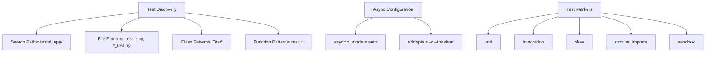
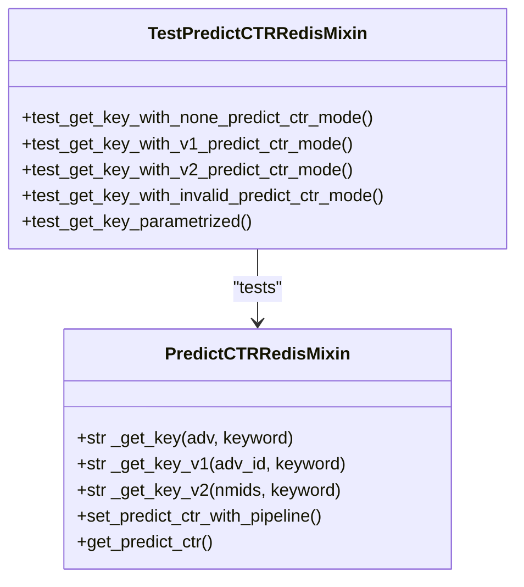
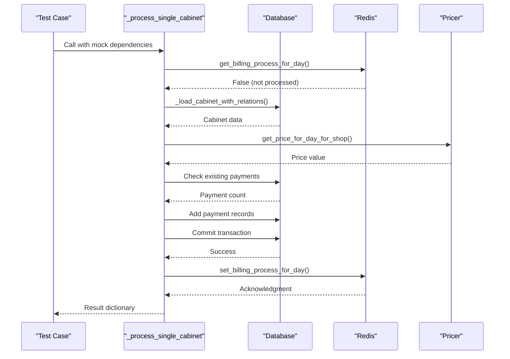
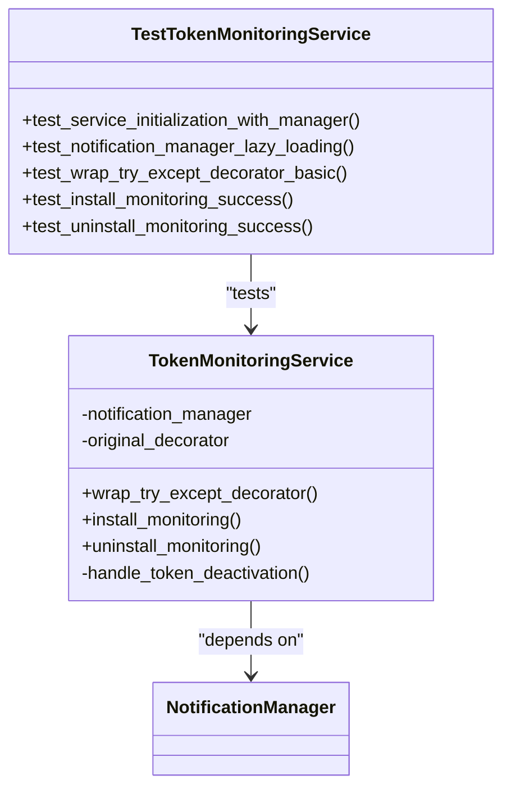
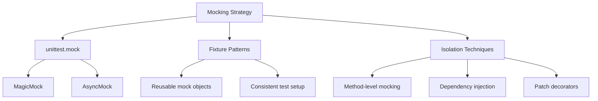
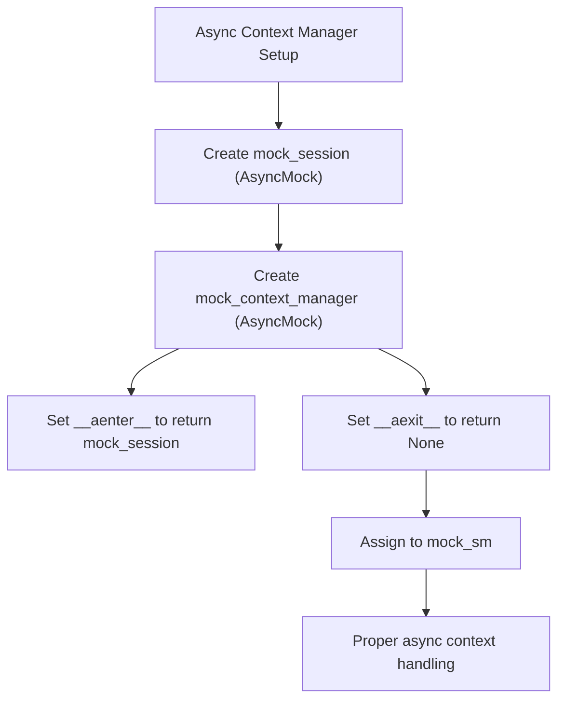
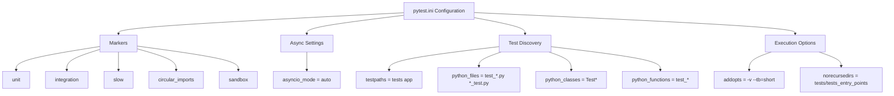

# Unit Testing

<cite>
**Referenced Files in This Document**   
- [pytest.ini](file://pytest.ini)
- [conftest.py](file://conftest.py)
- [test_predict_ctr_redis_mixin.py](file://tests/core/test_predict_ctr_redis_mixin.py)
- [test_billing.py](file://tests/modules/billing/test_billing.py)
- [billing.py](file://app/modules/billing/billing.py)
- [predict_ctr.py](file://app/core/redis_manager_v2/mixins/predict_ctr.py)
- [token_monitoring_service.py](file://app/modules/token_monitoring/services/token_monitoring_service.py)
- [test_token_monitoring_service.py](file://tests/token_monitoring/test_token_monitoring_service.py)
- [TEST_ASYNC_MOCKING_FIX.md](file://TEST_ASYNC_MOCKING_FIX.md)
</cite>

## Table of Contents
1. [Introduction](#introduction)
2. [Pytest Configuration and Test Discovery](#pytest-configuration-and-test-discovery)
3. [Core Unit Testing Components](#core-unit-testing-components)
4. [Mocking Strategies](#mocking-strategies)
5. [Asynchronous Testing Patterns](#asynchronous-testing-patterns)
6. [Test Markers and Configuration](#test-markers-and-configuration)
7. [Common Testing Issues and Solutions](#common-testing-issues-and-solutions)
8. [Conclusion](#conclusion)

## Introduction
The adv-bot project implements a comprehensive unit testing framework using pytest to ensure code reliability and maintainability. This documentation details the testing architecture, focusing on the implementation of unit tests for core components such as the predict_ctr_redis_mixin, billing module, and token monitoring services. The testing strategy emphasizes isolation through mocking, proper handling of asynchronous code, and the use of pytest markers to categorize test types. The framework is designed to support both unit and integration testing, with specific patterns for handling the project's complex dependencies on Redis, database operations, and external API calls.

## Pytest Configuration and Test Discovery
The pytest configuration in the adv-bot project is defined in pytest.ini, which establishes the testing environment and discovery patterns. The configuration specifies that tests should be discovered in both the "tests" and "app" directories, with test files following the patterns "test_*.py", "*_test.py", or "tests.py". Test classes are identified by the "Test*" pattern, while test functions follow the "test_*" pattern. The asyncio_mode is set to "auto", enabling native support for asynchronous testing without requiring explicit event loop management.

**Diagram sources**
- [pytest.ini](file://pytest.ini)

**Section sources**
- [pytest.ini](file://pytest.ini)

## Core Unit Testing Components

### Predict CTR Redis Mixin Testing
The predict_ctr_redis_mixin is tested in test_predict_ctr_redis_mixin.py, which validates the key generation logic for Redis operations. The tests verify that the _get_key method correctly routes to either _get_key_v1 or _get_key_v2 based on the predict_ctr_mode setting in the AdvSetting model. The test suite uses parameterized testing to cover all valid modes (None, V1, V2) and includes error cases for invalid modes. The implementation demonstrates proper isolation by mocking the underlying key generation methods and verifying their invocation patterns.

**Diagram sources**
- [test_predict_ctr_redis_mixin.py](file://tests/core/test_predict_ctr_redis_mixin.py)
- [predict_ctr.py](file://app/core/redis_manager_v2/mixins/predict_ctr.py)

**Section sources**
- [test_predict_ctr_redis_mixin.py](file://tests/core/test_predict_ctr_redis_mixin.py)
- [predict_ctr.py](file://app/core/redis_manager_v2/mixins/predict_ctr.py)

### Billing Module Testing
The billing module is tested in test_billing.py, which validates the daily charge processing logic for advertising campaigns. The tests focus on the _process_single_cabinet function, verifying payment processing under various conditions including sufficient funds, insufficient funds, zero pricing, and Redis-based idempotency checks. The test suite uses mock objects for the database session, pricer, and Redis manager to isolate the business logic. Each test case validates the expected outcome, including payment success/failure status, campaign deactivation, and proper database operations.

**Diagram sources**
- [test_billing.py](file://tests/modules/billing/test_billing.py)
- [billing.py](file://app/modules/billing/billing.py)

**Section sources**
- [test_billing.py](file://tests/modules/billing/test_billing.py)
- [billing.py](file://app/modules/billing/billing.py)

### Token Monitoring Service Testing
The token monitoring service is tested in test_token_monitoring_service.py, which validates the functionality of the TokenMonitoringService class. The tests cover service initialization, lazy loading of the notification manager, decorator wrapping functionality, and installation/uninstallation of the monitoring system. The test suite verifies that the enhanced try_except_decorator properly detects ApiForbiddenError exceptions and triggers token deactivation notifications while preserving the original decorator behavior. The tests also validate the singleton pattern implementation for the global monitoring service.

**Diagram sources**
- [test_token_monitoring_service.py](file://tests/token_monitoring/test_token_monitoring_service.py)
- [token_monitoring_service.py](file://app/modules/token_monitoring/services/token_monitoring_service.py)

**Section sources**
- [test_token_monitoring_service.py](file://tests/token_monitoring/test_token_monitoring_service.py)
- [token_monitoring_service.py](file://app/modules/token_monitoring/services/token_monitoring_service.py)

## Mocking Strategies
The adv-bot project employs comprehensive mocking strategies using unittest.mock's MagicMock and AsyncMock classes to isolate components during testing. The conftest.py file defines several reusable fixtures that provide pre-configured mock objects for common dependencies such as WBToken, WBCabinetAccess, and AdvSetting. These fixtures enable consistent test setup across multiple test files and reduce code duplication.

For the predict_ctr_redis_mixin tests, the approach involves mocking the internal key generation methods (_get_key_v1 and _get_key_v2) to verify that the correct method is called based on the predict_ctr_mode setting. This allows testing the routing logic without depending on the actual key generation implementation.

In the billing module tests, the strategy focuses on mocking external dependencies including the database session (AsyncSession), pricer service, and Redis manager. The mock_session fixture uses AsyncMock to simulate database operations, while the mock_pricer fixture provides controlled pricing responses. This enables testing the payment processing logic under various scenarios without requiring a real database connection.

The token monitoring service tests use patch decorators to mock imports and method calls, particularly for testing the decorator wrapping functionality. This approach allows testing the integration between the monitoring service and the original try_except_decorator without modifying the actual module imports.

**Diagram sources**
- [conftest.py](file://conftest.py)
- [test_predict_ctr_redis_mixin.py](file://tests/core/test_predict_ctr_redis_mixin.py)
- [test_billing.py](file://tests/modules/billing/test_billing.py)

**Section sources**
- [conftest.py](file://conftest.py)

## Asynchronous Testing Patterns
The adv-bot project follows specific patterns for testing asynchronous code, as documented in TEST_ASYNC_MOCKING_FIX.md. The key insight is the proper distinction between async and sync methods in database operations. The tests correctly use AsyncMock for async methods like session.execute() while using MagicMock for sync methods like result.scalar_one().

The correct async context manager setup is crucial for proper testing. Instead of the problematic approach of directly setting return values, the recommended pattern creates a complete async context manager chain:

This pattern ensures that when the code under test uses "async with sm() as session", the mock properly simulates the entire context manager lifecycle. The TEST_ASYNC_MOCKING_FIX.md document emphasizes that session.execute() is an async method (requiring AsyncMock) while result.scalar_one() is a sync method (requiring MagicMock), a distinction that is critical for avoiding "coroutine object has no attribute" errors.

The billing module tests demonstrate this pattern by using AsyncMock for database operations and properly handling the async context manager in the _process_payment_for_advs function. The tests verify that the function correctly processes multiple cabinets concurrently using asyncio.gather, with proper error handling for individual task failures.

**Diagram sources**
- [TEST_ASYNC_MOCKING_FIX.md](file://TEST_ASYNC_MOCKING_FIX.md)
- [test_billing.py](file://tests/modules/billing/test_billing.py)

**Section sources**
- [TEST_ASYNC_MOCKING_FIX.md](file://TEST_ASYNC_MOCKING_FIX.md)

## Test Markers and Configuration
The pytest configuration in pytest.ini defines several custom markers to categorize tests by type and characteristics. These markers include "unit" for unit tests, "integration" for integration tests, "slow" for time-consuming tests, "circular_imports" for tests detecting circular import issues, and "sandbox" for tests requiring real API access.

The configuration also sets important options for test execution. The asyncio_mode is set to "auto", enabling native support for asynchronous testing. The testpaths directive specifies that tests should be discovered in both the "tests" and "app" directories, while python_files defines the naming patterns for test files. The addopts setting enables verbose output (-v) and short tracebacks (--tb=short) for better test feedback.

The norecursedirs setting excludes the tests/tests_entry_points directory from test discovery, preventing potential conflicts with entry point tests. This structured configuration ensures consistent test discovery and execution across the codebase.

**Diagram sources**
- [pytest.ini](file://pytest.ini)

**Section sources**
- [pytest.ini](file://pytest.ini)

## Common Testing Issues and Solutions
The adv-bot project documentation identifies several common issues encountered during unit testing and their solutions. The most significant issue, documented in TEST_ASYNC_MOCKING_FIX.md, involves improper mocking of async context managers and database result objects. The solution requires understanding the distinction between async and sync methods in SQLAlchemy operations.

For async methods like session.execute(), AsyncMock should be used, while for sync methods like result.scalar_one(), MagicMock should be used. The correct async context manager setup involves creating a full chain with __aenter__ and __aexit__ methods properly configured.

Another common issue is circular imports, which are addressed through the use of lazy loading and proper dependency injection. The token monitoring service demonstrates this by using a lazy property to load the notification manager only when needed, preventing circular import problems during test setup.

The billing module tests address the challenge of testing complex business logic with multiple dependencies by using parameterized tests and comprehensive mocking. Each test case isolates a specific scenario (sufficient funds, insufficient funds, zero pricing) while maintaining consistent mock configurations through fixtures.

The project also addresses the challenge of testing decorator functionality by using patch decorators to mock imports and verify the correct wrapping of functions. This allows testing the enhanced behavior of decorators without modifying the actual module structure.

**Section sources**
- [TEST_ASYNC_MOCKING_FIX.md](file://TEST_ASYNC_MOCKING_FIX.md)
- [conftest.py](file://conftest.py)
- [token_monitoring_service.py](file://app/modules/token_monitoring/services/token_monitoring_service.py)

## Conclusion
The adv-bot project implements a robust unit testing framework that effectively validates core components through comprehensive test coverage, proper mocking strategies, and careful handling of asynchronous code. The pytest configuration provides a solid foundation for test discovery and execution, with custom markers enabling organized test categorization. The testing approach emphasizes isolation through mocking, allowing each component to be tested independently of its dependencies.

Key strengths of the testing framework include the proper handling of async context managers, the use of reusable fixtures for common dependencies, and the comprehensive coverage of edge cases and error conditions. The documentation of common issues and their solutions, particularly in TEST_ASYNC_MOCKING_FIX.md, provides valuable guidance for maintaining and extending the test suite.

The unit tests for the predict_ctr_redis_mixin, billing module, and token monitoring service demonstrate effective patterns for testing different types of functionality, from simple key generation logic to complex business rules and decorator-based monitoring systems. These tests provide confidence in the reliability of the codebase and serve as documentation for the expected behavior of each component.