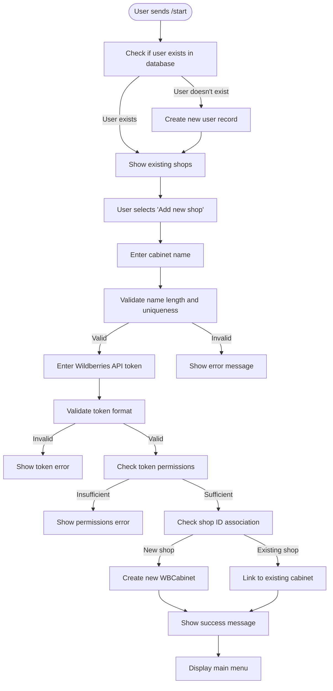
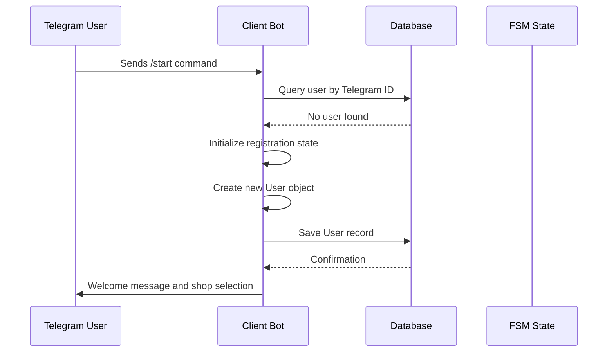
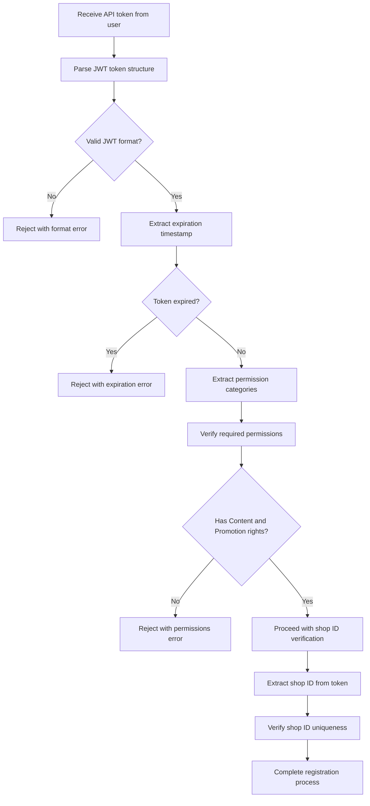
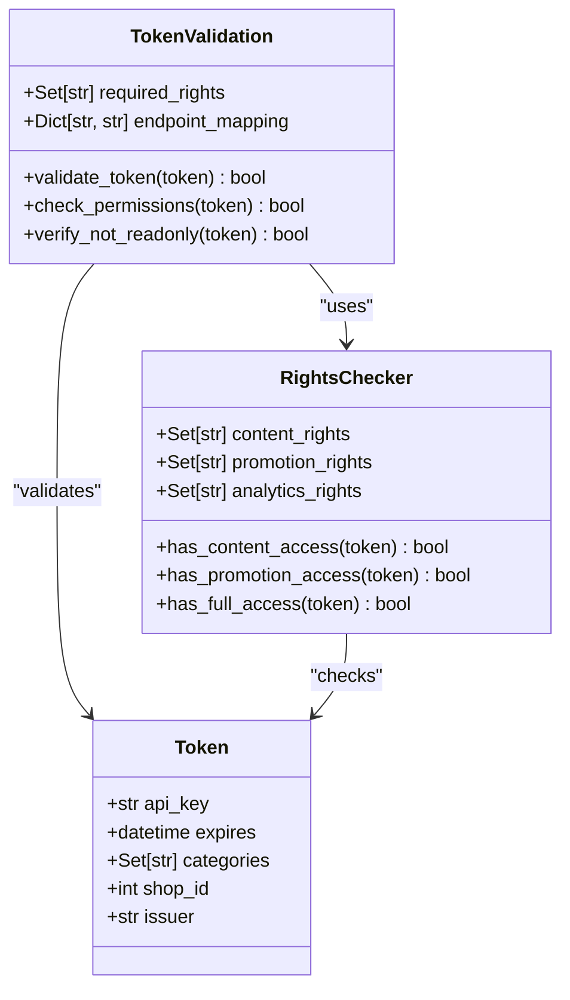
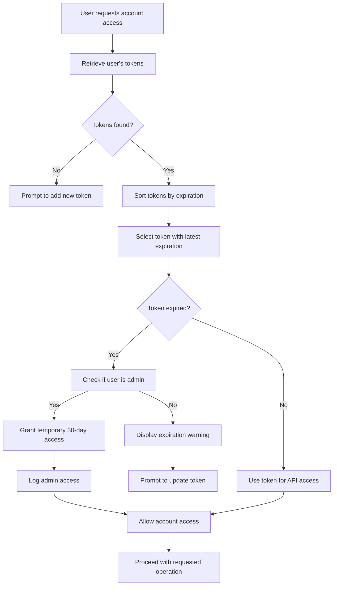
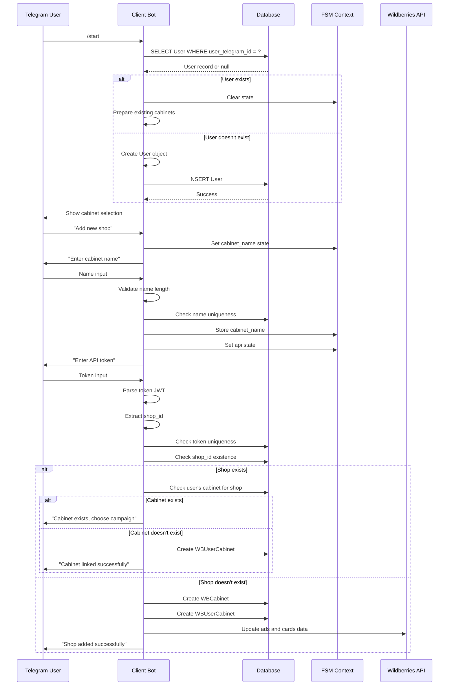
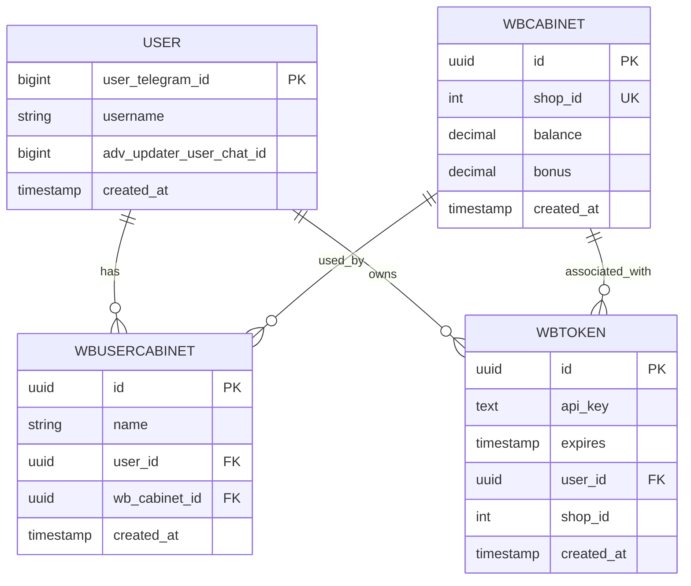
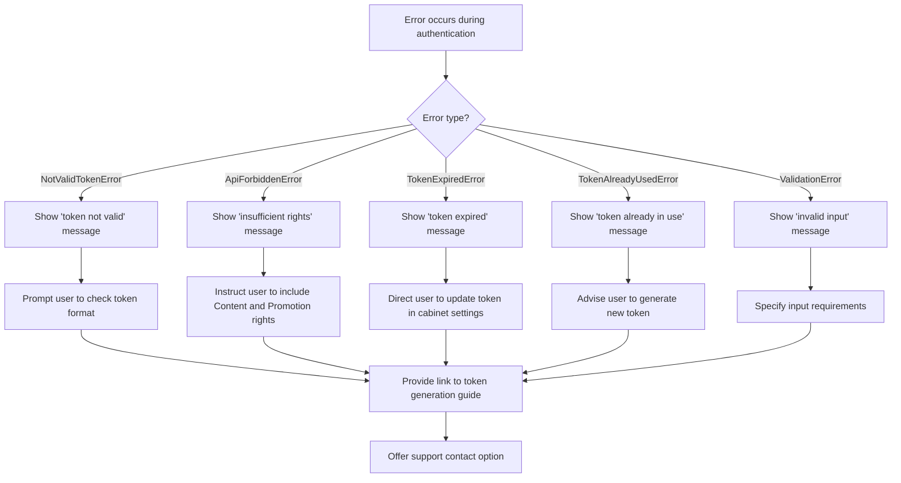

# Authentication

<cite>
**Referenced Files in This Document**   
- [start.py](file://app/client_bot/user_interface/handlers/start/start.py)
- [start_registration_func.py](file://app/client_bot/user_interface/handlers/start_registration_func.py)
- [token_master.py](file://app/modules/common_slaves/wildberries/token_master.py)
- [check_righter.py](file://app/core/wb_api/check_righter.py)
- [models.py](file://app/utils/db/models.py)
- [message.py](file://app/modules/shop_menu/message.py)
</cite>

## Table of Contents
1. [Introduction](#introduction)
2. [User Authentication Flow](#user-authentication-flow)
3. [Telegram-Based User Creation](#telegram-based-user-creation)
4. [Wildberries API Token Validation](#wildberries-api-token-validation)
5. [Token Rights and Permissions](#token-rights-and-permissions)
6. [Token Expiration Handling](#token-expiration-handling)
7. [Registration Flow Implementation](#registration-flow-implementation)
8. [Integration of Telegram and Wildberries Accounts](#integration-of-telegram-and-wildberries-accounts)
9. [Error Handling and Common Issues](#error-handling-and-common-issues)
10. [Security Practices and Session Management](#security-practices-and-session-management)
11. [Performance Considerations](#performance-considerations)

## Introduction
The adv-bot application implements a comprehensive authentication system that integrates Telegram user identification with Wildberries API token management. This system enables users to securely link their Wildberries advertising accounts to the bot through a structured registration process. The authentication mechanism handles user creation, token validation, permission checking, and session management, providing a robust foundation for the application's core functionality.

**Section sources**
- [start.py](file://app/client_bot/user_interface/handlers/start/start.py#L1-L50)
- [start_registration_func.py](file://app/client_bot/user_interface/handlers/start_registration_func.py#L1-L10)

## User Authentication Flow
The authentication process in adv-bot follows a multi-step flow that begins with Telegram interaction and culminates in the successful linking of a Wildberries account. When a user initiates contact with the bot via the /start command, the system checks for existing user records and creates a new user if none is found. The user is then guided through a registration process to add their Wildberries cabinet (account) by providing an API token.

The flow involves several state transitions managed by the Finite State Machine (FSM) in aiogram, progressing from cabinet name input to token validation and final account linking. Each step includes validation and error handling to ensure data integrity and provide clear feedback to users.

**Diagram sources**
- [start.py](file://app/client_bot/user_interface/handlers/start/start.py#L105-L195)
- [start_registration_func.py](file://app/client_bot/user_interface/handlers/start_registration_func.py#L1-L60)

**Section sources**
- [start.py](file://app/client_bot/user_interface/handlers/start/start.py#L105-L195)
- [start_registration_func.py](file://app/client_bot/user_interface/handlers/start_registration_func.py#L1-L60)

## Telegram-Based User Creation
The system automatically creates user records upon first interaction with the bot through the `start_registration_func.py` module. When a user sends the /start command, the system checks the database for an existing record using the Telegram user ID. If no record is found, a new User entity is created and persisted in the database.

The user creation process captures essential information including the Telegram user ID, username (if available), and chat ID for future communications. This approach ensures that each Telegram user has a unique identity within the system, enabling personalized service and secure account management.

**Diagram sources**
- [start_registration_func.py](file://app/client_bot/user_interface/handlers/start_registration_func.py#L1-L60)
- [models.py](file://app/utils/db/models.py#L1-L53)

**Section sources**
- [start_registration_func.py](file://app/client_bot/user_interface/handlers/start_registration_func.py#L1-L60)
- [models.py](file://app/utils/db/models.py#L1-L53)

## Wildberries API Token Validation
The authentication system validates Wildberries API tokens through a multi-layered verification process implemented in the `token_master.py` and `check_righter.py` modules. When a user submits a token during registration, the system first checks its basic validity by attempting to extract the shop ID from the token's JWT payload.

The validation process involves parsing the JWT token to verify its signature and extract embedded information such as expiration time and permission scopes. This initial validation ensures that the token is properly formatted and has not been tampered with before proceeding to more resource-intensive checks.

**Diagram sources**
- [token_master.py](file://app/modules/common_slaves/wildberries/token_master.py#L1-L38)
- [start.py](file://app/client_bot/user_interface/handlers/start/start.py#L160-L195)

**Section sources**
- [token_master.py](file://app/modules/common_slaves/wildberries/token_master.py#L1-L38)
- [start.py](file://app/client_bot/user_interface/handlers/start/start.py#L160-L195)

## Token Rights and Permissions
The system enforces strict permission requirements for Wildberries API tokens to ensure proper functionality of the advertising management features. According to the implementation in `token_master.py`, tokens must possess both "Content" and "Promotion" rights to be accepted by the system.

The permission validation is implemented through a set-based comparison where the system checks if the required rights are a subset of the token's granted permissions. This approach allows for flexible permission management while ensuring that essential capabilities are present. The system also verifies that the token is not restricted to read-only access, as write permissions are necessary for managing advertising campaigns.

**Diagram sources**
- [token_master.py](file://app/modules/common_slaves/wildberries/token_master.py#L1-L38)
- [check_righter.py](file://app/core/wb_api/check_righter.py#L1-L58)

**Section sources**
- [token_master.py](file://app/modules/common_slaves/wildberries/token_master.py#L1-L38)
- [check_righter.py](file://app/core/wb_api/check_righter.py#L1-L58)

## Token Expiration Handling
The authentication system implements comprehensive token expiration handling to maintain secure and uninterrupted service. As shown in the `message.py` file, the system checks token expiration times before allowing access to Wildberries account data. Tokens that have expired are rejected with appropriate user notifications.

For regular users, the system strictly enforces token expiration, requiring users to update their tokens when they expire. However, the system provides special handling for administrators, granting temporary access with a 30-day validity period to facilitate troubleshooting and maintenance activities without requiring immediate token updates.

**Diagram sources**
- [message.py](file://app/modules/shop_menu/message.py#L169-L244)
- [token_master.py](file://app/modules/common_slaves/wildberries/token_master.py#L1-L38)

**Section sources**
- [message.py](file://app/modules/shop_menu/message.py#L169-L244)

## Registration Flow Implementation
The registration flow is implemented across multiple files, with the core logic residing in `start_registration_func.py` and `start.py`. The process begins when a user sends the /start command, triggering the `start_registration` function which either retrieves an existing user or creates a new one.

The registration continues with the user providing a cabinet name and API token. The system validates the cabinet name for length and uniqueness before proceeding to token validation. Once a valid token is provided, the system checks for existing associations with the same shop ID and either links to an existing cabinet or creates a new one.

**Diagram sources**
- [start_registration_func.py](file://app/client_bot/user_interface/handlers/start_registration_func.py#L1-L60)
- [start.py](file://app/client_bot/user_interface/handlers/start/start.py#L105-L195)

**Section sources**
- [start_registration_func.py](file://app/client_bot/user_interface/handlers/start_registration_func.py#L1-L60)
- [start.py](file://app/client_bot/user_interface/handlers/start/start.py#L105-L195)

## Integration of Telegram and Wildberries Accounts
The system integrates Telegram user identities with Wildberries accounts through a relational data model that links User, WBUserCabinet, and WBCabinet entities. The User entity, identified by Telegram user ID, can have multiple WBUserCabinet instances, each representing a connection to a Wildberries cabinet.

This many-to-many relationship allows users to manage multiple Wildberries accounts while maintaining separation between different advertising cabinets. The integration is facilitated by the WBToken entity, which stores the API token and links it to both the user and the shop ID, enabling secure API access while maintaining proper authorization boundaries.

**Diagram sources**
- [models.py](file://app/utils/db/models.py#L1-L53)
- [start.py](file://app/client_bot/user_interface/handlers/start/start.py#L160-L195)

**Section sources**
- [models.py](file://app/utils/db/models.py#L1-L53)

## Error Handling and Common Issues
The authentication system implements comprehensive error handling for common issues such as invalid tokens, insufficient permissions, and expired credentials. When a user submits an invalid token, the system catches the `NotValidTokenError` exception and prompts the user to try again with a valid token.

For permission-related issues, the system specifically checks for the presence of "Content" and "Promotion" rights, rejecting tokens that lack these essential permissions. The error messages are designed to be user-friendly, guiding users toward resolution rather than simply indicating failure.

Common issues and their solutions include:
- **Invalid tokens**: Users are prompted to verify their token format and regenerate it from the Wildberries partner interface
- **Permission errors**: Users are advised to ensure their token includes both "Content" and "Promotion" rights when generated
- **Expired tokens**: Users receive clear instructions to update their tokens through the cabinet management interface
- **Duplicate tokens**: The system prevents multiple users from using the same token for security reasons

**Diagram sources**
- [start.py](file://app/client_bot/user_interface/handlers/start/start.py#L160-L195)
- [check_righter.py](file://app/core/wb_api/check_righter.py#L1-L58)
- [message.py](file://app/modules/shop_menu/message.py#L216-L244)

**Section sources**
- [start.py](file://app/client_bot/user_interface/handlers/start/start.py#L160-L195)
- [check_righter.py](file://app/core/wb_api/check_righter.py#L1-L58)
- [message.py](file://app/modules/shop_menu/message.py#L216-L244)

## Security Practices and Session Management
The authentication system employs several security practices to protect user data and prevent unauthorized access. API tokens are stored securely in the database, and access to sensitive operations is controlled through permission checks at multiple levels.

Session management is handled through aiogram's FSM (Finite State Machine) context, which maintains user state during the registration process without exposing sensitive information. The system also implements proper error handling that avoids leaking implementation details to users while still providing actionable feedback.

Security measures include:
- Validation of token ownership to prevent unauthorized use of API credentials
- Verification of required permissions before allowing access to advertising features
- Protection against token reuse by different users
- Secure storage of API tokens in the database
- Time-limited sessions to prevent stale state
- Input validation to prevent injection attacks

**Section sources**
- [start.py](file://app/client_bot/user_interface/handlers/start/start.py#L105-L195)
- [token_master.py](file://app/modules/common_slaves/wildberries/token_master.py#L1-L38)
- [check_righter.py](file://app/core/wb_api/check_righter.py#L1-L58)

## Performance Considerations
The authentication system is designed to handle high-volume authentication requests efficiently. The use of database indexing on frequently queried fields such as user_telegram_id and shop_id ensures fast lookups during the authentication process.

For operations that may take longer to complete, such as updating advertising data from Wildberries, the system implements timeout controls and asynchronous processing to prevent blocking other user requests. The system also includes caching mechanisms through Redis to reduce database load and improve response times for frequently accessed data.

Performance optimizations include:
- Database indexing on key lookup fields
- Asynchronous API calls to Wildberries services
- Connection pooling for database operations
- Caching of frequently accessed user data
- Timeout limits for external API operations
- Efficient state management to minimize memory usage

**Section sources**
- [start.py](file://app/client_bot/user_interface/handlers/start/start.py#L105-L195)
- [message.py](file://app/modules/shop_menu/message.py#L169-L244)
- [start_registration_func.py](file://app/client_bot/user_interface/handlers/start_registration_func.py#L1-L60)