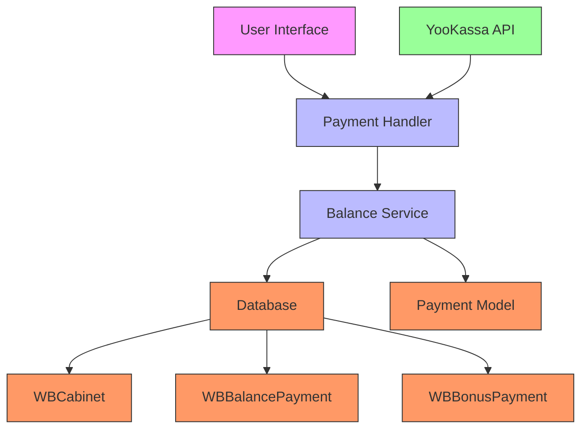
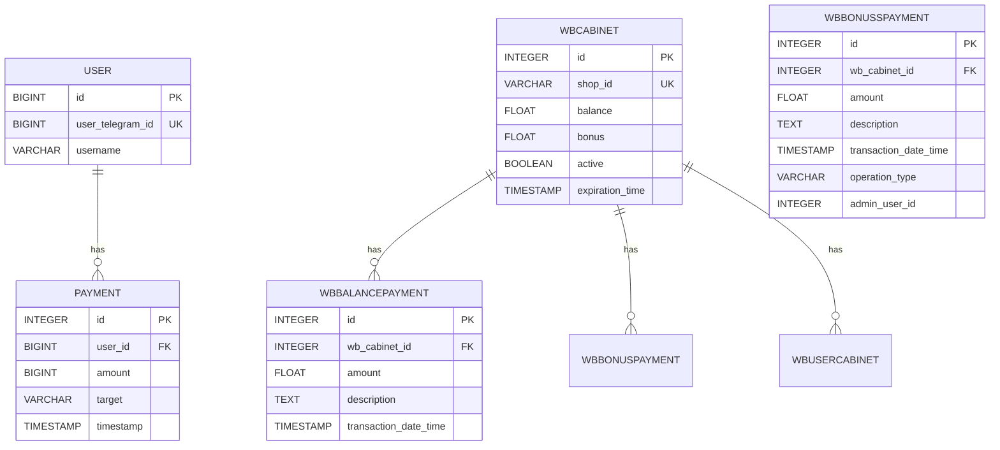
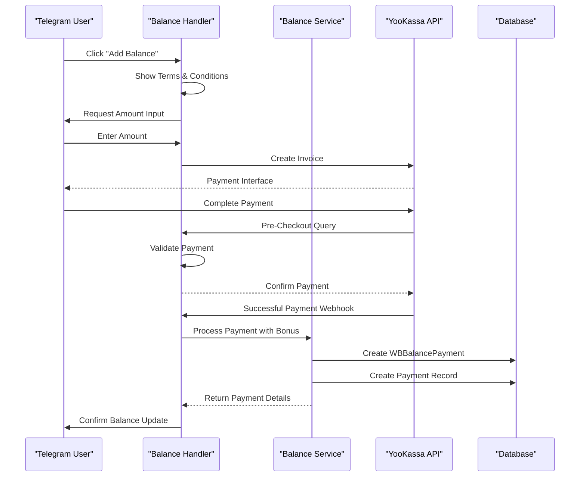
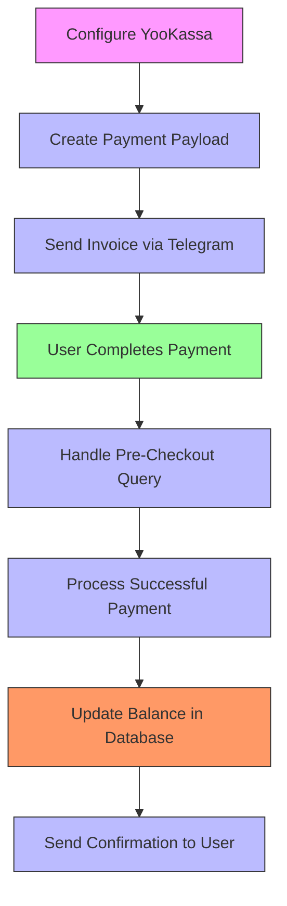
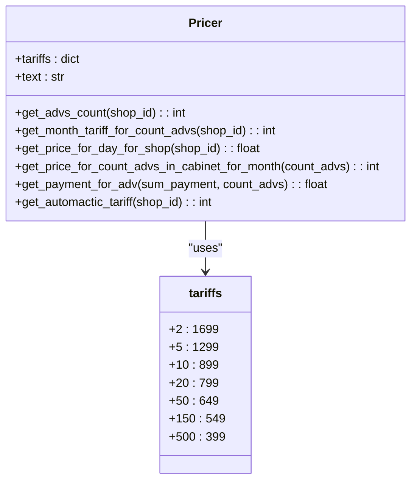
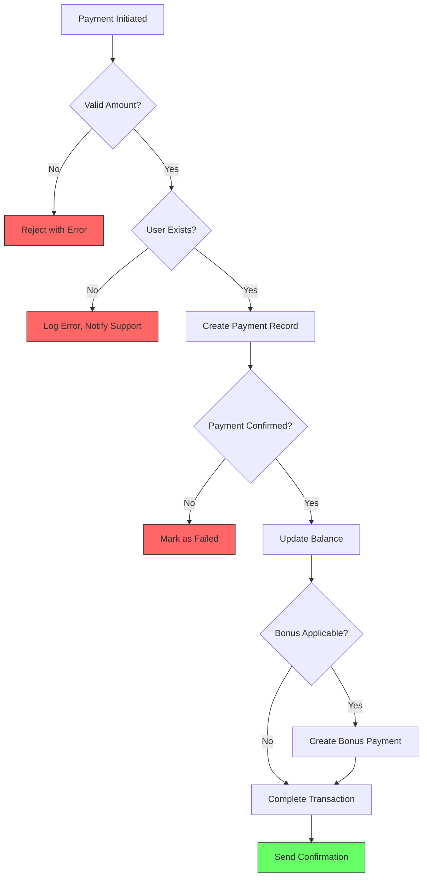
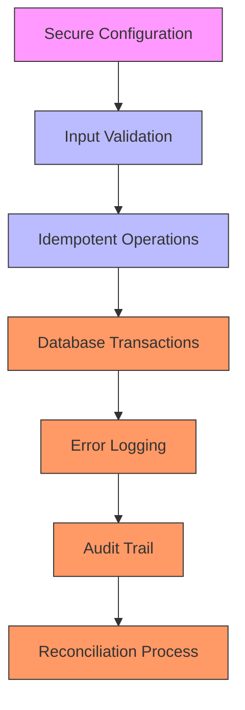
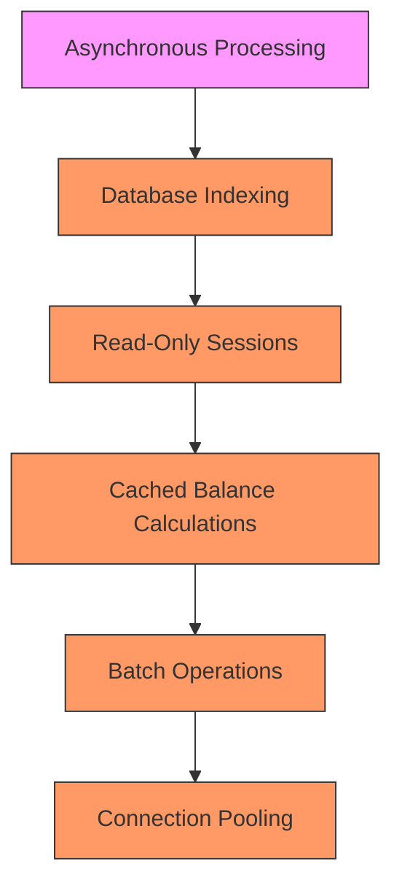

# Payment Processing

<cite>
**Referenced Files in This Document**   
- [manager.py](file://app/payments/manager.py)
- [models.py](file://app/payments/db/models.py)
- [balance_service.py](file://app/modules/balance_manager/balance_service.py)
- [handlers.py](file://app/modules/balance_manager/handlers.py)
- [models.py](file://app/modules/common_slaves/wildberries/models/models.py)
- [pricer.py](file://app/utils/pricer/pricer.py)
- [tariffs.py](file://app/utils/pricer/tariffs.py)
</cite>

## Table of Contents
1. [Introduction](#introduction)
2. [Payment System Architecture](#payment-system-architecture)
3. [Data Model for Payments](#data-model-for-payments)
4. [Payment Lifecycle](#payment-lifecycle)
5. [Integration with YooKassa](#integration-with-yookassa)
6. [Usage-Based Billing with Pricer](#usage-based-billing-with-pricer)
7. [Error Handling and Reconciliation](#error-handling-and-reconciliation)
8. [Security and Transaction Integrity](#security-and-transaction-integrity)
9. [Performance Considerations](#performance-considerations)
10. [Conclusion](#conclusion)

## Introduction
The adv-bot application implements a comprehensive payment processing system that enables users to manage advertising budgets through secure transactions. This document details the implementation of payment handling, including transaction recording, balance updates, integration with external providers like YooKassa, and usage-based billing calculations. The system is designed to handle high-volume operations while maintaining transaction integrity and security.

**Section sources**
- [manager.py](file://app/payments/manager.py#L1-L12)
- [balance_service.py](file://app/modules/balance_manager/balance_service.py#L1-L235)

## Payment System Architecture
The payment system in adv-bot follows a modular architecture with clear separation of concerns between payment processing, balance management, and user interface components. The core functionality is distributed across several modules that work together to process payments, update balances, and maintain transaction records.

**Diagram sources**
- [handlers.py](file://app/modules/balance_manager/handlers.py#L1-L226)
- [balance_service.py](file://app/modules/balance_manager/balance_service.py#L1-L235)

**Section sources**
- [handlers.py](file://app/modules/balance_manager/handlers.py#L1-L226)
- [balance_service.py](file://app/modules/balance_manager/balance_service.py#L1-L235)

## Data Model for Payments
The payment system utilizes a relational data model with several interconnected entities that track financial transactions and user balances. The core components include the Payment entity for system-wide transactions, WBBalancePayment for cabinet-specific balance changes, and WBCabinet for storing current balance states.

**Diagram sources**
- [models.py](file://app/utils/db/models.py#L1-L52)
- [models.py](file://app/modules/common_slaves/wildberries/models/models.py#L1-L199)
- [models.py](file://app/payments/db/models.py#L1-L12)

**Section sources**
- [models.py](file://app/utils/db/models.py#L1-L52)
- [models.py](file://app/modules/common_slaves/wildberries/models/models.py#L1-L199)
- [models.py](file://app/payments/db/models.py#L1-L12)

## Payment Lifecycle
The payment lifecycle in adv-bot follows a structured process from initiation to confirmation and balance update. This sequence ensures transaction integrity and provides a seamless user experience through the Telegram interface.

**Diagram sources**
- [handlers.py](file://app/modules/balance_manager/handlers.py#L1-L226)
- [balance_service.py](file://app/modules/balance_manager/balance_service.py#L1-L235)

**Section sources**
- [handlers.py](file://app/modules/balance_manager/handlers.py#L1-L226)
- [balance_service.py](file://app/modules/balance_manager/balance_service.py#L1-L235)

## Integration with YooKassa
The adv-bot application integrates with YooKassa, a popular Russian payment provider, to handle secure financial transactions. The integration is configured using account credentials and implements Telegram's payment API for a seamless user experience.

**Diagram sources**
- [manager.py](file://app/payments/manager.py#L1-L12)
- [handlers.py](file://app/modules/balance_manager/handlers.py#L1-L226)

**Section sources**
- [manager.py](file://app/payments/manager.py#L1-L12)
- [handlers.py](file://app/modules/balance_manager/handlers.py#L1-L226)

## Usage-Based Billing with Pricer
The pricer module implements a usage-based billing system that calculates charges based on the number of active advertising settings per shop. The pricing model uses tiered tariffs that provide volume discounts for larger numbers of advertisements.

**Diagram sources**
- [pricer.py](file://app/utils/pricer/pricer.py#L1-L105)
- [tariffs.py](file://app/utils/pricer/tariffs.py#L1-L9)

**Section sources**
- [pricer.py](file://app/utils/pricer/pricer.py#L1-L105)
- [tariffs.py](file://app/utils/pricer/tariffs.py#L1-L9)

## Error Handling and Reconciliation
The payment system implements robust error handling to address common issues such as failed payments, duplicate transactions, and reconciliation challenges. The architecture includes validation at multiple levels to ensure data consistency and transaction integrity.

**Diagram sources**
- [balance_service.py](file://app/modules/balance_manager/balance_service.py#L1-L235)
- [handlers.py](file://app/modules/balance_manager/handlers.py#L1-L226)

**Section sources**
- [balance_service.py](file://app/modules/balance_manager/balance_service.py#L1-L235)
- [handlers.py](file://app/modules/balance_manager/handlers.py#L1-L226)

## Security and Transaction Integrity
The payment system prioritizes security and transaction integrity through multiple mechanisms including idempotency, proper error handling, and database constraints. These measures ensure that financial operations are reliable and protected against common vulnerabilities.

**Diagram sources**
- [manager.py](file://app/payments/manager.py#L1-L12)
- [balance_service.py](file://app/modules/balance_manager/balance_service.py#L1-L235)

**Section sources**
- [manager.py](file://app/payments/manager.py#L1-L12)
- [balance_service.py](file://app/modules/balance_manager/balance_service.py#L1-L235)

## Performance Considerations
The payment system is designed to handle high-volume operations efficiently through optimized database queries, appropriate indexing, and asynchronous processing. These performance considerations ensure responsive user experiences even during peak usage periods.

**Diagram sources**
- [balance_service.py](file://app/modules/balance_manager/balance_service.py#L1-L235)
- [pricer.py](file://app/utils/pricer/pricer.py#L1-L105)

**Section sources**
- [balance_service.py](file://app/modules/balance_manager/balance_service.py#L1-L235)
- [pricer.py](file://app/utils/pricer/pricer.py#L1-L105)

## Conclusion
The payment processing system in adv-bot provides a comprehensive solution for managing advertising budgets through secure, reliable transactions. By integrating with YooKassa and implementing a usage-based billing model, the system offers flexibility and scalability for users with varying needs. The architecture emphasizes security, transaction integrity, and performance, ensuring a robust foundation for financial operations within the application.