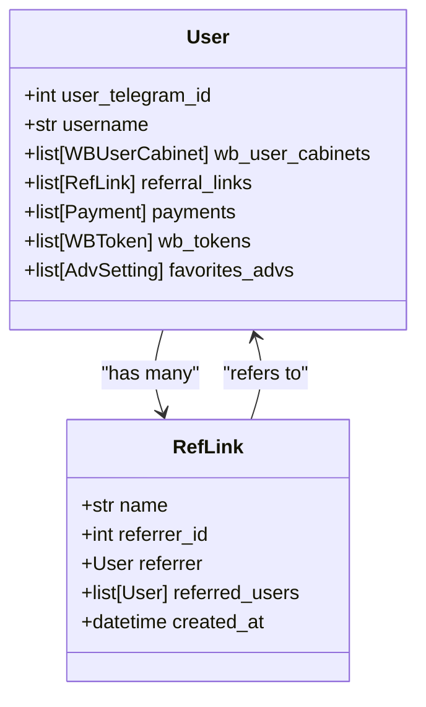
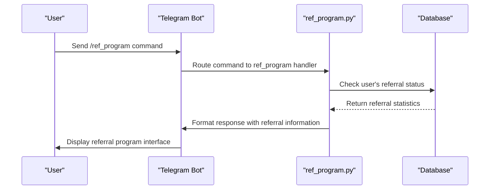
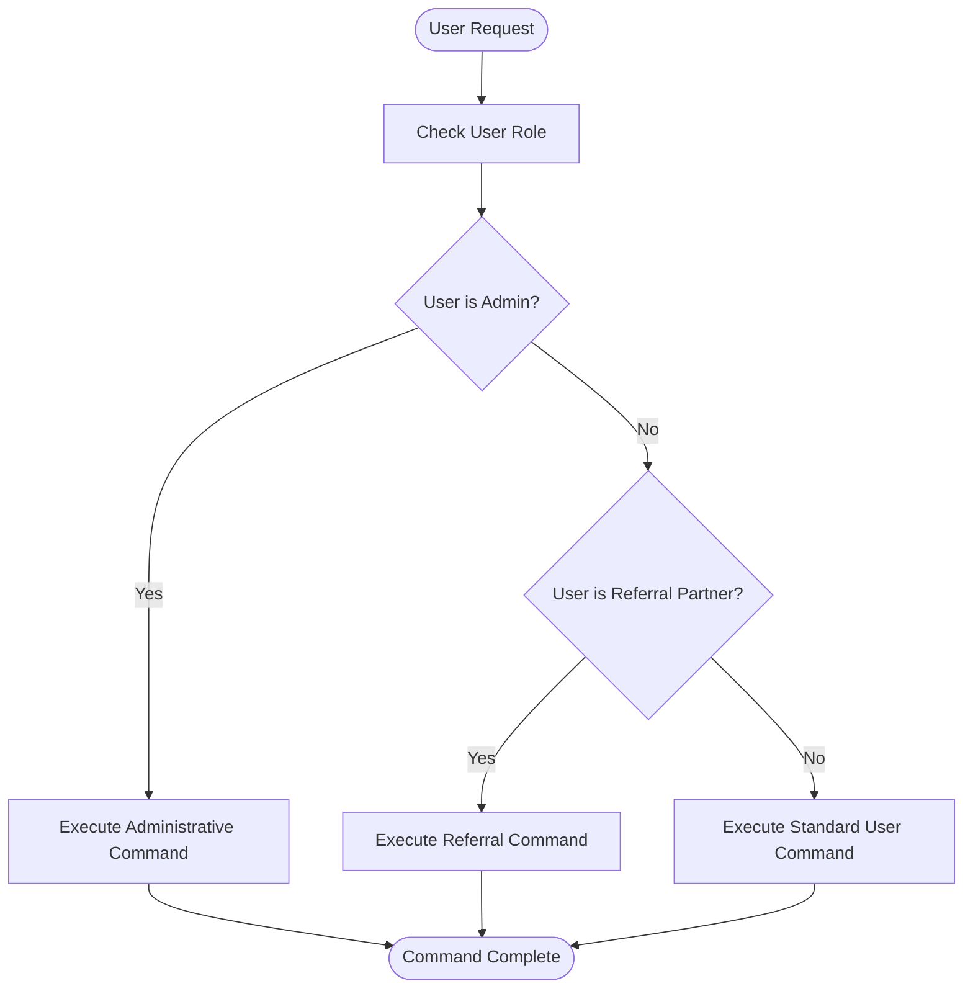

# Role-based Access

<cite>
**Referenced Files in This Document**   
- [telegram_user.py](file://app/core/data_manager/mixins/telegram_user.py)
- [const.py](file://app/client_bot/const.py)
- [admin_handler.py](file://app/client_bot/user_interface/handlers/admin_handler.py)
- [ref_program.py](file://app/client_bot/user_interface/handlers/ref_program.py)
- [models.py](file://app/utils/db/models.py)
- [messages.py](file://app/client_bot/user_interface/views/messages/messages.py)
- [get_shop_for_admin.py](file://app/client_bot/user_interface/handlers/get_shop_for_admin.py)
</cite>

## Table of Contents
1. [Introduction](#introduction)
2. [User Roles and Permissions](#user-roles-and-permissions)
3. [Role Implementation](#role-implementation)
4. [Access Control Logic](#access-control-logic)
5. [Data Flow and Authorization Enforcement](#data-flow-and-authorization-enforcement)
6. [Common Issues and Security Best Practices](#common-issues-and-security-best-practices)
7. [Performance Considerations](#performance-considerations)
8. [Conclusion](#conclusion)

## Introduction
The adv-bot application implements a role-based access control system to manage user permissions and functionality. This system defines different user roles including standard users, referral partners, and administrators, each with specific access rights and capabilities. The documentation provides a comprehensive overview of the implementation, focusing on how user roles are stored, checked, and enforced throughout the application.

**Section sources**
- [telegram_user.py](file://app/core/data_manager/mixins/telegram_user.py#L1-L46)
- [const.py](file://app/client_bot/const.py#L1-L52)

## User Roles and Permissions
The adv-bot application defines three primary user roles: standard users, referral partners, and administrators. Each role has distinct permissions and access to specific features within the system. Administrators have elevated privileges, including access to administrative commands and the ability to manage system settings. Referral partners can create and manage referral links, track referral statistics, and earn bonuses based on referred users' activities. Standard users have access to basic functionality without administrative or referral capabilities.

The system stores user roles through the User model in the database, which maintains user information including their Telegram ID and associated permissions. Role-based access is enforced through various handlers and filters that check user credentials before allowing access to restricted features.

**Diagram sources**
- [models.py](file://app/utils/db/models.py#L1-L52)
- [telegram_user.py](file://app/core/data_manager/mixins/telegram_user.py#L1-L46)

**Section sources**
- [models.py](file://app/utils/db/models.py#L1-L52)
- [const.py](file://app/client_bot/const.py#L1-L52)

## Role Implementation
User roles are implemented through a combination of database models and application logic. The User model in models.py defines the core user entity with relationships to various system components including referral links, payments, and advertising settings. The TelegramUserMixin class provides methods for retrieving and saving user data, including the get_telegram_user_model method that fetches user information from the database.

Referral partners can create referral links through the ref_program.py handler, which validates link names and creates new RefLink entries in the database. The system checks for duplicate names and enforces length restrictions to ensure data integrity. Administrators are defined in the const.py file as a list of Telegram user IDs, providing a simple but effective way to identify privileged users.

**Diagram sources**
- [ref_program.py](file://app/client_bot/user_interface/handlers/ref_program.py#L1-L70)
- [messages.py](file://app/client_bot/user_interface/views/messages/messages.py#L600-L799)

**Section sources**
- [ref_program.py](file://app/client_bot/user_interface/handlers/ref_program.py#L1-L70)
- [messages.py](file://app/client_bot/user_interface/views/messages/messages.py#L600-L799)

## Access Control Logic
The access control logic in the adv-bot application is implemented through a combination of middleware, filters, and role checks. The admin_handler.py file contains the foundation for administrative command handling, while the get_shop_for_admin.py file implements specific filters for administrator access. The AdminsGetShopFilter class checks if a user is in the ADMINS list before allowing access to certain administrative functions.

The system uses Telegram message filters to enforce role-based access, examining both the message content and the sender's user ID. For example, the AdminsGetShopFilter only allows users with IDs in the ADMINS constant to access certain administrative features. This approach provides a clear separation between regular user functionality and administrative capabilities.

**Diagram sources**
- [admin_handler.py](file://app/client_bot/user_interface/handlers/admin_handler.py#L1-L10)
- [get_shop_for_admin.py](file://app/client_bot/user_interface/handlers/get_shop_for_admin.py#L39-L78)

**Section sources**
- [admin_handler.py](file://app/client_bot/user_interface/handlers/admin_handler.py#L1-L10)
- [get_shop_for_admin.py](file://app/client_bot/user_interface/handlers/get_shop_for_admin.py#L39-L78)

## Data Flow and Authorization Enforcement
When a user attempts to access restricted features, the system follows a specific data flow to enforce authorization. The request first passes through the global router, which directs it to the appropriate handler based on the command or callback. The handler then applies relevant filters to verify the user's role and permissions before processing the request.

For administrative functions, the system checks if the user's Telegram ID is included in the ADMINS list defined in const.py. For referral program features, the system verifies the user's eligibility and retrieves their referral statistics from the database. This multi-layered approach ensures that only authorized users can access sensitive functionality.

The authorization process involves several steps:
1. Receiving the user request through the Telegram Bot API
2. Routing the request to the appropriate handler
3. Applying role-based filters to verify permissions
4. Retrieving user data from the database if needed
5. Executing the requested functionality
6. Returning the response to the user

**Section sources**
- [admin_handler.py](file://app/client_bot/user_interface/handlers/admin_handler.py#L1-L10)
- [get_shop_for_admin.py](file://app/client_bot/user_interface/handlers/get_shop_for_admin.py#L39-L78)
- [ref_program.py](file://app/client_bot/user_interface/handlers/ref_program.py#L1-L70)

## Common Issues and Security Best Practices
The role-based access system in adv-bot addresses several common security issues. Privilege escalation is prevented by strictly defining administrator roles through the ADMINS constant and verifying user IDs against this list. Role assignment errors are minimized by using a centralized approach to role management, with user roles determined by their position in the system rather than mutable attributes.

To prevent permission inheritance issues, the system uses explicit role checks rather than hierarchical permission models. This ensures that users only have access to features specifically granted to their role. The application also implements proper error handling for authorization failures, providing clear feedback to users without exposing sensitive system information.

Security best practices implemented in the system include:
- Storing administrator IDs in a configuration file rather than the database
- Using constant-time comparisons when checking user credentials
- Implementing proper input validation for all user-provided data
- Separating administrative functionality from user-facing features
- Using secure coding practices to prevent common vulnerabilities

**Section sources**
- [const.py](file://app/client_bot/const.py#L1-L52)
- [admin_handler.py](file://app/client_bot/user_interface/handlers/admin_handler.py#L1-L10)
- [get_shop_for_admin.py](file://app/client_bot/user_interface/handlers/get_shop_for_admin.py#L39-L78)

## Performance Considerations
The role-based access system is designed with performance in mind, particularly for high-traffic scenarios. Role checks are implemented using simple list membership tests for administrators, which provide O(1) average-case complexity. Database queries for user information are optimized using SQLAlchemy's query options to load only necessary fields.

The system minimizes database access by caching user roles and permissions when possible, reducing the need for repeated queries. For referral statistics and other frequently accessed data, the application could implement additional caching layers to further improve performance under heavy load.

The current implementation balances security and performance by using efficient data structures for role checking while maintaining the flexibility to extend the access control system as needed. In high-traffic scenarios, the system's performance is primarily limited by database query speed, which can be optimized through proper indexing and query optimization.

**Section sources**
- [telegram_user.py](file://app/core/data_manager/mixins/telegram_user.py#L1-L46)
- [const.py](file://app/client_bot/const.py#L1-L52)

## Conclusion
The role-based access system in the adv-bot application provides a robust framework for managing user permissions and functionality. By clearly defining roles for standard users, referral partners, and administrators, the system ensures that users have appropriate access to features while maintaining security and preventing unauthorized actions. The implementation leverages both database models and application logic to enforce access control, with careful attention to performance and security considerations. This approach provides a scalable foundation that can be extended to support additional roles and permissions as the application evolves.