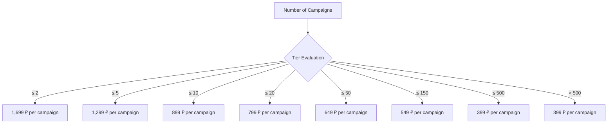
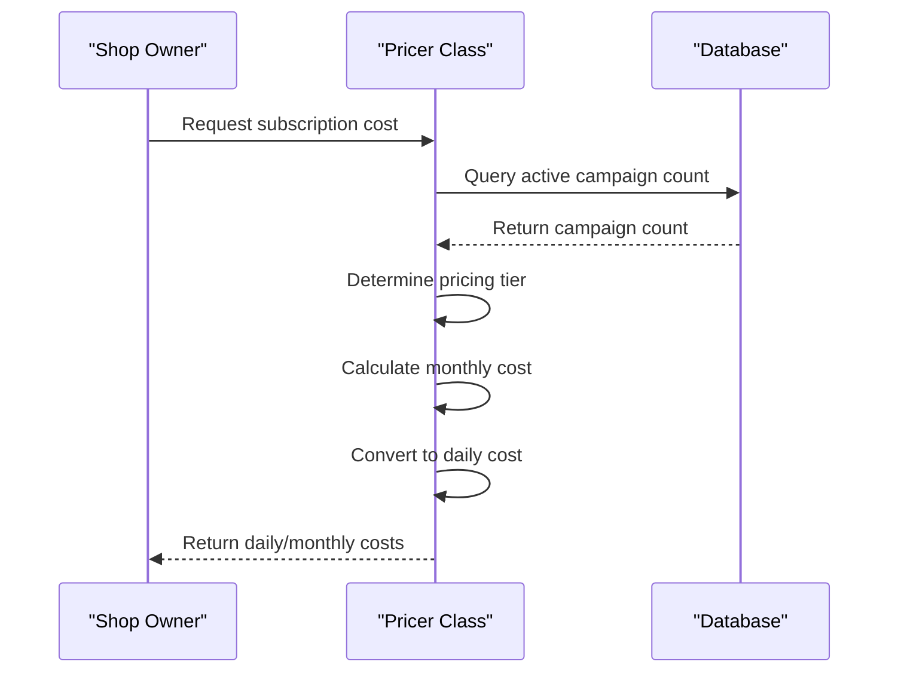
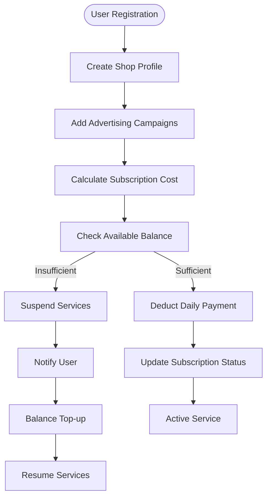
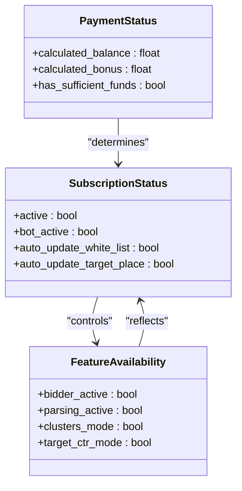
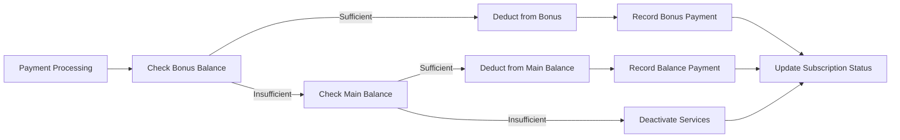
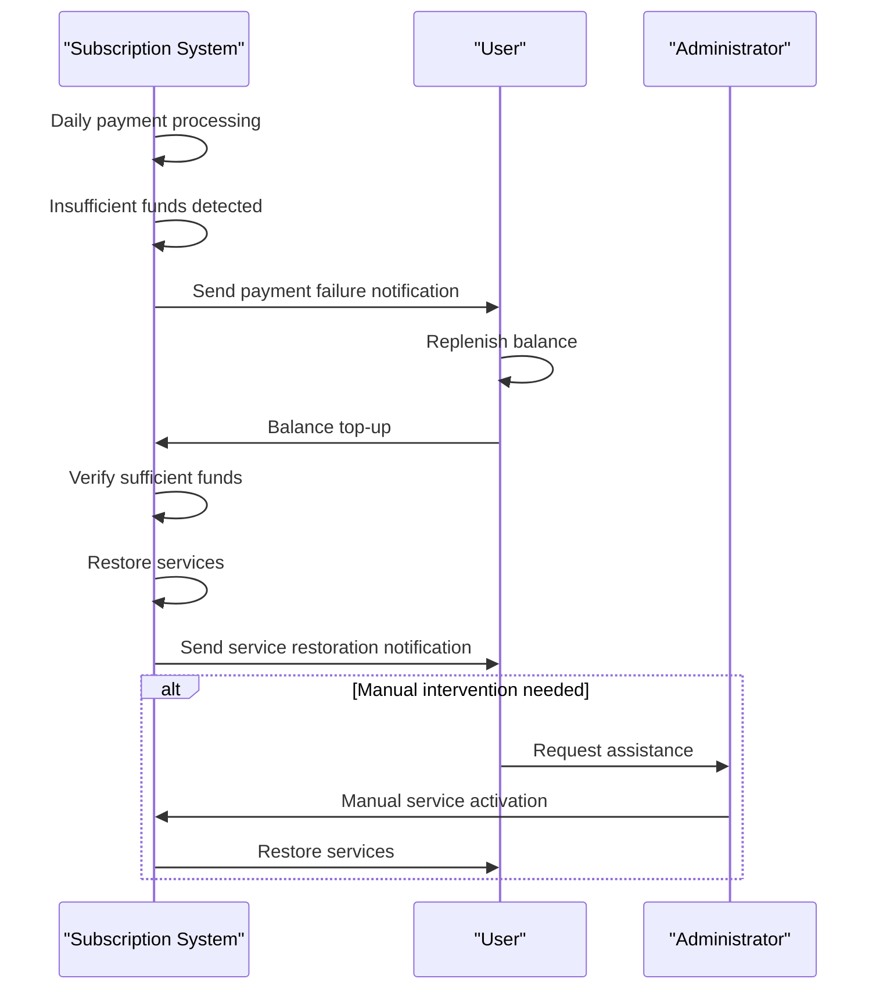
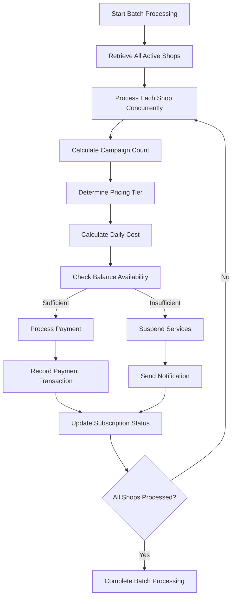

# Subscription Management

<cite>
**Referenced Files in This Document**   
- [tariffs.py](file://app/utils/pricer/tariffs.py)
- [pricer.py](file://app/utils/pricer/pricer.py)
- [wb_manager.py](file://app/modules/wb_adv_updater/wb_manager.py)
- [models.py](file://app/modules/common_slaves/wildberries/models/models.py)
- [settings_master.py](file://app/settings/settings_master.py)
</cite>

## Table of Contents
1. [Introduction](#introduction)
2. [Tiered Pricing Model](#tiered-pricing-model)
3. [Dynamic Pricing Implementation](#dynamic-pricing-implementation)
4. [Subscription Lifecycle and Payment Processing](#subscription-lifecycle-and-payment-processing)
5. [Feature Availability and Subscription Status](#feature-availability-and-subscription-status)
6. [Data Flow and Balance Management](#data-flow-and-balance-management)
7. [Common Issues and Recovery Procedures](#common-issues-and-recovery-procedures)
8. [Performance Considerations](#performance-considerations)

## Introduction
The Subscription Management system in the adv-bot application implements a dynamic pricing model based on the number of advertising campaigns per shop. This document details the implementation of tiered pricing, daily/monthly tariff calculations, payment processing logic, and the relationship between subscription status and feature availability. The system automatically calculates costs based on campaign count, processes payments from user balances, and manages subscription states to ensure service continuity.

## Tiered Pricing Model
The subscription system implements a tiered pricing model where the cost per advertising campaign decreases as the number of campaigns increases. This incentivizes users to manage more campaigns through the platform while maintaining revenue stability.

**Diagram sources**
- [tariffs.py](file://app/utils/pricer/tariffs.py#L1-L8)

**Section sources**
- [tariffs.py](file://app/utils/pricer/tariffs.py#L1-L8)
- [pricer.py](file://app/utils/pricer/pricer.py#L25-L45)

## Dynamic Pricing Implementation
The pricing system dynamically calculates subscription costs based on the number of active advertising campaigns associated with a shop. The implementation uses a tiered structure where higher campaign volumes receive discounted rates per campaign.

The pricing algorithm works as follows:
1. Count the number of active advertising campaigns for a shop
2. Determine the appropriate pricing tier based on campaign count
3. Calculate total monthly cost by multiplying campaign count by tier-specific rate
4. Convert monthly cost to daily cost for automated deductions

**Diagram sources**
- [pricer.py](file://app/utils/pricer/pricer.py#L25-L85)

**Section sources**
- [pricer.py](file://app/utils/pricer/pricer.py#L25-L85)

## Subscription Lifecycle and Payment Processing
The subscription lifecycle begins with user registration and continues through automated payment processing, status checks, and service provisioning. The system processes payments daily by checking campaign counts, calculating costs, and deducting amounts from user balances.

**Diagram sources**
- [wb_manager.py](file://app/modules/wb_adv_updater/wb_manager.py#L45-L120)

**Section sources**
- [wb_manager.py](file://app/modules/wb_adv_updater/wb_manager.py#L45-L120)
- [models.py](file://app/modules/common_slaves/wildberries/models/models.py#L150-L200)

## Feature Availability and Subscription Status
Subscription status directly controls feature availability within the application. When payments are current, all features remain active. Payment failures trigger automatic service restrictions to prevent unauthorized usage.

The relationship between subscription status and feature availability is implemented as follows:

When a payment fails due to insufficient balance, the system automatically deactivates key features by setting:
- `bot_active = False`
- `auto_update_white_list = False` 
- `auto_update_target_place = False`

**Diagram sources**
- [wb_manager.py](file://app/modules/wb_adv_updater/wb_manager.py#L95-L115)
- [models.py](file://app/modules/common_slaves/wildberries/models/models.py#L300-L350)

**Section sources**
- [wb_manager.py](file://app/modules/wb_adv_updater/wb_manager.py#L95-L115)
- [models.py](file://app/modules/common_slaves/wildberries/models/models.py#L300-L350)

## Data Flow and Balance Management
The system implements a comprehensive balance management system that tracks both main balance and bonus funds. Payment processing follows a priority order, first using bonus funds and then main balance when bonuses are depleted.

The balance calculation uses hybrid properties that combine initial balance values with transaction histories:

- `calculated_balance = balance + sum(payment.amount for payment in balance_payments)`
- `calculated_bonus = bonus + sum(payment.amount for payment in bonus_payments)`

**Diagram sources**
- [wb_manager.py](file://app/modules/wb_adv_updater/wb_manager.py#L60-L95)
- [models.py](file://app/modules/common_slaves/wildberries/models/models.py#L100-L130)

**Section sources**
- [wb_manager.py](file://app/modules/wb_adv_updater/wb_manager.py#L60-L95)
- [models.py](file://app/modules/common_slaves/wildberries/models/models.py#L100-L130)

## Common Issues and Recovery Procedures
The system addresses several common subscription management issues with automated procedures:

### Insufficient Balance
When a user's balance is insufficient for daily payments:
1. The system attempts to use bonus funds first
2. If both bonus and main balances are insufficient, services are suspended
3. Users receive notifications about the suspension
4. Services are automatically restored when balance is replenished

### Subscription Downgrades
When users reduce their campaign count:
1. The system recalculates the monthly cost based on the new tier
2. Daily deductions are adjusted accordingly
3. No service interruption occurs during downgrades

### Billing Cycles
The system processes payments daily at midnight:
1. Campaign count is checked for each active shop
2. Daily cost is calculated and deducted
3. Payment records are created in the database
4. Subscription status is updated

Recovery procedures include:
- Automated service restoration when balance is replenished
- Notification system for payment failures
- Manual intervention options for administrators

**Diagram sources**
- [wb_manager.py](file://app/modules/wb_adv_updater/wb_manager.py#L45-L120)
- [models.py](file://app/modules/common_slaves/wildberries/models/models.py#L100-L130)

**Section sources**
- [wb_manager.py](file://app/modules/wb_adv_updater/wb_manager.py#L45-L120)
- [models.py](file://app/modules/common_slaves/wildberries/models/models.py#L100-L130)

## Performance Considerations
The subscription management system is designed to handle batch processing efficiently, particularly for daily payment processing across multiple shops.

Key performance optimizations include:
- Asynchronous database operations to prevent blocking
- Batch processing of payment calculations
- Efficient querying with proper indexing
- Connection pooling for database access

The system processes payments in a single daily batch rather than individual transactions, reducing database load and improving overall performance. The implementation uses async/await patterns to handle multiple shops concurrently without blocking operations.

**Diagram sources**
- [wb_manager.py](file://app/modules/wb_adv_updater/wb_manager.py#L45-L120)
- [settings_master.py](file://app/settings/settings_master.py#L300-L350)

**Section sources**
- [wb_manager.py](file://app/modules/wb_adv_updater/wb_manager.py#L45-L120)
- [settings_master.py](file://app/settings/settings_master.py#L300-L350)