# User Management

<cite>
**Referenced Files in This Document**   
- [start_registration_func.py](file://app/client_bot/user_interface/handlers/start_registration_func.py)
- [manager.py](file://app/payments/manager.py)
- [models.py](file://app/utils/db/models.py)
- [balance_service.py](file://app/modules/balance_manager/balance_service.py)
- [ref_program.py](file://app/client_bot/user_interface/handlers/ref_program.py)
- [templates.py](file://app/client_bot/user_interface/message_templates/templates.py)
- [messages.py](file://app/client_bot/user_interface/views/messages/messages.py)
</cite>

## Table of Contents
1. [Introduction](#introduction)
2. [User Registration and Authentication](#user-registration-and-authentication)
3. [Subscription Management](#subscription-management)
4. [Payment Processing](#payment-processing)
5. [Role-Based Access Control](#role-based-access-control)
6. [Referral Program Implementation](#referral-program-implementation)
7. [Telegram Interaction Flow](#telegram-interaction-flow)
8. [User Data Models](#user-data-models)
9. [Subscription States and Domain Logic](#subscription-states-and-domain-logic)
10. [Premium Feature Access](#premium-feature-access)
11. [Common Issues and Solutions](#common-issues-and-solutions)
12. [Security and Data Management](#security-and-data-management)
13. [Performance Considerations](#performance-considerations)

## Introduction
The User Management system in the adv-bot application provides comprehensive functionality for handling user accounts, authentication, subscription management, payment processing, and role-based access control. This documentation details the implementation of these features, focusing on how Telegram interactions trigger user account operations, the data models used for user information, and the domain logic governing subscription states. The system is designed to be accessible to beginners while providing technical depth for developers working with the codebase.

## User Registration and Authentication

The user registration process begins when a user interacts with the bot through Telegram. The system captures the user's Telegram ID and username, creating a new user record if one doesn't already exist. The registration process also handles referral links, allowing users to be associated with referrers when they join through referral links.

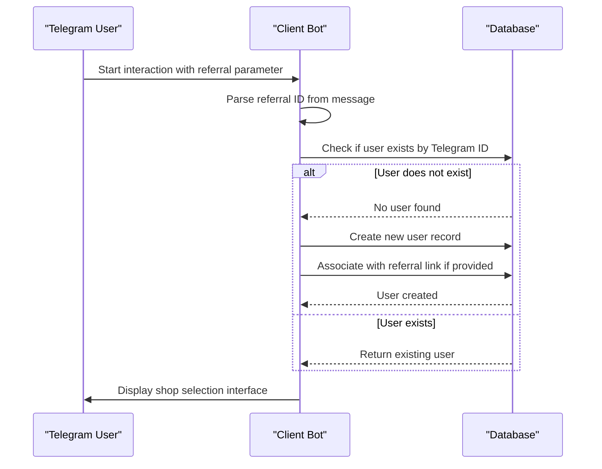

**Diagram sources**
- [start_registration_func.py](file://app/client_bot/user_interface/handlers/start_registration_func.py#L1-L60)

**Section sources**
- [start_registration_func.py](file://app/client_bot/user_interface/handlers/start_registration_func.py#L1-L60)
- [models.py](file://app/utils/db/models.py#L1-L53)

## Subscription Management

Subscription management in the adv-bot application is handled through a combination of payment verification and balance tracking. When a user's subscription expires due to insufficient funds, the system displays an appropriate message and provides options for payment. The subscription status is closely tied to the user's account balance, with services being suspended when the balance is insufficient to continue operations.

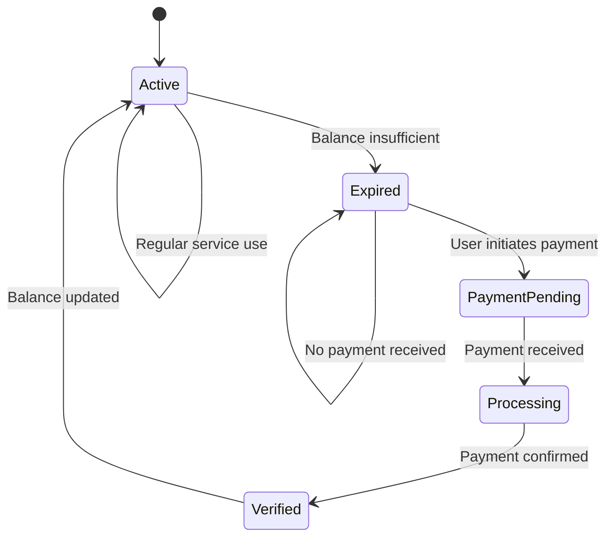

**Diagram sources**
- [messages.py](file://app/client_bot/user_interface/views/messages/messages.py#L1-L1337)
- [balance_service.py](file://app/modules/balance_manager/balance_service.py#L1-L236)

## Payment Processing

The payment processing system in adv-bot integrates with external payment providers and manages internal balance tracking. The system handles various types of payments including direct balance additions and bonus allocations. Payment confirmation is a critical step that ensures transactions are properly recorded in both the payment system and the user's account balance.

### Payment Architecture
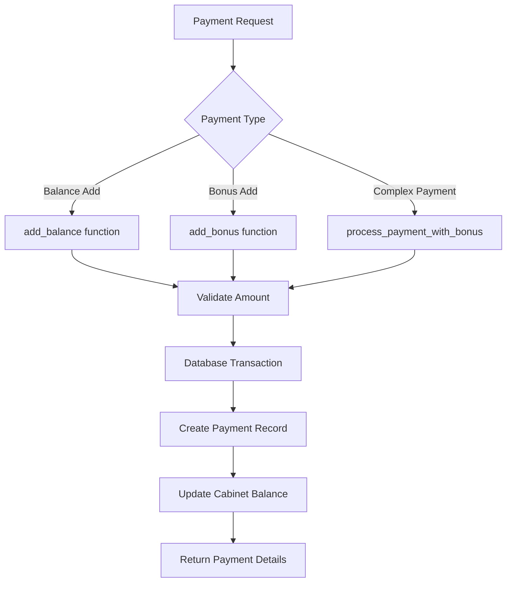

The payment manager initializes the YooKassa payment system with credentials loaded from configuration files. When processing payments, the system creates appropriate records in the database and updates the user's balance accordingly.

**Diagram sources**
- [manager.py](file://app/payments/manager.py#L1-L13)
- [balance_service.py](file://app/modules/balance_manager/balance_service.py#L1-L236)

**Section sources**
- [manager.py](file://app/payments/manager.py#L1-L13)
- [balance_service.py](file://app/modules/balance_manager/balance_service.py#L1-L236)

## Role-Based Access Control

The role-based access control system in adv-bot is implemented through a combination of user states, permissions, and feature availability. Different users have access to different functionality based on their subscription status, account balance, and specific permissions granted through their account type.

The system uses Telegram user IDs as the primary identifier for access control, associating each user with their permissions and subscription status. Access to premium features is controlled by checking the user's current subscription status and account balance before allowing access to specific functionality.

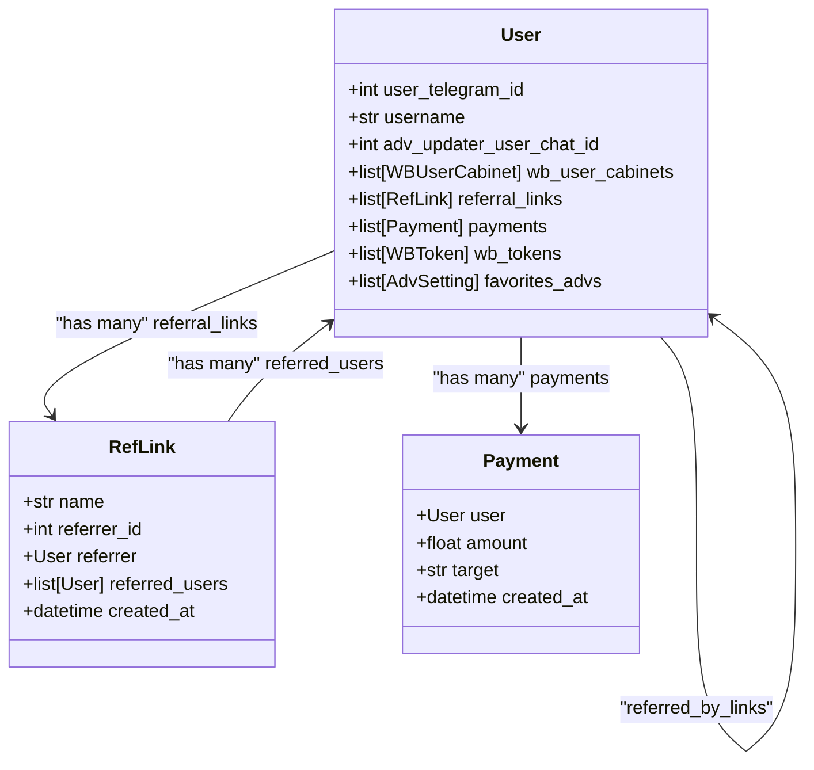

**Diagram sources**
- [models.py](file://app/utils/db/models.py#L1-L53)
- [messages.py](file://app/client_bot/user_interface/views/messages/messages.py#L1-L1337)

## Referral Program Implementation

The referral program allows users to create referral links that they can share with others. When someone registers through a referral link, they are associated with the referrer, and the referrer can track the number of referrals and associated payments.

The referral system includes functionality for creating new referral links, viewing existing links, and tracking referral statistics. Users can create multiple referral links with different names for tracking different marketing channels.

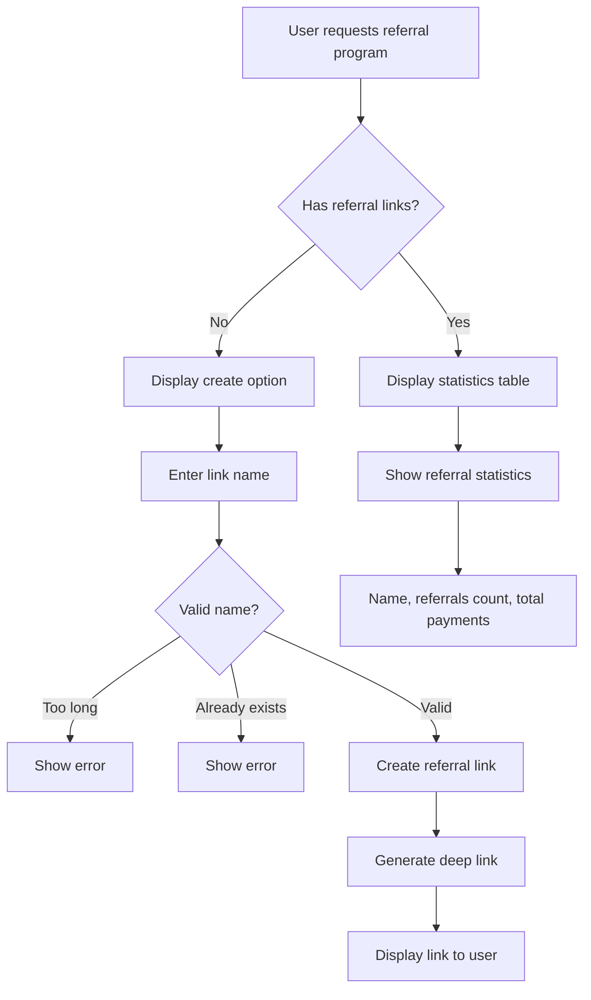

**Diagram sources**
- [ref_program.py](file://app/client_bot/user_interface/handlers/ref_program.py#L1-L71)
- [messages.py](file://app/client_bot/user_interface/views/messages/messages.py#L1-L1337)

**Section sources**
- [ref_program.py](file://app/client_bot/user_interface/handlers/ref_program.py#L1-L71)
- [messages.py](file://app/client_bot/user_interface/views/messages/messages.py#L1-L1337)

## Telegram Interaction Flow

The interaction between Telegram users and the adv-bot application follows a structured flow that begins with user registration and continues through various service interactions. The bot uses Telegram's callback query system to handle user interactions and maintain state during multi-step processes.

When a user sends a command to the bot, the appropriate handler is invoked based on the command or callback data. The system maintains user state using FSM (Finite State Machine) context, allowing for multi-step interactions such as registration, payment processing, and configuration changes.

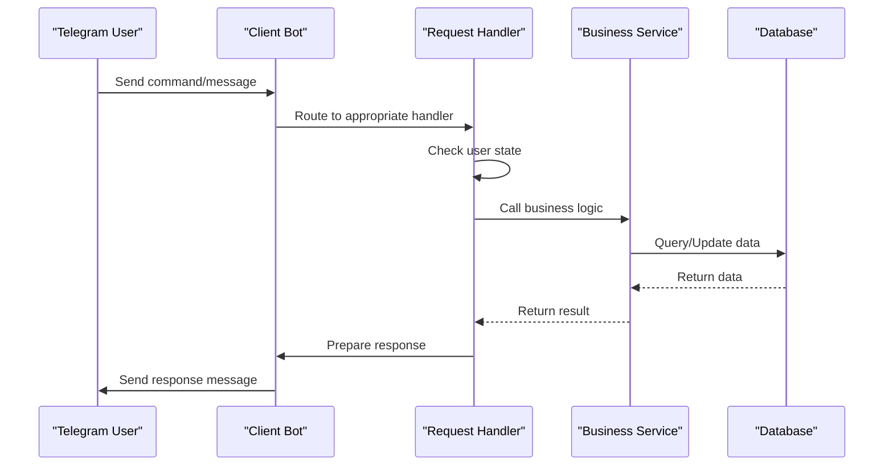

**Diagram sources**
- [start_registration_func.py](file://app/client_bot/user_interface/handlers/start_registration_func.py#L1-L60)
- [ref_program.py](file://app/client_bot/user_interface/handlers/ref_program.py#L1-L71)

## User Data Models

The user data model in adv-bot is designed to store essential user information while maintaining relationships with other entities such as referral links, payments, and Wildberries cabinets. The primary User model contains the Telegram user ID, username, and relationships to various associated objects.

The data model supports a flexible relationship system that allows users to have multiple Wildberries cabinets, referral links, and payment records. This design enables the system to support complex business requirements while maintaining data integrity through proper foreign key relationships and cascading operations.

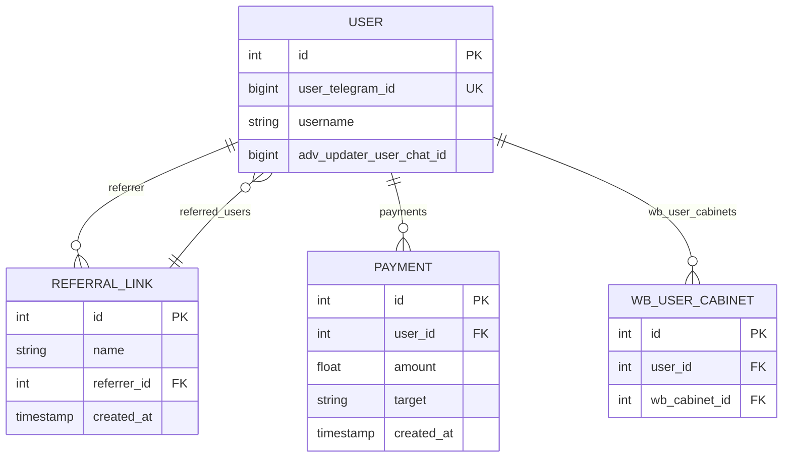

**Diagram sources**
- [models.py](file://app/utils/db/models.py#L1-L53)

## Subscription States and Domain Logic

The subscription system in adv-bot operates on a balance-based model where services continue as long as the user has sufficient funds in their account. When the balance falls below a threshold required for service continuation, the subscription is considered expired, and appropriate actions are taken.

The domain logic for subscription management includes:
- Balance checking before service execution
- Notification of low balance or expired subscription
- Payment processing to restore service
- Grace period handling for pending payments
- Service suspension and reactivation

The system uses a state-based approach to manage subscription status, with clear transitions between states based on user actions and account conditions.

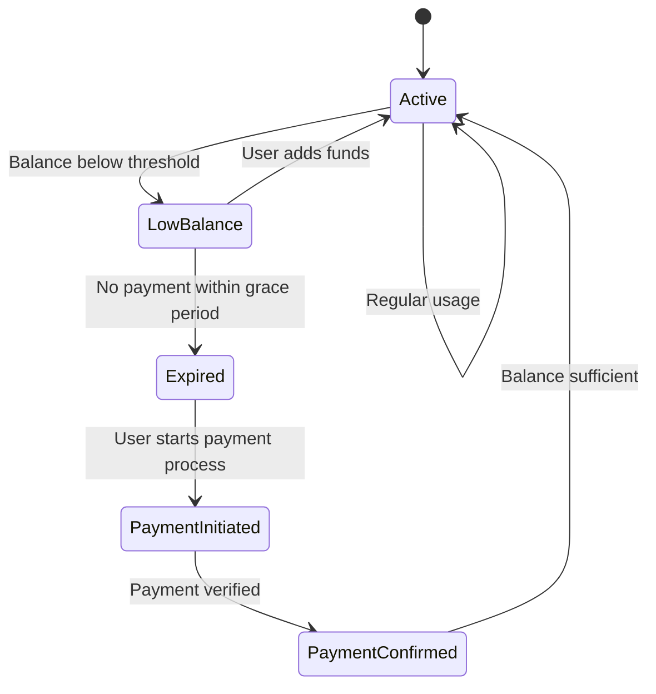

**Diagram sources**
- [messages.py](file://app/client_bot/user_interface/views/messages/messages.py#L1-L1337)
- [balance_service.py](file://app/modules/balance_manager/balance_service.py#L1-L236)

## Premium Feature Access

Premium features in the adv-bot application are gated behind subscription checks and balance verification. When a user attempts to access a premium feature, the system verifies their subscription status and account balance before allowing access.

The access control mechanism uses a combination of middleware and explicit checks within handler functions to ensure that only authorized users can access premium functionality. This approach provides both a user-friendly experience and robust security.

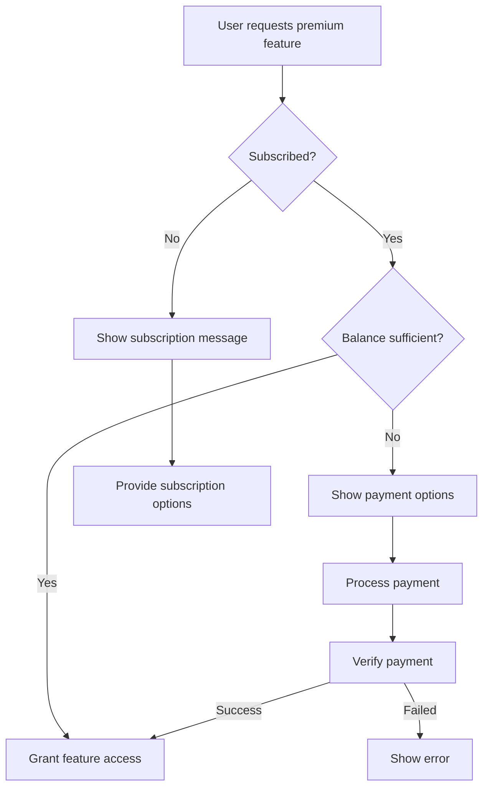

**Diagram sources**
- [messages.py](file://app/client_bot/user_interface/views/messages/messages.py#L1-L1337)
- [balance_service.py](file://app/modules/balance_manager/balance_service.py#L1-L236)

## Common Issues and Solutions

### Payment Failures
Payment failures can occur due to various reasons including invalid payment information, insufficient funds, or system errors. The system handles payment failures by:

1. Logging the error for debugging
2. Notifying the user of the failure
3. Providing options to retry or use alternative payment methods
4. Maintaining the user's previous state to allow seamless retry

### Account Synchronization Problems
Account synchronization issues may arise when there are discrepancies between the local database and external services like Wildberries. The system addresses these issues through:

1. Regular synchronization processes
2. Error logging and monitoring
3. Manual synchronization options for users
4. Clear error messages that guide users on resolution steps

### Solutions Implemented
The application includes several mechanisms to prevent and resolve common issues:

- **Retry mechanisms** for transient failures
- **Comprehensive logging** for debugging
- **User-friendly error messages** that guide resolution
- **Automated recovery** where possible
- **Manual intervention options** for complex issues

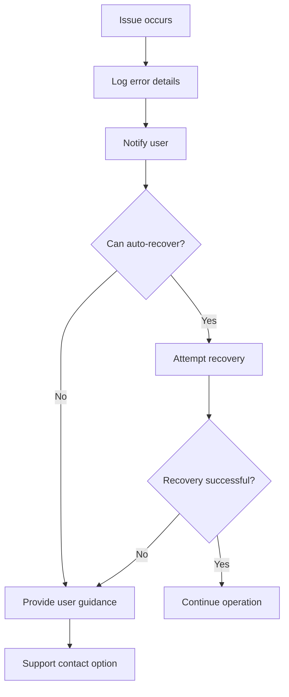

**Section sources**
- [messages.py](file://app/client_bot/user_interface/views/messages/messages.py#L1-L1337)
- [balance_service.py](file://app/modules/balance_manager/balance_service.py#L1-L236)

## Security and Data Management

The adv-bot application implements several security measures to protect user data and ensure secure operations:

1. **Data Encryption**: Sensitive data is encrypted at rest and in transit
2. **Authentication**: Telegram user IDs are used as primary authentication factors
3. **Authorization**: Role-based access control limits functionality based on user status
4. **Input Validation**: All user inputs are validated to prevent injection attacks
5. **Secure Storage**: API keys and credentials are stored securely in configuration files

The system follows the principle of least privilege, granting users only the permissions necessary for their intended operations. Database operations use parameterized queries to prevent SQL injection, and all external service interactions are validated for proper response handling.

User data is managed through a combination of database storage and Redis caching, with appropriate TTL (Time To Live) settings for cached data to ensure freshness while maintaining performance.

**Section sources**
- [models.py](file://app/utils/db/models.py#L1-L53)
- [manager.py](file://app/payments/manager.py#L1-L13)
- [redis_manager.py](file://app/core/redis_manager/base_redis_manager.py)

## Performance Considerations

The user management system in adv-bot is designed to handle high-concurrency user operations efficiently. Several performance optimization strategies have been implemented:

### Database Optimization
- Indexing on frequently queried fields like user_telegram_id
- Use of selectinload and joinedload for efficient relationship loading
- Read-only sessions for data retrieval operations
- Batch operations where appropriate

### Caching Strategy
- Redis caching for frequently accessed data
- TTL-based cache invalidation
- Cache warming for critical data
- Selective caching of expensive computations

### Concurrency Handling
The system uses asynchronous operations throughout to handle multiple user requests concurrently. Database sessions are properly managed to prevent connection leaks, and long-running operations are handled through background workers where appropriate.

### Optimization Tips
1. Use connection pooling for database operations
2. Implement proper indexing on query-heavy fields
3. Cache frequently accessed but infrequently changing data
4. Use asynchronous operations for I/O-bound tasks
5. Implement pagination for large result sets
6. Monitor and optimize slow database queries
7. Use bulk operations for batch updates
8. Implement proper error handling to prevent cascading failures

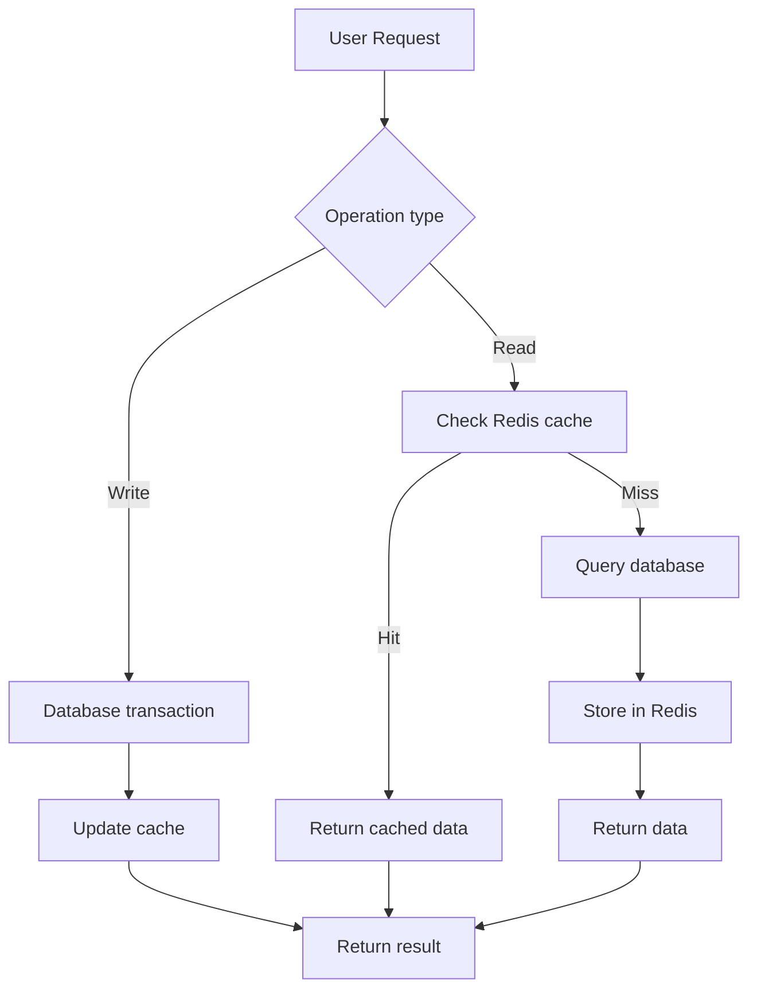

**Diagram sources**
- [balance_service.py](file://app/modules/balance_manager/balance_service.py#L1-L236)
- [messages.py](file://app/client_bot/user_interface/views/messages/messages.py#L1-L1337)
- [redis_manager.py](file://app/core/redis_manager/base_redis_manager.py)