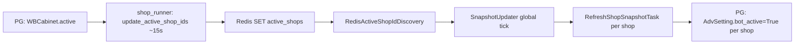

# Snapshot Data Updater — запуск и rollout

Пакет `app/snapshot_data_updater`: фоновый сбор read-only снимков по магазинам и запись в Redis (`adv_snapshot:v1:...`). Consumers (`update_cluster_bids`, `get_wb_advs_dto`) подключаются **отдельными** флагами.

## Режимы

| Режим | Env | Описание |
|-------|-----|----------|
| Stub | `SNAPSHOT_UPDATER_USE_LIVE=0` (default) | Фиктивные провайдеры, store no-op, без PG/Redis/CH |
| Live | `SNAPSHOT_UPDATER_USE_LIVE=1` | PG + Redis + CH, warmup keywords, запись snapshot |

`use_live_updater=False` — безопасно для CI и локального `updater.py` без БД.

## Переменные окружения

Скопируйте блок из `env.sample`:

| Переменная | Default | Назначение |
|------------|---------|------------|
| `SNAPSHOT_UPDATER_USE_LIVE` | `0` | Stub vs live stack |
| `SNAPSHOT_REFRESH_INTERVAL_SEC` | `300` | Интервал global tick (сек) |
| `SNAPSHOT_TICK_POLICY` | `skip` | `skip` — пропуск tick при занятом lock; `wait` — ждать |
| `SNAPSHOT_RESOURCE_TASK_TIMEOUT_SEC` | `30` | Таймаут задач CH / Redis / warmup в ResourceQueue (сек) |
| `SNAPSHOT_PG_TASK_TIMEOUT_SEC` | *(как RESOURCE)* | Таймаут фазы `pg:shop_load`; для крупных магазинов — `90`–`180` |
| `SNAPSHOT_KEYWORDS_FRESHNESS_SEC` | `900` | Макс. возраст metadata прогрева keywords |
| `SNAPSHOT_KEYWORDS_STRICT_FRESHNESS` | `0` | Строгий stale без metadata |
| `SNAPSHOT_CACHE_MAX_AGE_SEC` | `0` | Жёсткий fail при чтении кеша старше N сек (`CacheStaleError`) |
| `SNAPSHOT_REDIS_TTL_SEC` | `3600` | TTL ключей snapshot |
| `SNAPSHOT_SCHEMA_VERSION` | `1` | Версия DTO для consumers |
| `SNAPSHOT_CLUSTER_BIDS_SHADOW` | `0` | Shadow: логи сравнения keywords в update_cluster_bids |
| `SNAPSHOT_CLUSTER_BIDS_READ` | `0` | Read: `cache_only` после warmup (с fallback) |
| `SNAPSHOT_WB_ADV_DTO_SHADOW` | `0` | Shadow в WBAdvDTO path |
| `SNAPSHOT_WB_ADV_DTO_READ` | `0` | Зарезервировано для read cutover WBAdvDTO |

**`get_wb_advs_dto`:** keywords **только** из Redis (`calculated_keywords:{adv_id}`). При miss — `KeywordsCacheMissError` (нужен live snapshot updater и warmup). Fallback на `get_good_bad_phrases` нет.

**Важно:** после изменения `.env` entrypoint должен вызвать `dotenv.load_dotenv()` **до** импорта snapshot или `reload_snapshot_config()` (см. корневой `updater.py`, `cli.py`).

**Live warmup keywords** требует DI (как `new_wb_shop_update_run.py`): при `SNAPSHOT_UPDATER_USE_LIVE=1` процесс вызывает `ensure_di_bootstrapped()` — иначе `get_good_bad_phrases` падает на `Provide` / `WBManagerHub`.

## Entrypoints

```powershell
poetry run python -m app.snapshot_data_updater.cli smoke
poetry run python -m app.snapshot_data_updater.cli live-once --shop-id YOUR_SHOP_ID
poetry run python -m app.snapshot_data_updater.cli daemon
poetry run python updater.py
```

- **smoke** — stub ~50 ms, проверка scheduling без БД.
- **live-once** — один `RefreshShopSnapshotTask` для shop_id, запись в Redis (даже если `USE_LIVE=0`, CLI принудительно live stack).
- **daemon** — бесконечный global tick по `SNAPSHOT_REFRESH_INTERVAL_SEC`.

## Откуда берутся shop_id (live daemon)



| Этап | Источник | Критерий |
|------|----------|----------|
| Список магазинов на tick | Redis `active_shops` | Как у shop_runner: `WBCabinet.active` (+ `SHOP_FILTER_LIST` / `SHOP_EXCLUDE_LIST`) |
| РК внутри магазина | Postgres | `bot_active=True`, `active_status != done` |

Ручной прогон одного магазина: `cli live-once --shop-id …` (discovery не используется).

Код: `app/snapshot_data_updater/shop_discovery.py`, наполнение set — `update_active_shop_ids_in_redis.py`.

## Redis keys (live)

После успешного `live-once` / daemon:

- `adv_snapshot:v1:shop:<shop_id>:latest` — batch JSON
- `adv_snapshot:v1:shop:<shop_id>:adv:<adv_id>` — per-adv snapshot
- `adv_snapshot:v1:keywords_meta:adv:<adv_id>` — metadata прогрева (после warmup)

## Rollout (рекомендуемый порядок)

1. **Stub smoke** — `SNAPSHOT_UPDATER_USE_LIVE=0`, `cli smoke` или unit-тесты.
2. **Live once** — один shop: `cli live-once --shop-id …`, проверить ключи в Redis.
3. **Daemon shadow updater** — `USE_LIVE=1`, consumer flags = 0.
4. **Consumer shadow** — `SNAPSHOT_CLUSTER_BIDS_SHADOW=1`, `SNAPSHOT_WB_ADV_DTO_SHADOW=1`, read = 0.
5. **Consumer read** — `SNAPSHOT_CLUSTER_BIDS_READ=1` (fallback при stale/partial/schema).

## Rollback

1. `SNAPSHOT_UPDATER_USE_LIVE=0`
2. Все `SNAPSHOT_*_SHADOW` / `*_READ` = 0
3. Restart `updater.py` или deployment
4. Legacy keys `calculated_keywords:{adv_id}` не удаляются — consumers снова идут в legacy path

## Диагностика

- Логи фаз collector: PG, Redis min_bids, warmup, CH, assemble — длительность и ошибки по секциям.
- `partial=True` в snapshot + `SnapshotDiagnostics.errors_by_section` при сбое секции.
- Global tick skip: warning «previous tick still running» при `tick_policy=skip`.
- Duplicate shop task: debug «skip duplicate shop_id».

## Тесты

```powershell
poetry run pytest -m unit tests\unit\app\snapshot_data_updater\ -v
poetry run ruff app\snapshot_data_updater tests\unit\app\snapshot_data_updater
```

Integration smoke с реальным PG/Redis/CH — только при поднятом `docker-compose` и тестовом shop_id (опционально).
