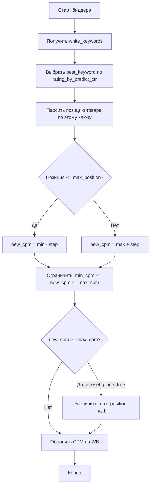

# Экспонента прогнозируемого CTR (Exponent Predict CTR)

## 📋 Содержание
1. [Что такое экспонента](#что-такое-экспонента)
2. [Зачем нужна экспонента](#зачем-нужна-экспонента)
3. [Как работает экспонента](#как-работает-экспонента)
4. [Влияние на систему](#влияние-на-систему)
5. [Настройка экспоненты](#настройка-экспоненты)
6. [Примеры расчетов](#примеры-расчетов)
7. [Рекомендации по использованию](#рекомендации-по-использованию)
8. [Правила включения/выключения ключевых слов](#правила-включениявыключения-ключевых-слов)
9. [Управление ставками (Bidder)](#управление-ставками-bidder)
10. [Заключение](#заключение)

---

## Что такое экспонента

**Экспонента прогнозируемого CTR** (`exponent_predict_ctr`) — это коэффициент, который используется для расчета **рейтинга ключевых слов** в системе автоматической оптимизации рекламных кампаний Wildberries.

### Основные характеристики:
- **Тип данных**: `Float` (число с плавающей точкой)
- **Диапазон значений**: Обычно от 0.5 до 2.0
- **Значение по умолчанию**: 20 (задается в `DEFAULT_CTR_EXPONENTA`)
- **Хранится в**: Таблица `AdvSetting`, поле `exponent_predict_ctr`
- **Уникальность**: Каждая рекламная кампания имеет свою собственную экспоненту

### Расположение в коде:
- **Модель данных**: `app/modules/common_slaves/wildberries/models/models.py` (класс `AdvSetting`)
- **Использование**: `app/modules/common_slaves/wildberries/data_classes/keywordstat_from_db.py` (класс `CalculatedKeyword`)
- **Настройки**: `app/settings/settings_master.py` (свойство `DEFAULT_CTR_EXPONENTA`)
- **UI интерфейс**: `app/modules/predict_ctr_exponent_settings/telegram/handlers.py`

---

## Зачем нужна экспонента

Экспонента решает важную задачу: **баланс между качеством (CTR) и объемом (показы) ключевых слов**.

### Проблема без экспоненты:
Представьте два ключевых слова:
1. **"Детские игрушки"** — CTR = 5%, показы = 10,000
2. **"Машинка красная трансформер"** — CTR = 8%, показы = 100

Без экспоненты система может выбрать второе слово как "лучшее", потому что у него выше CTR. Но на практике первое слово принесет больше кликов и продаж из-за огромного объема показов.

### Решение с экспонентой:
Экспонента позволяет **регулировать важность CTR** относительно количества показов:

- **Экспонента > 1**: Система отдает приоритет **высокому CTR** (качеству)
- **Экспонента = 1**: Сбалансированный подход
- **Экспонента < 1**: Система отдает приоритет **объему показов** (охвату)

---

## Как работает экспонента

### Формула расчета рейтинга

Рейтинг ключевого слова рассчитывается по формуле:

```
rating = predict_ctr ^ exponent_predict_ctr × views
```

Где:
- `predict_ctr` — прогнозируемый CTR (от 0 до 1, например 0.05 = 5%)
- `exponent_predict_ctr` — экспонента (настраиваемый параметр)
- `views` — количество показов ключевого слова

### Реализация в коде

```python
# app/modules/common_slaves/wildberries/data_classes/keywordstat_from_db.py
@property
def rating_by_predict_ctr(self) -> float:
    if self.predict_ctr is None or self.predict_ctr_exponent is None:
        return 0.0
    rating = self.predict_ctr**self.predict_ctr_exponent * self.views
    return rating
```

### Процесс установки экспоненты в ключевые слова

1. **Загрузка настроек кампании**: Из `AdvSetting` читается значение `exponent_predict_ctr`
2. **Присвоение каждому ключевому слову**:
   ```python
   # app/modules/wb_adv_updater/data_manager.py
   keyword_stat.predict_ctr_exponent = adv_setting.exponent_predict_ctr
   ```
3. **Расчет рейтинга**: Автоматически вычисляется через property `rating_by_predict_ctr`
4. **Сортировка**: Ключевые слова сортируются по рейтингу для принятия решений

---

## Влияние на систему

Экспонента влияет на **множество ключевых процессов** в системе автоматической оптимизации рекламы.

### 1. 🎯 Сортировка ключевых слов

**Где используется**: Отображение ключевых слов пользователю в Telegram-боте

```python
# app/client_bot/user_interface/views/keyboards.py
keywords_with_rating = [kw for kw in keywords if kw.rating_by_predict_ctr > 0]
keywords_with_rating.sort(key=lambda x: x.rating_by_predict_ctr, reverse=True)
```

**Эффект**: Пользователь видит сначала наиболее перспективные ключевые слова (с высоким рейтингом).

---

### 2. 🤖 Автоматическое добавление в белый список

**Где используется**: Модуль автоматического добавления фраз в whitelist

```python
# app/modules/shop_runner/service_manager/old_modules/setting_auto_updater/modules/
# white_list_updater/auto_white_list_updater/auto_white_list_updater.py

keywords_for_adding.sort(key=lambda kw: kw.rating_by_predict_ctr, reverse=True)
keyword_for_adding = keywords_for_adding[0]  # Выбирается фраза с максимальным рейтингом
```

**Логика работы**:
1. Система фильтрует ключевые слова-кандидаты (статус "хорошие", но не в белом списке)
2. Сортирует их по `rating_by_predict_ctr` (от большего к меньшему)
3. Выбирает ТОП-1 и добавляет в белый список (hard_status = 2)

**Эффект**: 
- При **высокой экспоненте** (> 1) в белый список попадают фразы с **высоким CTR**, даже если у них мало показов
- При **низкой экспоненте** (< 1) приоритет получают **высокочастотные фразы** с большим объемом показов

---

### 3. 🔝 Выбор топового ключевого слова

**Где используется**: Модуль автоматического обновления первой фразы

```python
# app/modules/shop_runner/service_manager/old_modules/setting_auto_updater/modules/
# first_key_updater/first_key_updater.py

clear_keywords = sorted(
    clear_keywords, key=lambda kw: kw.rating_by_predict_ctr, reverse=True
)
top_key = clear_keywords[0]  # Ключевое слово с максимальным рейтингом
```

**Эффект**: Определяет, какое ключевое слово система считает самым важным и должно быть активировано первым.

---

### 4. 📊 Определение лучшего ключевого слова

**Где используется**: Функция выбора best_keyword для анализа эффективности

```python
# app/modules/wb_adv_updater/data_manager.py
def get_best_keyword(keywords: list[CalculatedKeyword]) -> CalculatedKeyword | None:
    best_keyword_with_boost = [kw for kw in keywords if kw.position != 0]
    best_keyword = sorted(
        best_keyword_with_boost, key=lambda x: x.rating_by_predict_ctr, reverse=True
    )[0]
    return best_keyword
```

**Эффект**: Выбирает ключевое слово с наивысшим рейтингом среди тех, что имеют позицию в выдаче.

---

### 5. 📈 Экспорт данных в CSV

**Где используется**: Генерация CSV-отчетов для пользователей

```python
# app/client_bot/utils.py
str(round(keyword.rating_by_predict_ctr * 100, 4)).replace(".", ",")
```

**Эффект**: Рейтинг ключевых слов включается в экспортируемые отчеты для анализа.

---

### 6. 🔄 Автоматическая оптимизация кампаний

**Где используется**: Модуль автообновления настроек рекламы по плану/факту

```python
# app/modules/shop_runner/service_manager/old_modules/setting_auto_updater/update_adv_setting.py
await white_list_update_manager.add_phrase_to_white_list(keywords)
```

**Логика**:
- Если факт заказов < план заказов → добавить фразы с высоким рейтингом
- Если цена заказа > максимальная → удалить фразы с низким рейтингом

**Эффект**: Экспонента косвенно влияет на автоматическую экспансию/сжатие рекламных кампаний.

---

### 7. 🔍 Поисковая оптимизация в Search Advs

**Где используется**: Управление поисковыми РК

```python
# app/modules/wb_adv_updater/search_advs_manager.py
keywords = sorted(keywords, key=lambda kw: kw.rating_by_predict_ctr, reverse=True)
```

**Эффект**: В поисковых кампаниях приоритизация ключевых слов также зависит от рейтинга.

---

## Настройка экспоненты

### Способ 1: Через Telegram-бота (UI)

1. Открыть настройки рекламной кампании
2. Нажать кнопку **"Изменить экспоненту прог. ctr"**
3. Ввести новое значение (например, `1.5` или `0.8`)
4. Система сохранит изменение и пересчитает рейтинги всех ключевых слов

**Код обработчика**:
```python
# app/modules/predict_ctr_exponent_settings/telegram/handlers.py
@router.message(StateFilter("waiting_for_new_exponent"))
async def set_new_exponent_for_predict_ctr(message: Message, state: FSMContext, bot: Bot):
    exponent_predict_ctr = float(text)
    adv_setting.exponent_predict_ctr = exponent_predict_ctr
    await session.commit()
    await message.answer(f"Экспонента прогнозируемого CTR изменена на {exponent_predict_ctr}")
```

### Способ 2: Через базу данных (SQL)

```sql
UPDATE adv_setting 
SET exponent_predict_ctr = 1.2 
WHERE adv_id = 12345678;
```

### Способ 3: Значение по умолчанию (при создании кампании)

```python
# app/settings/settings_master.py
@property
def DEFAULT_CTR_EXPONENTA(self) -> int:
    value = os.getenv("MAX_HOURS_PERIOD_FOR_PARSING_KEYWORDS")
    if not value:
        return 20  # ⚠️ Внимание: сейчас значение по умолчанию = 20!
    return int(value)
```

⚠️ **Важно**: В коде есть потенциальная проблема — переменная окружения называется `MAX_HOURS_PERIOD_FOR_PARSING_KEYWORDS`, но используется для экспоненты. Это, скорее всего, ошибка копипаста.

---

## Примеры расчетов

### Пример 1: Сравнение двух ключевых слов

**Данные**:
| Ключевое слово | Predict CTR | Views | Экспонента | Рейтинг |
|----------------|-------------|-------|------------|---------|
| "Детские игрушки" | 0.05 (5%) | 10,000 | 1.0 | ? |
| "Машинка красная" | 0.08 (8%) | 100 | 1.0 | ? |

**Расчет с экспонентой = 1.0**:
```
Рейтинг_1 = 0.05^1.0 × 10,000 = 0.05 × 10,000 = 500
Рейтинг_2 = 0.08^1.0 × 100 = 0.08 × 100 = 8
```

**Результат**: "Детские игрушки" (500 > 8) — победитель! ✅

---

**Расчет с экспонентой = 2.0** (приоритет качеству):
```
Рейтинг_1 = 0.05^2.0 × 10,000 = 0.0025 × 10,000 = 25
Рейтинг_2 = 0.08^2.0 × 100 = 0.0064 × 100 = 0.64
```

**Результат**: "Детские игрушки" (25 > 0.64) — все еще победитель, но разрыв уменьшился. ✅

---

**Расчет с экспонентой = 0.5** (приоритет объему):
```
Рейтинг_1 = 0.05^0.5 × 10,000 = 0.2236 × 10,000 = 2,236
Рейтинг_2 = 0.08^0.5 × 100 = 0.2828 × 100 = 28.28
```

**Результат**: "Детские игрушки" (2,236 > 28.28) — победитель с огромным отрывом! ✅

---

### Пример 2: Влияние на выбор фразы для белого списка

**Сценарий**: Система должна выбрать одну фразу для добавления в белый список.

**Кандидаты**:
| Фраза | CTR | Показы | Экспонента = 1.0 | Экспонента = 1.5 | Экспонента = 0.7 |
|-------|-----|--------|------------------|------------------|------------------|
| "Футболка хлопок" | 0.03 | 5,000 | 150 | 82 | 323 |
| "Футболка премиум качество" | 0.07 | 500 | 35 | 46 | 82 |
| "Футболка" | 0.02 | 15,000 | 300 | 169 | 643 |

**Вывод**:
- **Экспонента 1.0**: Выбрана **"Футболка"** (самый высокий рейтинг)
- **Экспонента 1.5**: Выбрана **"Футболка"** (но **"Футболка премиум"** становится ближе)
- **Экспонента 0.7**: Выбрана **"Футболка"** (разрыв увеличился)

В данном примере низкочастотная фраза "Футболка премиум качество" становится конкурентоспособной только при **высокой экспоненте** (акцент на качестве).

---

## Рекомендации по использованию

### 🎯 Когда увеличивать экспоненту (> 1.0)

**Ситуации**:
1. **Премиум-товары** с высокой маржинальностью — важнее качество трафика, чем объем
2. **Нишевые товары** — целевая аудитория узкая, нужны точные запросы
3. **Ограниченный бюджет** — нужно максимизировать конверсию на каждый клик
4. **Высокая конкуренция** — ставка на эффективность, а не на охват

**Рекомендуемые значения**: 1.2 - 1.8

**Эффект**:
- ✅ Выше конверсия (больше покупок на клик)
- ✅ Ниже стоимость привлечения клиента (CPA)
- ❌ Меньше общий охват аудитории
- ❌ Меньше общее количество кликов

---

### 📊 Когда снижать экспоненту (< 1.0)

**Ситуации**:
1. **Массовые товары** — важен максимальный охват
2. **Новые товары** — нужно быстро набрать узнаваемость
3. **Сезонные распродажи** — цель: максимум продаж за короткий срок
4. **Низкая конкуренция** — можно "захватить" высокочастотные запросы

**Рекомендуемые значения**: 0.5 - 0.9

**Эффект**:
- ✅ Выше охват аудитории
- ✅ Больше кликов и показов
- ❌ Ниже средний CTR
- ❌ Может вырасти стоимость конверсии (CPA)

---

### ⚖️ Когда использовать экспоненту = 1.0

**Ситуации**:
1. **Универсальные товары** средней ценовой категории
2. **Тестирование** — начальная настройка кампании
3. **Стабильные кампании** — уже найден баланс между охватом и качеством

**Эффект**: Сбалансированный подход, формула упрощается до `rating = CTR × views`.

---

### 🔍 Как найти оптимальное значение

**Метод A/B тестирования**:
1. Запустить кампанию с экспонентой = 1.0
2. Наблюдать за метриками 3-7 дней:
   - Количество заказов
   - CPA (стоимость привлечения клиента)
   - ROI (окупаемость рекламы)
3. Изменить экспоненту на ±0.2
4. Сравнить метрики
5. Повторять до достижения оптимума

**Признаки правильной настройки**:
- ✅ Стабильный рост заказов
- ✅ CPA в пределах целевого значения
- ✅ ROI > 100%
- ✅ Нет резкого падения показов

---

### ⚠️ Частые ошибки

1. **Слишком высокая экспонента (> 2.0)**
   - Система может игнорировать высокочастотные запросы
   - Резкое падение охвата
   - Низкий объем продаж

2. **Слишком низкая экспонента (< 0.3)**
   - Система будет выбирать фразы с низким CTR только из-за объема
   - Падение конверсии
   - Рост стоимости клика

3. **Неправильное значение по умолчанию (20!)**
   - ⚠️ В коде сейчас `DEFAULT_CTR_EXPONENTA = 20` — это критически высокое значение!
   - Формула: `0.05^20 = 9.5 × 10^-27` — практически обнуляет влияние CTR
   - **Рекомендация**: Изменить дефолт на 1.0

4. **Отсутствие мониторинга**
   - Экспоненту нужно периодически корректировать в зависимости от результатов
   - Рекомендуется проверять раз в неделю

---

## Диаграмма влияния экспоненты

```
                    ┌─────────────────────────────────┐
                    │   Экспонента прогнозируемого CTR │
                    │    (exponent_predict_ctr)       │
                    └──────────────┬──────────────────┘
                                   │
                     ┌─────────────┴─────────────┐
                     ▼                           ▼
        ┌─────────────────────────┐   ┌─────────────────────────┐
        │  Расчет рейтинга        │   │  Сохраняется в          │
        │  rating = CTR^exp × views│   │  AdvSetting.exponent_   │
        │                         │   │  predict_ctr            │
        └──────────┬──────────────┘   └─────────────────────────┘
                   │
        ┌──────────┴──────────────────────────────────┐
        │                                             │
        ▼                                             ▼
┌────────────────────┐                    ┌────────────────────────┐
│  Сортировка        │                    │  Выбор лучшего         │
│  ключевых слов     │                    │  ключевого слова       │
│  для UI            │                    │  (best_keyword)        │
└────────────────────┘                    └────────────────────────┘
        │                                             │
        ▼                                             ▼
┌────────────────────┐                    ┌────────────────────────┐
│  Автодобавление    │                    │  Автоматическая        │
│  в белый список    │                    │  оптимизация кампаний  │
│  (WhiteListUpdater)│                    │  (план/факт)           │
└────────────────────┘                    └────────────────────────┘
        │                                             │
        └──────────────┬──────────────────────────────┘
                       ▼
            ┌─────────────────────┐
            │  ИТОГОВАЯ ЭФФЕКТ:   │
            │  - Приоритизация    │
            │  - Автооптимизация  │
            │  - Баланс качества/ │
            │    объема трафика   │
            └─────────────────────┘
```

---

## Правила включения/выключения ключевых слов

### 📊 Статусы ключевых слов (hard_status)

В системе существует 5 основных статусов управления ключевыми словами:

| hard_status | Название | Описание | Поведение системы |
|-------------|----------|----------|-------------------|
| **-1** | Тестирование | Продолжить проверку эффективности | Бот повышает ставку для улучшения позиции и пересчета CTR |
| **0** | Черный список | Нерелевантные фразы | Автоматически отключается ❌ |
| **1** | Авто режим | Управление ботом | Бот сам решает включать/выключать на основе CTR ✅/❌ |
| **2** | Белый список | Топовые фразы | Всегда включено, управляется биддером ✅ |
| **3** | Выключено | Отключено вручную | Не показывается в поиске ❌ |

### 🔄 Алгоритм определения статуса GOOD/BAD

Система автоматически определяет, должно ли ключевое слово быть включено (GOOD ✅) или выключено (BAD ❌) по следующим правилам:

```python
# Псевдокод алгоритма
if hard_status == 2:  # Белый список
    status = GOOD ✅
    reason = "white_list"

elif hard_status == 0:  # Черный список
    status = BAD ❌
    reason = "black_list"

elif hard_status == 3:  # Выключено
    status = BAD ❌
    reason = "turn_off"

elif cpc > max_cpc:  # Слишком дорогой клик
    status = BAD ❌
    reason = "max_cpc"

elif views < min_views_for_ml_predict:  # Недостаточно данных
    status = GOOD ✅
    reason = "views_is_not_enough"

elif baes_predict_ctr >= min_ctr:  # CTR выше минимального
    status = GOOD ✅
    reason = "baes_ctr_more_than_min_ctr"

else:  # CTR ниже минимального
    status = BAD ❌
    reason = "min_ctr"
```

### 📍 Ключевые параметры для принятия решений

1. **`min_ctr`** — минимальный CTR для включения фразы
   - Рассчитывается автоматически или задается вручную
   - Зависит от типа товара и конкуренции

2. **`max_cpc`** — максимальная стоимость клика
   - Защита от слишком дорогих ключевых слов
   - Если CPC превышает лимит → фраза выключается

3. **`min_views_for_ml_predict`** — минимум показов для оценки
   - Пока показов мало → фраза остается включенной (сбор статистики)
   - После набора показов → принимается решение на основе CTR

4. **`baes_predict_ctr`** — прогнозируемый CTR с учетом истории
   - Комбинация реального CTR и ML-прогноза
   - Основной показатель для принятия решений

---

## Управление ставками (Bidder)

### 🎯 Как работает биддер

**Биддер** — это автоматическая система управления ставками CPM (Cost Per Mille - стоимость за 1000 показов) для достижения целевой позиции в поиске Wildberries.

### Алгоритм работы биддера



### 📝 Пошаговое описание

**Шаг 1: Выбор ключевого слова для управления**

```python
# app/modules/shop_runner/bidder/bidder_func.py
white_keywords = [kw for kw in keywords if kw.hard_status == 2]
best_keyword = data_manager.get_best_keyword(white_keywords)
```

⭐ **Здесь используется экспонента!** 

`best_keyword` выбирается по максимальному `rating_by_predict_ctr`:

```python
# app/modules/wb_adv_updater/data_manager.py
def get_best_keyword(keywords: list[CalculatedKeyword]) -> CalculatedKeyword | None:
    best_keyword_with_boost = [kw for kw in keywords if kw.position != 0]
    best_keyword = sorted(
        best_keyword_with_boost, 
        key=lambda x: x.rating_by_predict_ctr,  # ← Экспонента влияет здесь!
        reverse=True
    )[0]
    return best_keyword
```

**Влияние экспоненты на выбор best_keyword:**
- **Высокая экспонента** (> 1.0) → Биддер будет управлять ставкой для ключа с **высоким CTR**
- **Низкая экспонента** (< 1.0) → Биддер будет управлять ставкой для ключа с **большим объемом показов**

---

**Шаг 2: Определение текущей позиции**

```python
# Парсится реальная позиция товара в поиске WB
wb_position = await redis_manager.get_keyword_position(text, nmid)
promo_position = wb_position.position
```

---

**Шаг 3: Расчет новой ставки**

```python
if promo_position <= max_position or promo_position == 1:
    # Позиция хорошая → снижаем ставку для экономии
    new_cpm = min(cpms) - step
else:
    # Позиция плохая → повышаем ставку
    new_cpm = max(cpms) + step

# Ограничиваем ставку
new_cpm = max(min(new_cpm, max_cpm), min_cpm)
```

**Параметры:**
- `max_position` — целевая позиция (например, 10 = топ-10)
- `step` — шаг изменения ставки (обычно 5-20 рублей)
- `max_cpm` — максимальная ставка (защита бюджета)
- `min_cpm` — минимальная ставка (чтобы не уйти в ноль)

---

**Шаг 4: Обработка превышения лимита**

```python
if new_cpm >= max_cpm and adv_setting.reset_place:
    # Ставка достигла максимума, но позиция все еще плохая
    # Увеличиваем целевую позицию на 1 (снижаем требования)
    adv_setting.max_place = promo_position + 1
```

**Логика:** Если даже при максимальной ставке не получается достичь целевой позиции, система автоматически корректирует цель на более реалистичную.

---

**Шаг 5: Обновление ставки на WB**

```python
await wb_api.update_cpm(adv_id, nmid, new_cpm)
```

---

### 🎚️ Автоматический расчет максимальной ставки

Система может автоматически рассчитывать `max_cpm` на основе целевой стоимости заказа:

```python
# app/modules/wb_adv_updater/data_manager.py
async def get_max_adv_bid(adv_setting: AdvSetting) -> int | float:
    if adv_setting.auto_max_bid:
        best_keyword = get_best_keyword(keywords)  # ← Экспонента влияет здесь!
        
        convert_views_to_order = views / orders
        ctr = best_keyword.predict_ctr
        
        max_bid_for_1000_views = (max_pay_for_order / convert_views_to_order) * ctr * 1000
        
        return max_bid_for_1000_views
```

**Формула расчета:**

```
max_cpm = (max_pay_for_order / (views/orders)) × predict_ctr × 1000
```

**Где:**
- `max_pay_for_order` — максимальная стоимость привлечения одного заказа
- `views/orders` — сколько показов нужно для одного заказа
- `predict_ctr` — прогнозируемый CTR **лучшего ключевого слова**

⭐ **Влияние экспоненты:**  
Экспонента определяет, какое ключевое слово считается "лучшим" для расчета максимальной ставки!

---

### 📊 Влияние экспоненты на управление ставками

| Экспонента | Выбор best_keyword | Влияние на биддер | Результат |
|------------|-------------------|-------------------|-----------|
| **Высокая (> 1.0)** | Слово с высоким CTR | Биддер управляет качественным трафиком | Высокая конверсия, меньше показов |
| **Средняя (= 1.0)** | Баланс CTR и показов | Сбалансированное управление | Умеренная конверсия и охват |
| **Низкая (< 1.0)** | Слово с большими показами | Биддер управляет массовым трафиком | Высокий охват, средняя конверсия |

### 🔍 Пример влияния

**Сценарий:** В белом списке 3 ключевых слова

| Ключевое слово | CTR | Показы | exp=1.0 | exp=1.5 | exp=0.7 |
|----------------|-----|--------|---------|---------|---------|
| "Телефон Samsung" | 3% | 5000 | 150 | 82 | 323 |
| "Смартфон премиум" | 7% | 800 | 56 | 73 | 131 |
| "Телефон недорого" | 2% | 12000 | 240 | 101 | 548 |

**С экспонентой 1.5:**
- best_keyword = "Смартфон премиум" (рейтинг 73)
- Биддер будет управлять ставкой для **качественного** запроса
- Трафик дорогой, но конверсия высокая

**С экспонентой 0.7:**
- best_keyword = "Телефон недорого" (рейтинг 548)
- Биддер будет управлять ставкой для **массового** запроса
- Трафик дешевый, большой охват

---

### ⚙️ Настройки биддера

Основные параметры в `AdvSetting`:

| Параметр | Описание | Значение по умолчанию |
|----------|----------|----------------------|
| `bidder_active` | Включен ли биддер | `False` |
| `bidder_step` | Шаг изменения ставки (руб) | `10` |
| `max_cpm` | Максимальная ставка (руб за 1000 показов) | `500` |
| `max_place` | Целевая позиция в поиске | `10` |
| `reset_place` | Увеличивать позицию при достижении max_cpm | `True` |
| `bidder_for_auto` | Применять к авто-кампании | `True` |
| `auto_max_bid` | Автоматический расчет max_cpm | `False` |

---

### 💡 Рекомендации по настройке биддера

1. **Для премиум-товаров:**
   - Экспонента: 1.3-1.8
   - `max_place`: 5-8 (топовые позиции)
   - `max_cpm`: Высокий (800-1500)
   - Биддер будет управлять качественными запросами с высоким CTR

2. **Для массовых товаров:**
   - Экспонента: 0.6-0.9
   - `max_place`: 10-20 (средние позиции)
   - `max_cpm`: Средний (300-600)
   - Биддер будет управлять высокочастотными запросами

3. **Для новых товаров:**
   - Экспонента: 0.8-1.0
   - `max_place`: 15-25 (собираем данные)
   - `max_cpm`: Умеренный (400-800)
   - Сначала собираем статистику, затем оптимизируем

---

### ⚠️ Типичные ошибки

1. **Слишком низкий `bidder_step`** (< 5)
   - Биддер работает слишком медленно
   - Позиция меняется очень долго

2. **Слишком высокий `bidder_step`** (> 50)
   - Резкие колебания позиции
   - Перерасход бюджета

3. **Неправильная экспонента для товара**
   - Биддер управляет не тем ключевым словом
   - Неэффективное использование бюджета

4. **Не настроен `max_cpm`**
   - Риск перерасхода бюджета
   - Ставка может уйти в бесконечность

---

## Заключение

**Экспонента прогнозируемого CTR** — это мощный инструмент для тонкой настройки стратегии управления ключевыми словами в рекламных кампаниях.

### Ключевые выводы:
1. **Формула**: `rating = predict_ctr ^ exponent × views`
2. **Влияние**: Определяет баланс между качеством (CTR) и объемом (показы)
3. **Применение**: Сортировка, автодобавление фраз, выбор топовых ключевых слов, **управление ставками**
4. **Статусы**: Определяет правила включения/выключения ключевых слов
5. **Биддер**: Влияет на выбор best_keyword для управления ставкой CPM
6. **Настройка**: Через Telegram-бот или напрямую в базе данных
7. **Оптимизация**: Требует тестирования и мониторинга результатов

### Цепочка влияния экспоненты:

```
Экспонента
    ↓
Расчет рейтинга (rating_by_predict_ctr)
    ↓
Выбор best_keyword из белого списка
    ↓
Управление ставкой CPM для этого ключевого слова
    ↓
Достижение целевой позиции в поиске
    ↓
Оптимизация ROI кампании
```

### TODO:
- [ ] Исправить баг с `DEFAULT_CTR_EXPONENTA = 20` → должно быть `1.0`
- [ ] Переименовать переменную окружения на корректное имя
- [ ] Добавить валидацию диапазона (0.1 - 3.0) в UI
- [ ] Создать аналитику влияния экспоненты на метрики кампаний
- [ ] Добавить рекомендации системы по оптимальной экспоненте для каждой кампании
- [ ] Добавить логирование выбора best_keyword для аналитики
- [ ] Создать дашборд для мониторинга работы биддера

---

**Дата создания**: 2025-10-29  
**Автор**: AI Assistant  
**Версия**: 2.0

